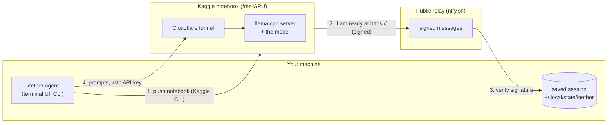

# 1. Overview: what ktether is and the ideas behind it

This page is the "what and why". If you have never worked with AI coding tools, GPUs or tunnels, read it first. It
introduces every idea the rest of the documentation relies on, in plain language.

## 1.1 The problem

An **AI coding agent** is a program that lets a language model do real work on your code. You describe a task, such
as "find why this test fails and fix it". The agent repeatedly asks the model what to do next, then carries out the
model's instructions: it reads files, edits them, runs commands, and shows you the result.

The model is the expensive part. The best coding models are very large neural networks. To answer quickly they need
to live in the memory of a **GPU** (a graphics card, used here as a very fast number cruncher). Two things make this
painful:

1. **Hosted models cost money.** Using a commercial model through an API, or a subscription agent, typically costs
   $20 to $50 or more per month.
2. **Open models are free but hungry.** Excellent open-source models exist, but a good one needs 16 to 32 GB of GPU
   memory. A typical laptop has none, or a few gigabytes.

## 1.2 The opportunity

Kaggle, a data-science website owned by Google, gives every account with a verified phone number roughly **30 hours
of free GPU time per week**. One of the machines it offers has **two Tesla T4 GPUs with 15 GB of memory each (30 GB
in total)**. That is enough for a 27-billion-parameter model squeezed into about 17 GB. The quota resets weekly and
mostly goes unused.

## 1.3 What ktether does

ktether is the glue that turns Kaggle's free GPU into a private model server and plugs it into a coding agent:

You run **one command**. ktether pushes a program to Kaggle, waits for a GPU, downloads the model, starts the
server, opens a tunnel, and tells your machine where it is. From then on the agent talks to that model as if it were
any other model provider. When you are finished, one more command stops the GPU.

## 1.4 Vocabulary you will meet

Skim this now; every term is explained again where it matters, and the full list is in
[19-glossary.md](19-glossary.md).

| Term | Plain-language meaning |
| --- | --- |
| **LLM** (large language model) | A neural network that predicts text. The thing that "thinks" for the agent. |
| **Open model / open weights** | A model whose files anyone may download and run, such as Qwen. |
| **Parameters** (27B, 14B, ...) | The number of learned numbers in the model, in billions. More usually means smarter and bigger. |
| **Quantization** (Q4_K_M) | Storing those numbers with fewer bits (here about 4) so the model is roughly four times smaller, at a small quality cost. |
| **GGUF** | A single-file model format used by `llama.cpp`. |
| **llama.cpp / llama-server** | A fast program that loads a GGUF model and serves it over HTTP using the same API shape as OpenAI's. |
| **GPU / VRAM** | The graphics card, and its memory. The model must fit in VRAM to run quickly. |
| **Token** | A chunk of text (roughly three quarters of a word). Models read and write tokens. |
| **Context window** | How many tokens the model can look at in one request. |
| **Prefill vs generation** | Prefill is the model reading your whole prompt; generation is it writing the answer, one token at a time. |
| **Tool calling** | The model asking the agent to run a function ("read this file") in a structured way. An agent needs this. |
| **Agent** | The loop around the model: send prompt, receive a tool call, run it, send the result back, repeat. |
| **Kaggle notebook / kernel** | A program Kaggle runs on its machines. ktether uses a private one as a server. |
| **Tunnel** | A way to reach a program behind someone else's network from the public internet. ktether uses Cloudflare's free "quick tunnel". |
| **Relay** | A public message board (ntfy.sh) used only to announce the tunnel address. |
| **HMAC signature** | A short code proving a message was written by someone who knows a shared secret. |

## 1.5 Design goals

These shaped most decisions; [18-design-decisions.md](18-design-decisions.md) records the evidence behind them.

- **Cheap and private.** Free GPU time, and your source code stays on your machine.
- **No servers to run.** No port forwarding, no cloud account, no domain name. Two free public services (the relay
  and the tunnel) and your Kaggle account are all it takes.
- **Safe by default.** The relay is untrusted. Secrets never travel through it, and everything it carries is signed.
- **Careful with quota.** Idle shutdown, a session-length cap, and a usage estimate protect the weekly allowance.
- **Honest about failure.** Failures are reported with the cause (a queue timeout, a full disk, a dead tunnel),
  never as a silent hang. This was learned the hard way; see the design-decisions page.
- **Testable without a GPU.** The whole pipeline can be tested against a fake Kaggle CLI, a fake relay and a fake
  clock. See [16-testing.md](16-testing.md).
- **One product, several front doors.** The CLI, the terminal UI and the HTTP API all drive the same engine.

## 1.6 What ktether is built on

ktether is a **fork of [OpenCode](https://github.com/sst/opencode)**, an MIT-licensed terminal coding agent. The
agent engine, terminal UI, tools, sessions, permissions, plugins and MCP support come from there. This project:

- removed what is unrelated to running models on a GPU you control (the upstream company's hosted services,
  billing, marketing sites, and integrations with other companies' hosted models),
- added the Kaggle pipeline, the `kaggle` provider, the `ktether gpu` commands, the API routes and the terminal-UI
  dialog,
- renamed everything to `ktether` (package scope `@ktether/*`, environment variables `KTETHER_*`, `.ktether/`
  folders, and so on).

The original license and copyright notice are kept in `LICENSE`.

## 1.7 Where to go next

| If you want to... | Read |
| --- | --- |
| Install it and run it | [02-getting-started.md](02-getting-started.md) |
| Understand the whole system | [03-architecture.md](03-architecture.md) |
| See exactly what happens when you start a GPU | [04-kaggle-pipeline.md](04-kaggle-pipeline.md) |
| Judge how safe it is | [05-security.md](05-security.md) |
| Choose or add a model | [06-models.md](06-models.md) |
| Look up a command or an API route | [07-cli-reference.md](07-cli-reference.md), [08-api-reference.md](08-api-reference.md) |
| Understand the repository | [10-repo-map.md](10-repo-map.md) and the pages after it |
| Fix a problem | [17-troubleshooting.md](17-troubleshooting.md) |
