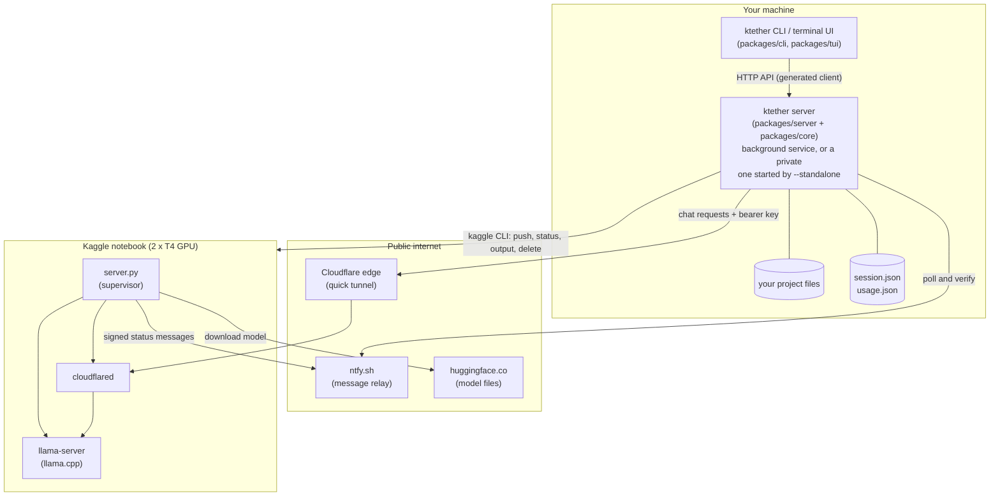
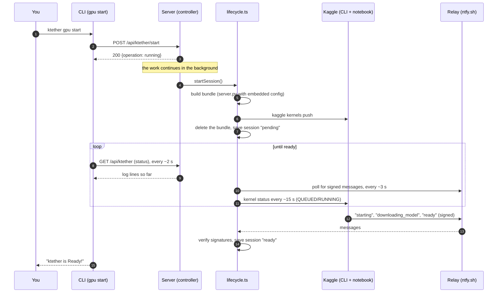
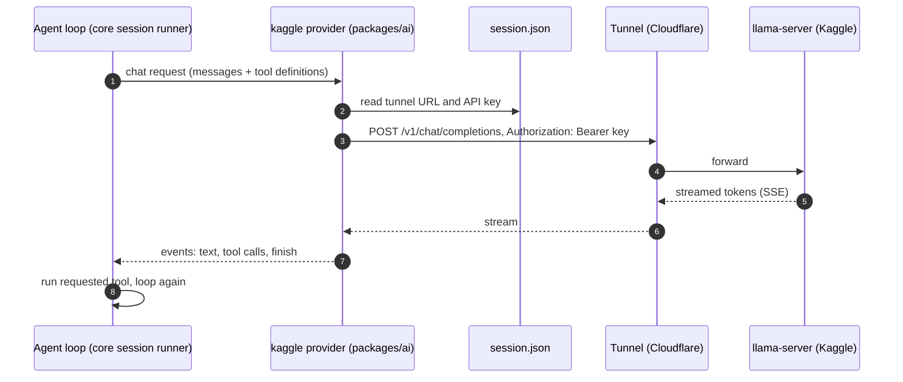
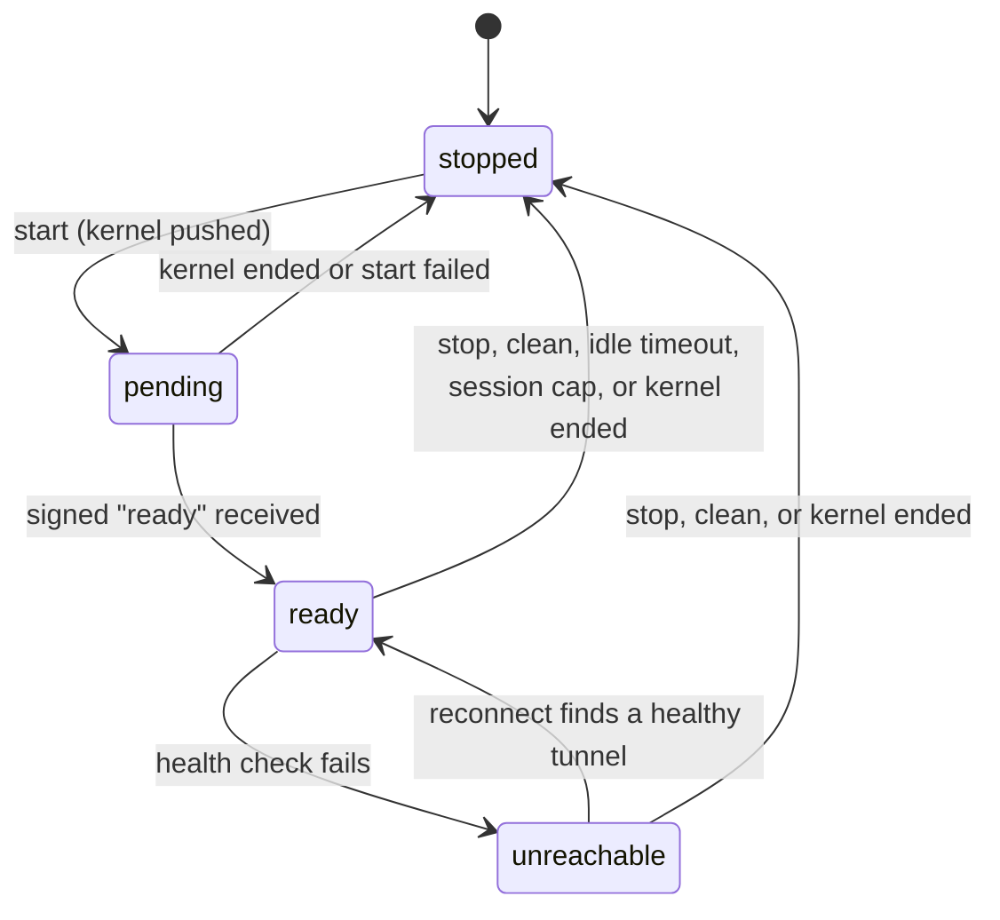

# 3. Architecture

This page shows how the pieces fit together at runtime. For the packages that implement them, see
[10-repo-map.md](10-repo-map.md); for the Kaggle side in depth, see [04-kaggle-pipeline.md](04-kaggle-pipeline.md).

## 3.1 The processes involved

When ktether is working there are up to five separate programs:



| Program | Where it runs | What it does |
| --- | --- | --- |
| **CLI / terminal UI** | Your machine | The front door. Collects what you type and shows results. Holds no business logic of its own for the GPU. |
| **ktether server** | Your machine | The engine: runs agent sessions, owns the Kaggle lifecycle, exposes everything through an HTTP API. |
| **server.py** | Kaggle | Installs and supervises the other two programs and reports progress. Generated by ktether, not hand-deployed. |
| **llama-server** | Kaggle | Loads the model onto the GPUs and answers chat requests. |
| **cloudflared** | Kaggle | Creates the public HTTPS address that forwards to `llama-server`. |

### Why the CLI talks to a server

You might expect `ktether gpu start` to call the Kaggle code directly. It does not, on purpose. The repository has a
strict layering rule (`AGENTS.md`): the CLI package does not depend on the engine package. It talks to the server
over HTTP, using a client that is *generated* from the API definition. That keeps every front door (CLI, terminal UI,
future web and desktop apps) behind one shared, tested interface, and means a long-running GPU operation can be
started by one program and watched by another.

By default the CLI connects to a **background service** (started automatically). `--standalone` starts a private
server just for that command, which is what the automated tests and live checks used.

## 3.2 Starting a GPU, end to end



The important design choice is steps 2-3: the server answers immediately and does the slow work in the background,
because starting a GPU takes minutes. Clients poll the status for the log. Details of every step are in
[04-kaggle-pipeline.md](04-kaggle-pipeline.md).

## 3.3 Using the GPU: one model request

Once the session is `ready`, the agent uses the model like any other provider:



Two details matter:

- **The URL and key come from `session.json`, not from a config file.** The provider package
  `packages/ai/src/providers/ktether.ts` builds the model each time the agent resolves it
  (`module.model(...)` in `packages/core/src/model-resolver.ts`), choosing the address in this order: an explicit
  setting, then the environment variables `KTETHER_URL` and `KTETHER_API_KEY`, then `session.json`, then
  `http://127.0.0.1:8080/v1` (a local `llama-server`). Because the file is never copied into configuration, it cannot
  go stale. I read this from the code; I did not separately test a long-running server across a reconnect, so if a
  reply seems to use an old address, start a new run.
- **The provider and its models are registered by a plugin**, `packages/core/src/plugin/provider/ktether.ts`, from
  the model list in `packages/core/src/ktether/registry.ts`. Its provider id is **`kaggle`**, so models are named
  `kaggle/<model>`. (The id is deliberately not `ktether`; see
  [18-design-decisions.md](18-design-decisions.md).)

## 3.4 The session state machine

`ktether gpu status` reports one of four states:



| State | Meaning |
| --- | --- |
| `stopped` | No session. The saved file keeps only the identifiers needed to stop or clean later. |
| `pending` | A notebook was pushed and is queued, booting, or downloading. `start` resumes it. |
| `ready` | The tunnel answers its health check. The agent can use the model. |
| `unreachable` | A session exists but the tunnel does not answer. Try `ktether gpu reconnect`. |

A kernel can end on its own (idle timeout, Kaggle's cap, a crash). `status` detects that, closes the stale session,
and counts the time it ran.

## 3.5 Where state lives

| What | Where | Notes |
| --- | --- | --- |
| Current session (tunnel URL, API key, signing key, channel id, model, timings) | `~/.local/state/ktether/session.json` | Written atomically, readable only by you (mode 0600 on systems that support it). Contains secrets. |
| GPU usage ledger | `~/.local/state/ktether/usage.json` | Start/end of recent sessions; powers the weekly estimate. |
| Agent data (sessions, messages) | the data directory (a SQLite database) | See [15-configuration.md](15-configuration.md). |
| Configuration | `.ktether/` in a project, and the user config directory | See [15-configuration.md](15-configuration.md). |
| Kaggle credentials | `~/.kaggle/kaggle.json` or `KAGGLE_*` variables | Owned by the Kaggle CLI, not by ktether. |
| In-flight operation log | memory of the server | The last 200 lines; lost if the server restarts. |

## 3.6 Layers inside the engine

The Kaggle code sits in one folder, `packages/core/src/ktether/`, with a small, one-directional structure:

```text
registry.ts   the curated model list (data only)
signaling.ts  HMAC signing and verification, id generation (pure functions)
state.ts      session.json and usage.json (read, write, decode with schemas)
kaggle.ts     the only place that runs the Kaggle CLI (replaceable in tests)
bundle.ts     builds the staging folder: renders kernel/server.py with the config embedded
session.ts    polls the relay and Kaggle until ready, with timeouts
lifecycle.ts  start, stop, clean, reconnect, status, doctor (orchestration)
controller.ts runs lifecycle operations in the background with a bounded log
kernel/server.py   the program that runs on Kaggle
```

Everything above `controller.ts` is plain async code that takes its dependencies (`fetch`, `sleep`, `now`, the Kaggle
CLI runner) as parameters, which is why it can be tested with fakes in milliseconds
([16-testing.md](16-testing.md)).

The API layer is a thin wrapper: `packages/protocol/src/groups/ktether.ts` declares the routes,
`packages/server/src/handlers/ktether.ts` calls the controller, and `packages/client` is generated from the
declaration ([08-api-reference.md](08-api-reference.md)).
