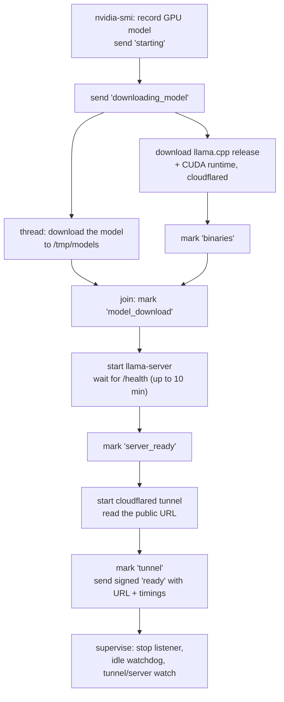

# 4. The Kaggle pipeline, step by step

This is the deepest page about ktether's own feature. It follows one `ktether gpu start` from the first keystroke to a
working model, then covers stopping, recovery and the limits. Every behaviour below was read from
`packages/core/src/ktether/` and verified by tests or by real runs on Kaggle.

Read [03-architecture.md](03-architecture.md) first for the big picture.

## 4.1 The cast

| Piece | File | Role |
| --- | --- | --- |
| Registry | `registry.ts` | The curated model list and each model's server settings |
| Bundle | `bundle.ts` | Builds the folder that is uploaded to Kaggle |
| Kaggle CLI wrapper | `kaggle.ts` | The only code that runs the `kaggle` program |
| Session poller | `session.ts` | Waits for the notebook, watching the relay and Kaggle |
| Signing | `signaling.ts` | Creates ids and keys; signs and verifies messages |
| State | `state.ts` | `session.json` and `usage.json` |
| Lifecycle | `lifecycle.ts` | `start`, `stop`, `clean`, `reconnect`, `status`, `doctor` |
| Controller | `controller.ts` | Runs those in the background and keeps a progress log |
| Kernel program | `kernel/server.py` | Runs on Kaggle; downloads, serves, reports, supervises |

## 4.2 Step 1: choosing what to run

`startSession` first checks that the model name exists in the registry. A model entry
(`ModelSpec`) says which Hugging Face file to download and how to run it:

| Field | Meaning |
| --- | --- |
| `repo`, `file` | Where the GGUF file lives on Hugging Face |
| `context` | Context window **per slot**, in tokens |
| `parallel` | Number of server slots (simultaneous requests) |
| `reasoningBudget` | Max "thinking" tokens per request, for thinking models |
| `serverArgs` | Extra `llama-server` flags (currently `-fa on`, flash attention) |
| `toolCalling` | `reliable` or `unreliable`; shown in `gpu models` and used to warn you |

It then decides whether there is already something to reuse:

1. If a saved session is `ready` and its tunnel answers `/health`, nothing is started ("already active").
2. If it is `ready` but unhealthy, ktether tries `reconnect` first (the kernel may have replaced the tunnel).
3. If a previous launch is `pending`, for the **same model**, and Kaggle says the notebook is `QUEUED` or `RUNNING`,
   it **resumes** that launch and does not push again.
4. If an old notebook is still `RUNNING` but cannot be resumed, ktether sends it a signed stop and waits up to 90
   seconds for it to end, because pushing over a live notebook would race with it.

## 4.3 Step 2: building and pushing the notebook

`prepareStagingBundle` (in `bundle.ts`) makes a fresh temporary folder named `ktether-staging-XXXX` and writes two
files into it:

- **`server.py`**: the contents of `kernel/server.py` with one line prepended,
  `EMBEDDED_CONFIG_JSON = "..."`. The line holds the launch's configuration as a JSON string. The config is
  embedded because `kaggle kernels push` uploads **only the single code file**. (An early version shipped the config
  as a second file and the notebook crashed with a `KeyError`; see the design-decisions page.)
- **`kernel-metadata.json`**: tells Kaggle how to run it:

```json
{
  "id": "<you>/ktether-runner",
  "title": "ktether-runner",
  "code_file": "server.py",
  "language": "python",
  "kernel_type": "script",
  "is_private": "true",
  "enable_gpu": "true",
  "enable_tpu": "false",
  "enable_internet": "true",
  "accelerator": "NvidiaTeslaT4"
}
```

The configuration inside `server.py` contains:

| Key | Meaning |
| --- | --- |
| `channel_id` | Random relay topic name: `kt_` plus 32 hex characters (128 bits) |
| `api_key` | Random bearer key: `kgp_` plus 32 hex characters; protects the tunnel |
| `signing_key` | Random 256-bit key used to sign relay messages |
| `ntfy_url` | The relay (default `https://ntfy.sh`, override with `KTETHER_NTFY_URL`) |
| `model_repo`, `model_file`, `model_name` | What to download and its friendly name |
| `context_size` | `context × parallel`, because `llama-server` splits `-c` evenly across slots |
| `parallel`, `reasoning_budget`, `server_args` | Server settings from the registry |
| `idle_timeout_minutes` | Stop after this much inactivity (default 45) |
| `max_runtime_minutes` | Stop before Kaggle's 12-hour cap (700 = 11 h 40 min) |

The push is `kaggle kernels push -p <folder> --accelerator NvidiaTeslaT4`. The staging folder holds your keys in
plain text, so it is **deleted immediately after the push, even if the push fails**.

Right after the push, ktether saves the session as `pending` (channel id, API key, signing key, model). That save is
what makes `start` resumable: if the CLI is interrupted or times out, the next `start` finds the pending session.

> Kaggle keeps every pushed version of a notebook. The script of each version contains that session's keys. They are
> random per session and useless once the session ends, but if you want the history gone, run `ktether gpu clean`.

## 4.4 Step 3: what the notebook does

`server.py` runs on Kaggle's machine (Ubuntu, two T4 GPUs, internet on). It does the following, reporting each
milestone to the relay and recording how many seconds after its own start each stage finished:



Details worth knowing:

- **The model downloads while the programs install.** The model is the biggest download (about 17 GB), so it runs in
  a separate thread alongside the smaller ones. It uses `huggingface-cli download`, falling back to `curl`.
- **Pinned versions.** `llama.cpp` release `b11647` (the CUDA 12.8 build for Ubuntu) and `cloudflared` `2026.9.3`.
  Pinning keeps behaviour reproducible; `b11647` was verified to support the Qwen3.6 architecture.
- **How the server is started.** The command is:

```text
llama-server -m <model> --host 127.0.0.1 --port 8080 --api-key <key>
  -ngl 99 -c <context*slots> -np <slots> --split-mode layer --jinja
  --reasoning-budget <n> -fa on
```

| Flag | Why |
| --- | --- |
| `--host 127.0.0.1` | Only the local tunnel program can reach it; nothing is exposed directly |
| `--api-key` | Every request must carry the bearer key |
| `-ngl 99` | Put all layers on the GPUs |
| `--split-mode layer` | Spread layers across both T4s (15 GB each) |
| `-c` and `-np` | Total context and number of slots (see below) |
| `--jinja` | Use the model's own chat template. **Required for tool calling.** |
| `--reasoning-budget` | Cap runaway "thinking" (see below) |
| `-fa on` | Flash attention |

### Why two slots and a reasoning budget

The agent sends a short "title" request next to the real request, and the title request carries no token limit. A
thinking model can reason for minutes about a title. With a single slot the real request waits behind it, no bytes
flow, and the tunnel closes the idle connection after about 100 seconds, which the agent sees as a reset. Two slots
let both proceed, and the reasoning budget bounds the runaway. This was found by reproducing the failure; see
[18-design-decisions.md](18-design-decisions.md). It is also why the per-model `context` is per slot: with two slots
and `-c 65536`, each slot has 32,768 tokens.

### Supervision

After `ready`, the program loops every two seconds and:

- **restarts the tunnel** if `cloudflared` died, then sends a new signed `ready` marked `reconnected`;
- **fails fast** (and tells you why) if `llama-server` died;
- **stops itself** at the maximum session length with reason `session_limit`.

Two threads run alongside: a **stop listener** (below) and an **idle watchdog** that polls `llama-server`'s `/slots`
every 30 seconds and stops the notebook with reason `idle_timeout` after the configured idle period.

On any error the program sends a signed `stopped` message with the reason (`error: ...`) and exits with a non-zero
code, so Kaggle marks the notebook `ERROR` and `ktether` can fetch its log.

## 4.5 The signalling channel

The notebook cannot call your laptop (it has no public address), and your laptop cannot easily watch the notebook
(Kaggle does not stream logs). So both use a **relay**: a public publish/subscribe service, `ntfy.sh`. A topic is
just a name; anyone who knows it can read and write it. That is why the design assumes the relay is hostile.

**Notebook to laptop.** Each message is a JSON envelope:

```json
{ "p": "{\"event\":\"ready\",\"timestamp\":1792366974.1,\"tunnel_url\":\"https://...\",\"model\":\"...\",\"gpu\":\"...\",\"timings\":{...}}",
  "s": "<HMAC-SHA256 of p with the signing key, hex>" }
```

`p` is the payload serialised once with sorted keys; `s` is its HMAC. The laptop recomputes the HMAC with the signing
key and compares in constant time. Anything not signed with the right key is **ignored silently**.

Events: `starting`, `downloading_model`, `ready` (carries the tunnel URL and stage timings; may repeat with
`reconnected: true`), and `stopped` (with a `reason`).

**Laptop to notebook.** To stop, the laptop posts a plain text message to the topic `<channel>_ctrl`:
`STOP:<unix-seconds>:<HMAC of "STOP:<unix-seconds>">`. The notebook accepts it only if the HMAC is valid **and** the
timestamp is within ten minutes, so a captured message cannot be replayed later.

**What is never sent.** The API key never goes through the relay: the laptop generated it and already has it. The
signing key never goes through it either. The relay only ever carries the tunnel URL (useless without the key), and
signed progress. See [05-security.md](05-security.md).

## 4.6 Step 4: waiting on the laptop

`pollSignaling` in `session.ts` loops until the notebook is ready, failed, or timed out:

1. **Every ~3 seconds** it fetches the topic's messages and verifies each signature.
2. **Every ~15 seconds** it asks Kaggle for the notebook status (`QUEUED`, `RUNNING`, `COMPLETE`, `ERROR`,
   `CANCEL_REQUESTED`, `CANCEL_ACKNOWLEDGED`) and reports changes.
3. If Kaggle reports a terminal status before a `ready` arrived, it fetches the notebook's log with
   `kaggle kernels output` and fails with that text, instead of waiting for a timeout.
4. A signed `stopped` message fails the start with its reason.
5. **Two separate clocks.** The *queue* clock allows up to 3600 seconds before a notebook starts; the *boot* clock
   allows 900 seconds from the moment it starts. Queue time never counts against boot time.
6. Transient relay errors are retried on the next tick.

A `ready` message's tunnel URL must be `https://<words>.trycloudflare.com` or the start fails ("invalid tunnel URL"),
so a signed message cannot be used to send your prompts elsewhere.

When it succeeds, ktether saves `ready` with the URL, key, model and stage timings, and `sessionStart` for the usage
estimate.

## 4.7 Reconnecting after a tunnel change

Quick tunnels have no guarantee. If `cloudflared` exits, the notebook restarts it and publishes a new `ready`. On the
laptop, `ktether gpu reconnect` (and `start`, when it finds an unhealthy session) reads the relay for the **most
recent signed `ready`**, checks that its tunnel answers, and saves it.

## 4.8 Stopping

`ktether gpu stop`:

1. posts the signed stop message,
2. warns if the notebook is still `QUEUED` (Kaggle offers no way to cancel a queued run from the CLI; use
   `ktether gpu clean --yes`, which deletes the notebook and so removes it from the queue),
3. records the session's duration in the usage ledger,
4. closes the saved session, keeping only the identifiers needed to stop or clean again,
5. with `--delete`, waits up to 90 seconds for the notebook to end and then deletes it.

`ktether gpu clean` previews by default and only deletes with `--yes`. It runs `kaggle kernels delete
<you>/ktether-runner --yes`. **The notebook slug is a constant** (`KERNEL_SLUG` in `kaggle.ts`), so this can never
delete anything else of yours; a test asserts that the only delete call is for that one notebook.

## 4.9 The usage estimate

Kaggle's CLI does not expose your remaining weekly quota. ktether keeps a ledger in `usage.json` (start and end of
each session it knows about) and reports the sum over the trailing seven days, clipped to the window. It is labelled
"local estimate" everywhere. It can undercount if a session ended while ktether was not running and no later command
noticed; `status` reconciles that the next time you run it.

## 4.10 Timing (measured)

From real runs with the default model on two T4s:

| Stage | Typical |
| --- | --- |
| Queue | seconds to many minutes (Kaggle decides) |
| Install `llama.cpp` and `cloudflared` | 14 to 52 s |
| Model download complete (runs in parallel) | about 77 to 146 s after start |
| Load onto both GPUs | about 138 to 153 s |
| Tunnel | 3 to 6 s |
| **Total after the machine is assigned** | **about 4.5 to 5 minutes** |

The 17 GB download is not the bottleneck: it runs concurrently with the installs, at roughly 115 MB/s. Caching the
model in a Kaggle dataset would have saved under two minutes and added something to manage, so it was not built.

Request speed, with the 27B model, on a real ~11,000-token agent prompt:

| Measure | Value |
| --- | --- |
| Cold prefill (first turn) | about 67 s, roughly 170 tokens/s |
| Same prompt, cached | about 0.3 s |
| Generation | about 12 tokens/s |

A larger physical batch (`-ub 2048 -b 2048`) did not help (156 tokens/s) and was not adopted.

## 4.11 Failure modes

| Symptom | Cause | What ktether does / what to do |
| --- | --- | --- |
| Stays `QUEUED` | Kaggle has no free GPU | Waits up to an hour, then says to run `start` again (it resumes). |
| "Kaggle kernel ended (ERROR) before the tunnel was ready" plus a log | The notebook crashed (out of memory, download refused, ...) | The log tail is shown. Fix the cause and `start` again. |
| "Kernel started but was not ready within 900s" | Boot hung | `start` again; inspect the notebook on kaggle.com. |
| `403` or an authentication error on push | Missing phone verification or bad credentials | Run `ktether gpu doctor`; verify your phone on Kaggle. |
| `unreachable` in `status` | Tunnel dropped | `ktether gpu reconnect`. |
| Requests reset mid-reply | Idle tunnel connection while a request waits | Fixed by two slots and the reasoning budget; if it recurs, see [17-troubleshooting.md](17-troubleshooting.md). |
| Notebook stops by itself | Idle timeout (45 min) or session cap (11 h 40 min) | By design; `start` again. |
| "Provider request failed with HTTP 530" | The saved URL is for a tunnel that no longer exists | Run `ktether gpu status`, then `ktether gpu start`. |

## 4.12 How this is tested without a GPU

The pipeline takes its dependencies as parameters, so the tests in `packages/core/test/ktether/` run it against a
**fake Kaggle CLI**, a **fake relay** and a **fake clock**, and run the real `kernel/server.py` locally with fake
subprocesses to cover tunnel restarts, a dead server, the session cap, concurrent downloads and failures. See
[16-testing.md](16-testing.md). The first live validation of each change was still done on real Kaggle GPUs.
