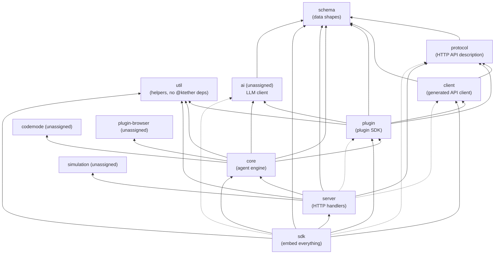

# Repository map: the platform packages

This document is a guided tour of eight packages in the ktether monorepo: `schema`, `util`, `protocol`, `core`, `server`, `client`, `sdk` and `plugin`. Together they are the platform the agent runs on. They are everything between "a model on a GPU" and "a terminal window", except the Kaggle pipeline itself (see `docs/04-kaggle-pipeline.md`) and the user interfaces (terminal UI, web app, desktop app), which are separate packages not covered here.

ktether is a fork of OpenCode (MIT licensed), heavily trimmed. You will still see traces of the upstream project in the code (comments, a few dependency names, some leftover features). Where I noticed these, they are collected at the end of this document so they can be reviewed. Every claim below was checked against the files named; when I could not check something I say "I did not verify this".

## How to read this document

- **Monorepo**: one git repository that holds many npm-style packages under `packages/`. Each package has its own `package.json`. A package named `@ktether/core` lives in `packages/core`. Packages refer to each other with the version `workspace:*`, which means "use the copy in this repository", not a download from npm.
- **Bun**: the JavaScript/TypeScript runtime and package manager this repo uses. `bun run <script>` runs a script from a `package.json`.
- **Effect** (the `effect` library): a TypeScript library for writing programs that can fail, run concurrently and be wired together safely. Most of this code is written with it. `docs/11-core-concepts.md` explains the three Effect ideas you need (`Effect`, `Layer`, `Context.Service`). You do not need them to read this map.
- Paths such as `packages/core/src/session/...` are relative to the repository root.

## 1. Dependency direction

The root `AGENTS.md` (the instructions file for contributors and coding agents) states the layering rule:

> Keep runtime dependencies directed from Schema to Core and Protocol, then from Core and Protocol to Server. Client runtime code may depend on Schema and Protocol but never Core or Server; `sdk` composes Client, Core, and Server.

In plain language:

1. `schema` is at the bottom. It describes the *shapes of data* (a session, a message, a permission rule, an event). It does not do anything.
2. `core` and `protocol` sit on top of `schema`. `core` is the engine that actually runs agents. `protocol` describes the HTTP API in terms of those shapes (which URLs exist, what they accept and return). `core` and `protocol` are siblings: neither depends on the other.
3. `server` sits on top of both. It takes the API description from `protocol` and fills in each URL with a handler that calls into `core`.
4. `client` is deliberately *not* allowed to touch `core` or `server`. It only knows the API description (`protocol`) and the data shapes (`schema`). That is what lets a browser or terminal UI talk to a server without bundling the whole engine.
5. `sdk` is the one package allowed to bring everything together: it embeds `core` and `server` in your own process and gives you a `client` wired to them with no network in between.

### What the `package.json` files actually say

I read the `dependencies` of every package. The picture below draws the real edges (solid arrows are `dependencies`, dashed arrows are `devDependencies` or peer-style relations). Boxes with a grey label are packages outside the eight documented here but visible in the edges.

Facts worth noticing, all verified from `package.json` files and from grepping the `import` lines in each package's `src/`:

- **`schema` and `util` depend on no other `@ktether` package.** `util` is not mentioned in the `AGENTS.md` rule at all; it is a shared helper library used by `core`, `server`, `plugin`, `sdk` and several UI packages. `client` and `protocol` do not use it.
- **`client` matches the rule exactly.** Its only `@ktether` runtime dependencies are `schema` and `protocol`, and its source imports only those two (I counted 74 imports from schema and 7 from protocol, none from anything else).
- **`core` does not depend on `protocol`.** The two are siblings. Core's `package.json` has no `@ktether/protocol` entry and `packages/core/src` imports none.
- **`core` depends on `plugin`.** The plugin package is the typed interface that plugins (including ktether's own built-in ones) are written against, so the engine has to know it. `plugin` in turn lists `client` and `protocol` as dependencies. So, *through* `plugin`, `core` transitively reaches `client` and `protocol` in the package graph. In the files I checked, `plugin`'s imports from `@ktether/client` are all type-only (`import type` or `export type`), so there is no runtime import of client code into the engine from that route. I did not exhaustively verify every file.
- **`server` lists `client` and `plugin` only as `devDependencies`**, meaning they are used by its tests, not by its runtime code. Its runtime imports are `core` (130 imports), `protocol` (45), `util` (12) and `schema` (3). It also loads `@ktether/simulation/backend` with a dynamic `import()` when the `simulation` option is on (`packages/server/src/routes.ts`).
- **Nothing in the repository depends on `sdk`.** I checked every `packages/*/package.json`; only `sdk` itself mentions `@ktether/sdk`. It is a product for outside embedders. (The `sdks/vscode` folder at the repo root is a separate VS Code extension; I did not check whether it uses `sdk`.)
- **The app packages sit above everything.** `cli` depends on `client`, `plugin`, `schema`, `server`, `tui`, `util` and `protocol`; `tui` depends on `client`, `core`, `plugin`, `schema`, `util` and more. They are applications, so the "never Core or Server" rule for *client runtime code* does not apply to them, and `tui` does list `core`. Neither is documented here.

### Where each rule is enforced

The rule is written down in `AGENTS.md` and, for schema, in `packages/schema/AGENTS.md`, which adds: "Schema values should be serializable contract definitions, not service implementations or runtime registries." I did not find an automated check (a lint rule or a test that fails if someone adds a forbidden import) for the package-level rule. There are bundle-boundary tests for client (the client README says "Bundle-boundary tests enforce both import graphs"). I did not read those tests.

## 2. `packages/schema` (`@ktether/schema`)

**Purpose.** The dictionary of the platform. A *schema* here is a description of a data shape together with code that can check ("decode") and write ("encode") values of that shape. Using one shared description means a message produced by the engine, sent over HTTP and displayed in a UI is guaranteed to have the same structure at every step. Schema contains only data definitions: no services, no I/O, no database access. Its `AGENTS.md` calls these "browser-safe wire and storage contracts".

**What is inside** (`packages/schema/src/`, flat files named after the domain):

| Area | Files | What they define |
| --- | --- | --- |
| Sessions | `session.ts`, `session-id.ts`, `session-message.ts`, `session-inbox.ts`, `session-event.ts`, `session-error.ts`, `session-fork.ts`, `session-revert.ts`, `session-stats.ts`, `session-transfer.ts`, `session-metadata.ts` | A session, the messages inside it (user, assistant, tool calls, synthetic, shell, skill, compaction...), the *inbox* of pending work, and every session event |
| Events | `event.ts`, `event-log.ts`, `event-manifest.ts`, `durable-event-manifest.ts`, `server-event.ts`, `tui-event.ts` | How an event is declared (`Event.durable(...)` vs `Event.ephemeral(...)`), plus registries of which events exist |
| Agents and permissions | `agent.ts`, `permission.ts`, `permission-saved.ts`, `question.ts`, `form.ts` | What an agent is, permission rules and requests, questions and forms shown to the user |
| Models and providers | `model.ts`, `provider.ts`, `integration.ts`, `credential.ts`, `models-dev.ts`, `llm.ts`, `money.ts`, `token-usage.ts` | Catalog shapes, how a login method is described, credentials |
| Configuration | `config.ts` and `config/*.ts` (one file per section: `agent`, `command`, `mcp`, `provider`, `model`, `shell`, `worktree`, ...) | The shape of `ktether.json` |
| Environment | `location.ts`, `project.ts`, `workspace.ts`, `filesystem.ts`, `vcs.ts`, `worktree.ts`, `pty.ts`, `persistent-pty.ts`, `shell.ts`, `snapshot.ts`, `file-diff.ts` | Where work happens and what you can ask about it |
| Extensions | `skill.ts`, `mcp.ts`, `mcp-event.ts`, `plugin.ts`, `reference.ts`, `rpc.ts`, `websearch.ts`, `tool.ts` | Skills, MCP servers, plugin status, tool shapes |
| Legacy | `v1/` and files ending in `-v1.ts`, `legacy-event.ts` | Older contracts still needed for migration |
| Plumbing | `schema.ts` (helpers like `optional`, `statics`, `AbsolutePath`), `identifier.ts` (sortable id generator) | Small helpers used by every other file |

`src/index.ts` is a "barrel": one file that re-exports the main domain namespaces (`Agent`, `Session`, `Permission`, ...). Many other modules are deliberately *not* in the barrel and are imported by path (`@ktether/schema/session-event`). The `exports` field in `package.json` allows both `@ktether/schema` and `@ktether/schema/<file>`.

**Conventions you will meet everywhere** (from `packages/schema/AGENTS.md`):

- A file ends up exposing a namespace by self-export, e.g. `export * as Session from "./session.js"` at the top. You then write `Session.Info`, `Session.ID`.
- IDs are "branded strings": at runtime they are text, but the type system refuses to let you mix a `Session.ID` with a `Permission.ID`.
- Unversioned names (`Session`, `Permission`) are the current contracts; names with a `V1` suffix are legacy. New code must not depend on `src/v1/`.
- An *event* is declared with `Event.durable({ type, durable: { aggregate, version }, schema })` or `Event.ephemeral({ type, schema })`. "Durable" events are recorded in order for one aggregate (for sessions, the aggregate is the `sessionID`); "ephemeral" events are only broadcast live. Example from `packages/schema/src/session-event.ts`: `session.created`, `session.inbox.enqueued`, `session.step.started` are durable; `session.text.delta` and `session.tool.progress` are ephemeral.

**Depends on:** only `effect` and `@standard-schema/spec` (an interoperability type for validators).

**Depended on by:** protocol, core, server (a few imports), client, plugin, sdk, plugin-browser, ai, and the app packages (`cli`, `tui`, `app`, `desktop`, `gui-extensions`).

**Extra scripts:** `script/config-schema.ts` generates a JSON Schema for `ktether.json` by combining the new `Config.Info` shape with a frozen older schema (`script/config-v1.json`). The generated file's published location is a GitHub URL; see "unsure" below.

**Where to start reading.** (1) `packages/schema/AGENTS.md`, which is short and explains the rules. (2) `src/event.ts` to see how events are declared. (3) `src/session-inbox.ts` and `src/session-message.ts`, which are the two most important shapes for understanding the engine. (4) `src/config.ts` if you care about configuration. Tests live in `packages/schema/test/` (for example `contract-hygiene.test.ts`, `v1-isolation.test.ts`); I did not read them.

## 3. `packages/util` (`@ktether/util`)

**Purpose.** A grab bag of low-level helpers shared by the engine, server and plugin code. Nothing in it is specific to coding agents. It also holds a small piece of custom Effect infrastructure, `LayerNode`, which wires the engine's services together (explained in `docs/11-core-concepts.md`).

**What is inside** (`packages/util/src/`):

| File or folder | What it provides |
| --- | --- |
| `effect/layer-node.ts`, `effect/app-node.ts`, `docs/layer-node.md` | `LayerNode`, a replaceable "node and graph" wrapper around Effect layers, and `makeGlobalNode` / `makeLocationNode`. The markdown file in `packages/util/docs/` is the best explanation |
| `effect/app-node-platform.ts`, `effect/memo-map.ts`, `effect/runtime.ts`, `effect/service-use.ts` | Platform layers (HTTP client), runtime and helper utilities for services |
| `global.ts`, `global-roots.ts` | Where ktether keeps its files (data, config, cache, state, log, temp), derived from the XDG base directories and the app name `ktether` |
| `fs-util.ts` | `FSUtil`, a file-system service (read, scan, walk up directories, ...) |
| `process.ts`, `cross-spawn-spawner.ts` | `AppProcess`, the service used to run child processes |
| `npm.ts`, `npm-config.ts` | Install npm packages at runtime (used to load provider and plugin packages that are not bundled) |
| `flock.ts`, `effect-flock.ts` | File locking |
| `observability.ts`, `observability/` | Logging and OpenTelemetry tracing setup |
| `runtime-import.ts`, `runtime/import.{bun,node,workerd}.ts` | Dynamic module loading that differs per runtime |
| `patch.ts`, `glob.ts`, `hash.ts`, `path.ts`, `retry.ts`, `bom.ts`, `binary.ts`, `base64.ts`, `encode.ts` | Small utilities |
| `session-title-fallback.ts`, `activity-calendar.ts`, `artifact.ts`, `open.ts` | Narrow helpers that look UI-oriented. I did not trace who uses `activity-calendar` and `artifact` |

**The `imports` field.** `package.json` uses "conditional imports" such as `#runtime-import` and `#global-roots`: the same import name resolves to a different file depending on whether the code runs on Bun, Node or Cloudflare's `workerd`. Core uses the same trick for SQLite, PTY, ripgrep-like search and WebAssembly modules (see section 5).

**Depends on:** no `@ktether` packages. Outside libraries include Effect's Node platform, OpenTelemetry, npm's `arborist` and `pacote`, `glob`, `minimatch`.

**Depended on by:** core, plugin, server, sdk, simulation, `cli`, `tui`, `app`, `gui-extensions`, `session-ui`.

**Where to start.** `packages/util/docs/layer-node.md` first, then `src/global.ts` (short) to learn where ktether stores things on disk, then `src/fs-util.ts` when you meet `FSUtil` in the engine.

## 4. `packages/protocol` (`@ktether/protocol`)

**Purpose.** The written contract of the HTTP API. Using Effect's `HttpApi` module, it declares every route (`GET /api/skill`, `POST /api/session/:sessionID/prompt`, ...), its path and query parameters, the body it accepts, the body it returns and the errors it can raise. It contains no behaviour: no handler code and no engine imports. That is why the client can import it safely. The server later "fills in" each declared route with a handler.

**What is inside** (`packages/protocol/src/`):

| File or folder | What it is |
| --- | --- |
| `api.ts` | `makeApi` and `makeDefaultApi`: assemble all groups into one `HttpApi` named `"server"`, attach the `Authorization` and `SchemaErrorMiddleware` middleware, and annotate OpenAPI metadata (title "ktether HttpApi", version "0.0.1") |
| `groups/*.ts` | One file per *group* of related routes. There are 30+: `session`, `message`, `model`, `provider`, `integration`, `credential`, `agent`, `permission`, `mcp`, `skill`, `command`, `fs`, `pty`, `persistent-pty`, `shell`, `vcs`, `worktree`, `websearch`, `voice`, `event`, `form`, `config`, `plugin`, `reference`, `rpc`, `debug`, `migration`, `server`, `generate`, `project`, `location` and `ktether` (the Kaggle control API, documented elsewhere) |
| `errors.ts` | Typed HTTP errors with their status codes (`LocationNotFoundError` 404, `InvalidRequestError` 400, `UnauthorizedError` 401, `ConflictError`, ...) |
| `middleware/` | The `Authorization` and `SchemaErrorMiddleware` declarations (just identities; the behaviour is supplied by the server) |
| `client.ts` | `ClientApi`: the same API built with placeholder middleware, plus `groupNames` (which group becomes which client namespace, e.g. `server.fs` becomes `file`) and lists of endpoints to omit from the generated clients. This is what the client code generator reads |
| `simulation.ts` | JSON-RPC schema definitions exported as `@ktether/protocol/simulation`. It looks related to the `simulation` package; I did not trace it |
| `../openapi.json` | A generated OpenAPI document. `bun run generate` in `packages/protocol` regenerates it; `bun run check:generated` fails if it is stale |

**A key design detail.** Some routes need to run "inside a location" (a project directory with its own set of services; see `docs/11-core-concepts.md`). Protocol cannot name the engine's services, so `api.ts` says in a comment: "Protocol owns middleware placement, while Server injects concrete keys so Core service identities stay downstream." In practice: `makeDefaultApi({ locationMiddleware, formLocationMiddleware, sessionLocationMiddleware })` receives three middleware identities. The server passes the real ones (`packages/server/src/api.ts`); the client generator passes dummy ones (`packages/protocol/src/client.ts`).

**Depends on:** `schema`, `effect` (and `prettier` for formatting the OpenAPI output).

**Depended on by:** server, client, plugin (declared; I saw no imports from it in plugin's `src`), sdk (dev), simulation, cli.

**Where to start.** Open `src/groups/skill.ts` (a 30-line group with one route) to see the pattern, then `src/api.ts` to see how groups are assembled, then `src/groups/session.ts` for the busiest group (about 800 lines). The "HTTP walkthrough" in `docs/11-core-concepts.md` follows one route through all three layers.

## 5. `packages/core` (`@ktether/core`)

**Purpose.** The engine. It owns everything that makes ktether an agent: sessions and their history, the loop that sends a conversation to a model and runs the tools the model asks for, permissions, configuration loading, the plugin system, MCP clients, providers/models/credentials, the SQLite database, the event bus, the file/shell/terminal/git subsystems and more. It has no HTTP code: it exposes Effect services which `server` (or `sdk`) calls. Its README is a single line ("Core runtime services for ktether."), so the best documentation is `docs/11-core-concepts.md` plus the folder-level `AGENTS.md` files (for example `packages/core/src/tool/AGENTS.md`).

**What is inside** (`packages/core/src/`). Core is large: top-level `*.ts` files are usually one service each, and folders hold supporting modules. `package.json` has `"exports": { "./*": "./src/*.ts" }`, so other packages import `@ktether/core/session`, `@ktether/core/bus`, and so on.

| Area | Top-level file(s) and folder | Responsibility |
| --- | --- | --- |
| Sessions | `session.ts`, `session/` | The public `Session.Service`; inbox, runner, execution, store, projector, compaction, revert, fork, transfer, diff, title generation, subagent jobs (see doc 11) |
| Event bus | `bus.ts`, `event/sql.ts`, `event-logger.ts` | Publishing events, running projections in a transaction, optional event retention |
| Database | `database/` | SQLite via Drizzle, bootstrap and migrations, per-runtime SQLite drivers; `database/drizzle/` is a local fork of Drizzle's Effect adapter (its `README.md` explains) |
| Tools | `tool.ts`, `tool/`, `tool-output.ts`, `codemode/` | The tool registry, built-in tools (`tool/plugin/*.ts`), output truncation, "Code Mode" |
| Permissions | `permission.ts`, `permission/saved.ts` | Rules, ask/allow/deny evaluation, saved "always allow" decisions |
| Agents and commands | `agent.ts`, `command.ts`, `plugin/agent.ts`, `plugin/command.ts`, `plugin/plan.ts` | Agent definitions, slash commands |
| Plugins | `plugin.ts`, `plugin/` | Plugin registry, hook dispatch, the built-in ("internal") plugins list in `plugin/internal.ts`, loading external plugins |
| Providers | `provider.ts`, `model.ts`, `model-resolver.ts`, `integration.ts`, `credential.ts`, `models-dev.ts`, `aisdk*.ts`, `plugin/provider/` | Providers, models, login methods, credentials, turning a catalog entry into a callable model |
| Config | `config.ts`, `config/` | Discovery and loading of `ktether.json(c)`; `config/plugin/*.ts` applies each config section to its domain |
| Locations | `location.ts`, `location-service-map.ts`, `location-services.ts`, `location-lifecycle.ts`, `location-activity.ts`, `instance.ts`, `instance/service.ts`, `app.ts`, `project.ts`, `workspace.ts`, `worktree.ts` | The per-directory service graph and project/workspace identity |
| Instructions | `instruction-discovery.ts`, `instructions/`, `reference.ts`, `skill.ts`, `skill/`, `session/system-prompt.ts` | What text the model sees besides your messages |
| MCP | `mcp/` | Model Context Protocol clients (stdio and remote, OAuth) |
| Files and processes | `filesystem.ts`, `filesystem/`, `file-access.ts`, `file-mutation.ts`, `shell.ts`, `shell/`, `pty.ts`, `pty/`, `persistent-pty/`, `ripgrep.ts`, `ripgrep/`, `git.ts`, `vcs.ts`, `snapshot.ts`, `formatter.ts`, `image.ts` | The local machine subsystems |
| Web and voice | `websearch.ts`, `plugin/websearch/`, `voice.ts` | Web search provider registry and realtime voice sessions |
| Misc services | `job.ts`, `kv.ts`, `form.ts`, `rpc.ts`, `state.ts`, `managed-policy.ts`, `wellknown.ts`, `oauth/` | Background jobs, key-value store, user prompts, plugin RPC, the transform-state helper, policy |
| ktether specific | `ktether/` | The Kaggle pipeline (documented in `docs/04-kaggle-pipeline.md`) |
| Compatibility | `v1/` | Reading legacy (V1) configuration shapes |

`package.json` `imports` shows core's runtime-switching points: `#sqlite`, `#pty`, `#persistent-pty-binary`, `#fff` (fast file search), `#photon-wasm` (image resizing), `#shell-parser-wasm` (shell command parsing) and `#v1-migration`, each resolving to a Bun, Node or workerd variant.

**Depends on:** `schema`, `util`, `plugin`, `ai` (the LLM client library; not documented here), `codemode` (confined JavaScript execution; unassigned), `plugin-browser` (a built-in browser plugin; unassigned), plus third-party libraries: Drizzle ORM, the MCP SDK, tree-sitter (shell parsing), `@parcel/watcher`, `jsonc-parser`, `gray-matter` (front-matter in markdown), `immer`, and PTY libraries.

**Depended on by:** server, sdk, simulation and `tui`.

**Where to start reading.** In this order:
1. `packages/core/src/session/runner/llm.ts`: the loop that drives a conversation (`drain`, `runStep`).
2. `packages/core/src/session/inbox.ts`: how prompts are queued and delivered.
3. `packages/core/src/bus.ts` and `packages/core/src/session/projector.ts`: how events become database rows.
4. `packages/core/src/instance.ts`: the list of services created for each location.
5. `packages/core/src/plugin/internal.ts`: the list of built-in plugins, which is the best table of contents for "what features does ktether have".
6. `packages/core/src/tool.ts` plus `packages/core/src/tool/AGENTS.md`.

## 6. `packages/server` (`@ktether/server`)

**Purpose.** Turn the engine into an HTTP server. For every route group declared in `protocol` it provides a *handler*: a small function that unpacks the request, calls the right `core` service and shapes the response. It also owns server concerns: authentication, CORS, the live event stream, binding a port, and building "all the services the handlers need".

**What is inside** (`packages/server/src/`):

| File | What it does |
| --- | --- |
| `api.ts` | `Api = makeDefaultApi({ locationMiddleware, formLocationMiddleware, sessionLocationMiddleware })`: the protocol API with the server's real middleware plugged in |
| `handlers.ts`, `handlers/*.ts` | One file per protocol group; `handlers.ts` merges them all into one layer. Most handlers are a few lines (see `handlers/skill.ts`) |
| `routes.ts` | `createRoutes` (server process) and `createEmbeddedRoutes` (used by `sdk`): builds the whole service graph, applies option-driven replacements, and mounts the API at `/openapi.json` plus the routes |
| `location.ts`, `middleware/*.ts` | The "which project directory is this request about?" middleware: `LocationMiddleware` (uses `?location[directory]=` or the `x-ktether-directory` header, else the process directory), `SessionLocationMiddleware` (looks up a session and uses *its* location), `FormLocationMiddleware`, authorization, schema error mapping |
| `auth.ts`, `pairing.ts`, `middleware/authorization.ts` | HTTP Basic authentication with username `ktether` and an optional password, signed session cookies issued by pairing links |
| `event-feed.ts`, `handlers/event.ts` | Server-sent events at `GET /api/event`: first `server.connected`, then live events, with a heartbeat every 15 seconds; each subscriber has a bounded queue (`SubscriberCapacity = 4096`) |
| `process.ts` | Starts a real Node HTTP server (tries the next port if a port is busy and none was requested) |
| `fetch.ts` | `ServerFetch.make`: builds a web-standard `(Request) => Promise<Response>` handler without opening a port. Used for runtimes such as workerd |
| `workerd.ts` | Replacement services for running inside a Cloudflare Durable Object (I read the header only) |
| `options.ts` | `ServerOptions`: hostname, port, password, CORS origins, database path, event persistence, config directory, and so on |
| `server-info.ts`, `service-status.ts`, `cors.ts`, `pty-environment.ts`, `request-tracing.ts` | Small supporting modules |

**Depends on:** `core`, `protocol`, `schema`, `util`, `simulation` (runtime); `client` and `plugin` (dev, tests); Effect's Node platform.

**Depended on by:** `cli` (it starts the server process) and `sdk` (it embeds the routes).

**Where to start.** `packages/server/src/handlers/skill.ts` (6 lines of logic) and `handlers/model.ts`, then `routes.ts`. Read `handlers/session.ts` last; it is the largest.

## 7. `packages/client` (`@ktether/client`)

**Purpose.** The typed way to talk to a ktether server from TypeScript. Almost all of it is **generated** from the `protocol` description. The README calls it a "private generation target for clients derived directly from ktether's authoritative Effect `HttpApi`". Two styles are produced:
- `@ktether/client` (the default entry): a plain **Promise** client using `fetch`, with no dependency on Effect at runtime.
- `@ktether/client/effect`: an **Effect** client. It needs an Effect `HttpClient` provided to it.

There is also a `@ktether/client/solid` entry with reactive helpers (Solid.js is a UI library) such as connection and data stores. I only read the barrel file.

**What is inside** (`packages/client/src/`):

| Path | What it is |
| --- | --- |
| `promise/generated/`, `effect/generated/`, `effect/api/` | Generated code. **Never edit by hand.** Regenerate with `bun run generate` from `packages/client`, as `AGENTS.md` requires after changing Protocol or the Server `HttpApi` |
| `promise/client.ts`, `effect/client.ts` | Hand-written factory: `KTether.make({ baseUrl, fetch? })` |
| `contract.ts` | Re-exports `ClientApi`, `groupNames` and the omit lists from `@ktether/protocol/client` |
| `service.ts`, `promise/service.ts`, `effect/service.ts`, `service-probe.ts`, `service-contender.ts`, `service-version.ts`, `service-timing.ts` | Discovering, starting and stopping the **local background service** (a long-lived server registered in a file under the XDG state directory); default command `ktether serve --service` |
| `shared-events.ts`, `rpc.ts`, `rpc-runtime.ts` | One shared event stream for many consumers; calling plugin RPC methods |
| `pty-handoff.ts` | Hand terminals from an old service process to its replacement |
| `solid/` | Reactive wrappers for UIs |

**Depends on:** `schema`, `protocol` (runtime); `effect` and `solid-js` as optional peer dependencies; `httpapi-codegen` (the generator, dev only).

**Depended on by:** plugin, sdk, cli, tui, app, desktop, gui-extensions, session-ui, storybook; server (dev).

**Where to start.** `packages/client/README.md`, then `src/promise/client.ts` and skim `src/promise/generated/client.ts` to see what one generated method looks like. The generator entry is `script/build.ts`.

## 8. `packages/sdk` (`@ktether/sdk`)

**Purpose.** Embed ktether in your own program. The README says: "In-process ktether host for Promise and Effect applications. The SDK executes Server's assembled HTTP router in memory, opening no listener and adding no network hop." Internally it builds the same routes as the server, wraps them in a fake `fetch` function, and hands that to a normal `client`. You use it like a client but there is no network involved.

**What is inside** (`packages/sdk/src/`):

| File | What it does |
| --- | --- |
| `index.ts` | Exports `KTether` (the Promise entry), `Tool`, and schema namespaces re-exported from `contracts.ts` |
| `ktether.ts`, `promise.ts` | `create(options)` for Promise users: boots the host, registers plugins, builds a client over the in-memory `fetch`, and returns `{ ...client, sessions, events, plugin, close }` |
| `effect/ktether.ts` | The same for Effect users, as a scoped resource and a `Layer` |
| `internal/host.ts` | `EmbeddedHost.create`: builds the routes with `createEmbeddedRoutes` (default database `:memory:`), registers plugins, and starts the restart-recovery sweep for sessions that were running when a previous host died |
| `internal/fetch.ts` | `OwnedFetch`: tracks in-flight requests so `close()` can abort and wait for them |
| `internal/instances.ts` | Per-session plugin sets ("instances": different plugins for sessions in the same directory) |
| `workerd.ts`, `effect/workerd.ts`, `internal/workerd.ts` | Entry points for Cloudflare workerd |
| `tool.ts`, `effect/tool.ts` | Helpers for defining tools |
| `logging.ts` | Optional structured logging; embedded hosts are silent by default |

**Depends on:** `client`, `core`, `plugin`, `schema`, `server`, `util` (runtime); `ai`, `httpapi-codegen`, `protocol` (dev).

**Depended on by:** nothing else in this repository.

**Where to start.** `packages/sdk/README.md`, then `src/promise.ts` (75 lines) and `src/internal/host.ts` (73 lines). Note that the README examples are stale in places (see below).

## 9. `packages/plugin` (`@ktether/plugin`)

**Purpose.** The public API for extending ktether. A *plugin* is a small module with an `id` and a setup function; during setup it registers *hooks* and *transforms* on the domains it wants to change (agents, commands, providers, models, tools, skills, MCP servers, permissions, web search, version control, and more). ktether's own built-in features are written as plugins against the same API (`packages/core/src/plugin/internal.ts`). The package provides two styles of the same API:
- Promise style (default entry `@ktether/plugin`): `Plugin.define({ id, setup: async (ctx) => { ... } })`.
- Effect style (`@ktether/plugin/effect`): `define({ id, effect: (ctx) => Effect... })`.

It also has a TUI entry (`@ktether/plugin/tui`) for plugins that add interface elements to the terminal UI. I read only the top of that file.

**What is inside** (`packages/plugin/src/`):

| Path | What it is |
| --- | --- |
| `promise/*.ts` | Promise-flavoured types per domain (`agent.ts`, `tool.ts`, `provider.ts`, `session.ts`, ...); `adapter.ts` converts to the Effect form |
| `effect/*.ts` | The Effect-flavoured types: `plugin.ts` defines `Context` (the object a plugin receives: `ctx.agent`, `ctx.tool`, `ctx.provider`, `ctx.session`, ...) and `define` |
| `effect/README.md`, `effect/PLAN.md`, `README.md` | Documentation. `README.md` (the Promise API) explains transforms, hooks and registration with examples |
| `host.ts` | Given a directory or package name, finds a plugin's `server`, `tui` and `rpc` entrypoints |
| `source.ts`, `source.bun.ts`, `source.node.ts`, `source.package.ts` | Loading plugin source modules and watching them for changes (so edits reload) |
| `runtime.ts`, `runtime-modules.ts` | Make `effect` and `@ktether/plugin` resolve to the *host's* copies when a plugin imports them, and refuse plugin-local copies. This is why plugins cannot bundle their own Effect |
| `tui/` | Types for TUI plugins (`definition.setup(context)`) |
| `storage.ts`, `options.ts`, `app.ts`, `permission.ts`, `rpc.ts`, `worktree.ts` | Supporting types |

`packages/plugin/AGENTS.md` exists; I did not read it in full.

**Depends on:** `ai`, `client`, `protocol`, `schema`, `util`, `effect`, plus optional peers (`@ktether/theme`, OpenTUI, Solid) for TUI plugins. I saw no imports from `protocol` in its `src`.

**Depended on by:** core (it needs the interface to host plugins), sdk, server (dev), cli, tui, plugin-browser, latex, merman, simulation.

**Where to start.** `packages/plugin/src/README.md` and then `src/effect/plugin.ts` (about 60 lines: the whole `Context`). Then read one small built-in plugin, `packages/core/src/plugin/agent.ts`, to see the API used for real.

## 10. Reading order for a newcomer

1. `README.md` and `AGENTS.md` at the repo root (project rules, commands).
2. `packages/schema/AGENTS.md`, then `packages/schema/src/session-inbox.ts` and `session-message.ts`.
3. `docs/11-core-concepts.md`.
4. `packages/protocol/src/groups/skill.ts` -> `packages/server/src/handlers/skill.ts` -> `packages/client/src/promise/generated/client.ts`.
5. `packages/core/src/session/runner/llm.ts`.
6. `packages/core/src/plugin/internal.ts` and one plugin from it.

To try the platform without any UI, `packages/sdk/README.md` shows how to create an in-process host. Because those examples are stale, use `KTether.create()` from `@ktether/sdk` (the actual export in `packages/sdk/src/index.ts` is `export * as KTether from "./ktether"`).

## 11. Things I was unsure about or that look wrong or dead

These are observations for review. I changed nothing.

1. **Stale README identifiers.** `packages/sdk/README.md` imports `{ ktether } from "@ktether/sdk"` and calls `ktether.create()`; the code exports `KTether` (capital K). `packages/client/README.md` uses `ktether.make(...)` while the client exports `KTether`. This looks like a case-insensitive find-and-replace of an upstream name; check other lowercase `ktether` identifiers in docs.
2. **Client README misstates the generator input.** It says "The build compiler reads `@ktether/server/api`". The script `packages/client/script/build.ts` imports `ClientApi` from `@ktether/protocol/client`. The README's `check:generated` description may also be out of date; I did not run it.
3. **Repository URLs disagree.** Every `package.json` I opened has `repository.url` of `git+https://github.com/anomalyco/ktether.git`. `.ktether/ktether.jsonc` points its `$schema` at `https://raw.githubusercontent.com/premsuggu/ktether/main/schema/config.json`, but there is no `schema/` directory at the repository root (the generator `packages/schema/script/config-schema.ts` exists; I did not check where its output is written).
4. **Un-migrated dependency scope.** `packages/core/package.json` and `packages/server/package.json` depend on `@opencode-ai/pty`; `packages/core/src/persistent-pty/pty-binding.ts` carries the comment "Published separately by anomalyco/ktether-pty; it has not migrated npm scopes."
5. **Possibly unused dependencies in core.** `@ai-sdk/cohere`, `@ai-sdk/perplexity` and `@ai-sdk/vercel` are listed in `packages/core/package.json` dependencies but I found no import of them in `packages/core/src` (I did not search tests or scripts). `gitlab-ai-provider` is imported only in `packages/core/src/variant.ts`.
6. **Leftover upstream hosted-provider material in core.**
   - `packages/core/src/plugin/models-dev.ts` still has a `BEDROCK_PROFILE_ONLY_IDS` list naming many hosted models.
   - `packages/core/src/session/runner/model.ts` has error text for the deprecated providers `azure-cognitive-services` and `google-vertex-anthropic`.
   - `packages/core/src/plugin/optimize.ts` keeps system prompts for GPT, Claude, Kimi, Trinity and "muse" models (`plugin/system-prompt/*.txt`). Its GPT test is a substring match (`id.includes("gpt")`), so an open model such as `gpt-oss` would also receive the GPT prompt. This is not dead code, but may not be intended.
   - A migration named `20261007190000_azure_cli_external_credential.ts` and tables `account`, `account_state`, `control_account` exist; I did not check whether anything still uses them.
   - `packages/core/src/database/v1-migration.bun.ts` mentions a database file named `ktether-next.db`.
7. **"Console" and enterprise remnants.** `plugin/internal.ts` has a comment "Repository config must not switch off policy enforcement or the Console connection that delivers organization statements". The `WellKnown` service (`packages/core/src/wellknown.ts`) fetches remote configuration and `ManagedPolicy` supports macOS MDM (managed preferences) and a system config directory. These are upstream enterprise features. I did not verify they are reachable in ktether's defaults.
8. **Web-search providers are third-party hosted services.** `packages/core/src/plugin/websearch/` registers Exa, Firecrawl, Parallel, Tavily and TinyFish integrations, with fixed endpoints such as `https://mcp.exa.ai/mcp`. They need keys supplied by the user. Whether to keep them is a product decision.
9. **Stale comments in `models-dev.ts`.** The bundled snapshot is described as "a multi-MB module-level constant", but `packages/core/src/models-dev/snapshot.txt` is about 2.7 KB, and the default source is the placeholder `https://models.invalid`.
10. **Vocabulary drift ("step" vs "turn").** `AGENTS.md` reserves "turn" for a future unit. The code already uses "turn" in comments in `session/execution.ts`, `session/execution/restart.ts` (`maxAttempts` doc) and in `SessionDiff.turn` / `TurnRangeError`. See `docs/11-core-concepts.md`.
11. **`@ktether/protocol` in plugin's dependencies.** Declared, but I found no imports of it in `packages/plugin/src`. I did not check tests or scripts.
12. **Event persistence defaults to off.** `Bus.configured` uses `persist = options?.persist ?? false`, and the only place I found that turns it on is `packages/server/src/workerd.ts`. See `docs/11-core-concepts.md` for what that means.
13. **UI-flavoured helpers in `util`.** `activity-calendar.ts`, `artifact.ts` and `open.ts` look like they belong to an app package. I did not trace users.
14. **`session.execution.interrupted` reasons differ.** The event schema allows `"user" | "shutdown" | "superseded" | "inactivity"` (`packages/schema/src/session-event.ts`), while `core/src/session/execution.ts` declares `InterruptReason = "user" | "shutdown" | "inactivity"`. `"superseded"` may be unused; I did not search for it.
