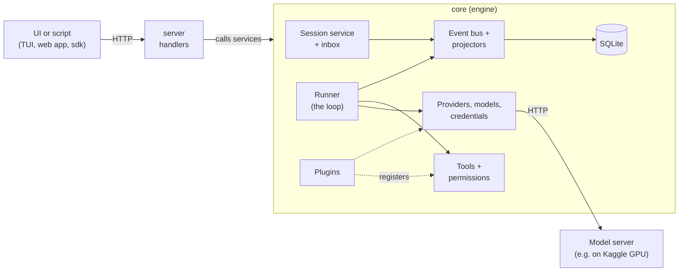
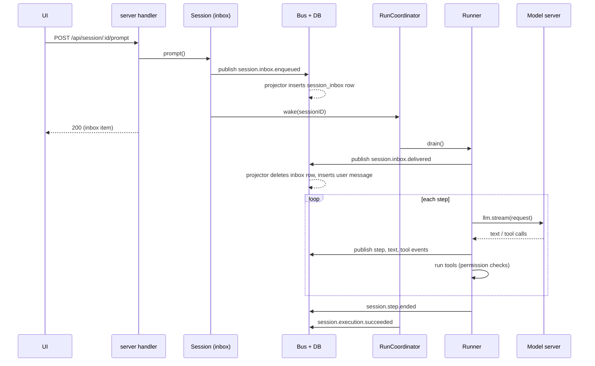

# Core concepts: how `packages/core` works

This document explains the ideas you need before reading `packages/core`, the engine of ktether. ktether is a fork of OpenCode (MIT licensed), so some vocabulary and a few leftovers come from that project. The Kaggle GPU pipeline that gives ktether its models is covered in `docs/04-kaggle-pipeline.md` and is not described here beyond one sentence: ktether starts a model server on a Kaggle notebook, and the engine talks to it through a provider named `kaggle`.

Every claim below was checked by reading the files cited. Where I could not check something, I say so.

For the layout of the whole repository, read `docs/10-repo-map.md` first.

## 0. A map of the territory

An *agent* in this context is a loop: send the conversation to a language model; if the model asks to use a *tool* (read a file, run a shell command, edit text), run it and send the result back; repeat until the model answers without asking for anything more. Everything in `packages/core` supports that loop. In outline:



## 1. Three Effect ideas

Almost all of `core` is written with the Effect library. You only need three ideas to read it.

**1. `Effect<A, E, R>` is a description of work, not the work itself.** It says: "when run, this produces a value of type `A`, may fail with an error of type `E`, and needs the services `R` to be available". Nothing happens until something runs it. Inside `Effect.gen(function* () { ... })`, the `yield*` keyword plays the role of `await`: `const row = yield* db.select()...`. Errors are typed (for example `Session.NotFoundError`) and are caught by tag (`Effect.catchTag("Session.NotFoundError", ...)`). Wrappers such as `Effect.fn("Session.prompt")(function* ...)` give the work a name for tracing.

**2. `Context.Service` declares a service: a named bundle of capabilities.** Every subsystem is a service with an interface and an identifier. From `packages/core/src/agent.ts`:

```ts
export class Service extends Context.Service<Service, Interface>()("@ktether/Agent") {}
```

Code that needs agents does `const agents = yield* Agent.Service` and then calls `agents.list()`. (The project style guide says to bind the service to a variable first and not to nest yields.) The `R` in `Effect<A, E, R>` records which services a piece of work requires. A convenience, `Service.use(...)`, is used in handlers: `Skill.Service.use((skill) => skill.list())`.

**3. `Layer` is the recipe for building a service.** A layer says "to build the `Agent` service, first get the `Bus` service, then do this setup". Layers can depend on other layers. When the server starts, Effect builds every layer in dependency order, once.

### ktether's own wiring layer: `LayerNode`

Plain Effect layers are hard to override in tests or in other runtimes. ktether adds a small wrapper in `packages/util/src/effect/layer-node.ts` (explained in `packages/util/docs/layer-node.md`): a **Node** is a replaceable declaration of one service: its default layer plus the other nodes it depends on. Example, the end of `packages/core/src/agent.ts`:

```ts
export const node = makeLocationNode({ service: Service, layer, deps: [Bus.node] })
```

- `LayerNode.group([...nodes])` collects nodes into a graph.
- `someNode.replace(layer)` produces a checked replacement; the server uses this to configure services from options (`Database.node.replace(Database.configured(options.database))` in `packages/server/src/routes.ts`).
- `LayerNode.unbound(Service, tag)` declares a service whose implementation must be supplied by the caller (for example `Location.node`, and `Instance.node`).
- `LayerNode.compile(root, { replacements })` turns the graph into a real layer.

There are two **tags**: `makeGlobalNode` services exist once per server process (database, bus, credentials, session store, project service); `makeLocationNode` services exist once *per project directory* ("location", section 4): agents, tools, permissions, config, MCP clients, the runner. Location nodes may depend on global nodes, but not the other way round (`tags` in `packages/util/src/effect/app-node.ts`: `location: ["global"], global: []`).

## 2. The "transform" pattern: how most registries work

Many services hold a *registry* of things that several parties contribute to: agents, tools, providers, models, skills, MCP servers, web-search providers, commands, references, VCS adapters. They all use the same helper, `State` (`packages/core/src/state.ts`). Understand it once and the plugin system makes sense.

- A service creates a state with `State.create({ name, initial, editor, notify })`. `initial()` produces an empty value, and `editor(value)` wraps it in a small editing API (for agents: `list`, `get`, `default`, `update`, `remove`).
- Anyone can **register a transform**: a *synchronous* function that receives the editor and edits the state. `ctx.agent.transform((editor) => { editor.update("build", (agent) => { agent.name = "Build" }) })`.
- `state.get()` does not store a mutable object that is edited in place. When something changed (`dirty`), it starts again from `initial()` and **replays every registered transform in registration order**, producing a fresh value. Later registrations see and can override earlier ones.
- Registering returns a registration with `dispose`. Closing the owning scope removes the transform and the state is rebuilt without it. That is how an unloaded plugin's contributions disappear cleanly.
- `reload()` marks the state dirty without adding or removing anything: you call it when the *inputs* a transform read (for example config files) changed.
- Each change triggers `notify`, usually publishing an event such as `agent.updated`, so UIs refresh.
- If a plugin's transform throws, the transform's *group* (all registrations of that plugin) is disabled and the state rebuilt without it; the plugin is reported as failed (`State.group` and `disable` in `state.ts`; the failure text is "Plugin disabled after ...transform failed").

Because transforms are synchronous, plugins must load any asynchronous data first and then register the transform (the Promise plugin README says this explicitly).

## 3. Sessions, messages, steps and turns

A **session** is one conversation with the agent: a title, an agent, a model, a location (directory), permissions, and an ordered history of **messages**. The shapes are in `packages/schema/src/session.ts` and `session-message.ts`; the services are in `packages/core/src/session.ts` (the public `Session.Service`) and `packages/core/src/session/` (the machinery).

There are two files that both define a `Session` namespace, which is confusing at first:
- `packages/core/src/session.ts` exports `Session.Service`: create, list, fork, get, prompt, interrupt, compact, revert, move, and so on. Handlers call this.
- `packages/core/src/session/session.ts` builds the per-session operations (`prompt`, `shell`, `skill`, `compact`, `interrupt`, ...) that `Session.Service` wraps via `forSession(id)`.

### Message kinds

`SessionMessage.Info` (in `packages/schema/src/session-message.ts`) is a union of: `user`, `synthetic` (text inserted by the system, e.g. a note that a background job finished or "continue where you left off"), `system`, `skill` (a skill was activated), `shell` (the user ran a shell command), `assistant`, `compaction`, and three markers that record that the agent, model or location was switched. An `assistant` message holds an ordered `content` list of `text`, `reasoning` and `tool` items; a `tool` item has a state of `streaming`, `running`, `completed` or `error`.

### Events describe what happens; messages are what you read

The runner does not write messages directly. It publishes **events**, and a projector folds them into message rows (section 16). Session events (`packages/schema/src/session-event.ts`) include `session.created`, `session.inbox.enqueued`, `session.inbox.delivered`, `session.execution.started/succeeded/failed/interrupted`, `session.step.started/streamed/ended/failed`, `session.text.started/delta/ended`, `session.reasoning.*`, `session.tool.input.*`, `session.tool.called`, `session.tool.success`, `session.tool.failed`, `session.compaction.*`, `session.retry.scheduled` and more. Deltas (`session.text.delta`, `session.reasoning.delta`, `session.tool.input.delta`, `session.compaction.delta`), `session.tool.progress` and `session.usage.updated` are *ephemeral* (live only); the rest of the list above is durable.

### Step versus turn

The root `AGENTS.md` ("Session Core") fixes the vocabulary, and it matters when you read the code:

- A **step** is one logical LLM call: one request to the model and its streamed response, including any tool calls the model made in that response and their results being recorded. "One step is one logical LLM call; its durable record covers only the model-visible span. Do not write 'provider turn', and do not use bare 'turn' for a single call."
- A **turn** is reserved for a *future* assistant-turn unit: all steps from the moment a prompt is promoted until the session would go idle.
- The code's own term for the contiguous period during which a session is being driven is a **busy period** (one *execution*): see `packages/core/src/session/run-coordinator.ts`, "One execution is a busy period for one key".

Note that the code does not yet follow the rule perfectly: the word "turn" appears in `session/execution.ts` ("durable intent that a turn is in flight"), in `session/execution/restart.ts` (the `maxAttempts` option: "Times a single turn may be resumed"), and in `SessionDiff.turn` / `TurnRangeError`. In those places "turn" means roughly "busy period" or "assistant response", not one LLM call. Treat "turn" as informal in the code; use "step" for one call and "busy period" for the stretch of work.

A step can be attempted more than once. In `packages/core/src/session/runner/llm.ts`, `runStep` loops: each pass calls `steps.attempt` (one `llm.stream` call). If the provider fails in a retryable way, it records `session.retry.scheduled`, waits, and tries again within the same logical step. Other outcomes (`Compacted`, `RecoverFull`, `OutputLimit`, `Continue`) are handled in the same loop. When a step reaches the maximum number allowed by the agent (`agent.steps`), the runner sends the request with `toolChoice: "none"` plus a "MAXIMUM STEPS REACHED" assistant message (`session/runner/max-steps.ts`), so the model summarizes instead of calling tools.

## 4. Locations, instances, workspaces and projects

Tools need a directory to work in, config is read relative to a directory, and permissions are saved per project. ktether models this with a few concepts.

- **Location** (`packages/core/src/location.ts`, shape in `packages/schema/src/location.ts`): "where work happens". A `Location.Ref` is a `directory` plus an optional `workspaceID`. The `Location.Service` exposes the directory, the workspace id, the resolved project (`id`, `directory`, `canonical`) and VCS info.
- **Project** (`packages/core/src/project.ts`): a repository or folder identified across directories and clones. For git, the id is derived from the normalized `origin` remote URL (`Hash.fast("git-remote:" + host/path)`), else from a cached id file in the repository's git common directory, else from the root commit. Mercurial uses a cached id or its first root changeset. A plain directory gets a hash of its path. If nothing identifies it, the id is `ID.global`.
- **Instance** (`packages/core/src/instance.ts` and `instance/service.ts`): the bundle of all location-scoped services for one location. `instance.ts` lists the nodes (`Location.node`, `Config.node`, `Agent.node`, `Provider.node`, `Model.node`, `Plugin.node`, `FileSystem.node`, `Shell.node`, `Skill.node`, `Mcp.node`, `Permission.node`, `Tool.node`, `SessionRunnerLLM.node`, and about forty more) and exports their combined `graph`. `Instance.Service.provide(session)` returns a function that runs an effect "inside" the session's location services.
- **LocationServiceMap** (`location-service-map.ts`, `location-services.ts`): a cache from `Location.Ref` to a built instance. The first request for a directory builds the whole instance (loads config, activates plugins, connects MCP servers); healthy instances are retained (`idleTimeToLive: Duration.infinity`). `LocationServiceMap.reload()` rebuilds all cached instances. `LocationActivity` (`location-activity.ts`) tracks use and has a default time-to-live of 60 minutes and a one-minute sweep; I did not read what it does at expiry.
- **Workspace** (`packages/core/src/workspace.ts`, `workspace/driver.ts`): a logical remote-or-sandboxed place work can be placed in. `workspaceID` on a location selects a *workspace driver* (registered by the embedder, for example through `@ktether/sdk`) that supplies the file and process environment. The `Environment` service (`environment/environment.ts`) hands the rest of the engine a `files` API and a process `spawner`: the local driver when there is no `workspaceID`, otherwise the driver from `Workspace.connect`. The AGENTS notes say: "Omitted `Location.workspaceID` means implicit-local placement; explicit workspace identity remains reserved for future placement semantics." I did not find a place in the ktether UI where users create workspaces; treat this as an advanced/embedder feature.
- **Worktree** (`worktree.ts`, `worktree/`): git worktrees managed per project, with pluggable strategies.

How a request chooses its location: for most routes the server's `LocationMiddleware` (`packages/server/src/location.ts`) reads `?location[directory]=...` or the `x-ktether-directory` header, falling back to the server process's current directory, and provides that location's services to the handler. For session routes, `SessionLocationMiddleware` instead loads the session and uses *the session's* location.

## 5. Prompts: the inbox, and how a prompt becomes a model call

### The idea

ktether separates **admitting** a prompt (durably recording that the user said something) from **running the model**. The AGENTS notes: "Keep durable prompt admission separate from model execution. `Session.prompt(...)` publishes `session.inbox.enqueued`, whose projection inserts one durable `session_inbox` row, before scheduling advisory `SessionExecution.wake(sessionID)` unless `resume: false` requests admit-only behavior."

The consequences are practical: if the server crashes right after you press Enter, your prompt is still in the database; and while the model is busy you can queue more input, or change queued items between **queue** and **steer**.

### Delivery: steer versus queue

`SessionInbox.Delivery` is `"steer"` or `"queue"` (`packages/schema/src/session-inbox.ts`). Default for a prompt is `steer` (`input.delivery ?? "steer"`).
- **steer**: deliver at the next safe boundary (between steps) so the model sees it while it is working.
- **queue**: wait until the current work finishes (an idle boundary), then deliver exactly one queued item.

Inbox items come in four types: `user`, `synthetic`, `compaction` (a manual `/compact` request) and `move` (relocating the session to another directory). Rules from `SessionInbox.promote` and the AGENTS notes: at a step boundary only steers are promoted; steered compaction goes first (up to the first steered `move`); at an idle boundary steers take priority, otherwise exactly one queued item delivers. Items can be cancelled, or switched between queue and steer, until delivery. Re-sending a prompt with the same message ID is idempotent: the first admission wins (`SessionInbox.reconcile`).

### Walkthrough: you type "fix the bug" and press Enter

1. **UI to server.** The client sends `POST /api/session/:sessionID/prompt` with `text`, optional `files`, `agents`, `skills`, `metadata`, `delivery` and `resume` (`packages/protocol/src/groups/session.ts`, endpoint `session.prompt`).
2. **Pick the location.** `SessionLocationMiddleware` (`packages/server/src/middleware/session-location.ts`) decodes the session id, loads the session (404 if unknown) and runs the handler inside that session's instance.
3. **Handler to service.** `session.prompt` in `packages/server/src/handlers/session.ts` calls `Session.Service.prompt`, which uses the handle in `packages/core/src/session/session.ts`.
4. **Prepare.** The handle's `prompt` first checks `admission.reconcile` (retry safety), then runs `SessionPrompt.prepare` (`session/prompt.ts`): it waits for plugins to finish activating, fires the plugin hook `session` / `prompt` (plugins may rewrite the prompt), materializes file attachments, and resolves the requested skills. If a revert is staged it is committed first.
5. **Admit.** `admission.admit` publishes the durable event `session.inbox.enqueued` through the bus (section 16). In the same database transaction the projector inserts a row into `session_inbox` (`SessionInbox.projectAdmitted`, wired in `session/projector.ts`).
6. **Wake.** Unless `resume: false`, `execution.wake(sessionID)` rings the "doorbell" of the session's coordinator (section 6). The HTTP call returns the admitted inbox item immediately; model execution happens in the background.
7. **Start a busy period.** If the session is idle, the `SessionRunCoordinator` forks an execution fiber. Its first act is to publish `session.execution.started` while writing a durable **execution claim** in the same transaction (so a crash can be recovered, section 6).
8. **Drain.** `SessionExecution` calls `SessionRunner.drain` inside the session's instance (`session/execution.ts`). The runner (`session/runner/llm.ts`) first checks there is something promotable, waits for plugins (`plugins.awaitActivation`), and marks leftover running compactions and tool calls from a previous crash as interrupted (`settleStaleCompactions`, `settleStaleToolCalls`).
9. **Advance to a step boundary** (`advanceToStep`). Under a per-session lock it picks the next promotable inbox item. Compaction and move items are handled first. Otherwise it **prepares context**: `SessionContext.select` fixes the agent, the instruction texts and a *snapshot* of the tool registry filtered by this agent's and session's permissions; then `SessionInbox.promote` publishes `session.inbox.delivered`; the projector deletes the inbox row and inserts the visible `user` message **in the same transaction**. If the session has no title yet and is a top-level session, title generation starts in the background using the hidden `title` agent.
10. **Load model and history.** `SessionContext.load` resolves the model (section 15) and reads the active history from the database (`SessionHistory.entriesForRunner`).
11. **Run a step** (`runStep`). The runner may first compact the history automatically if it is nearly full (section 7). Then it builds the transcript (`SessionModelRequest.baseTranscript`): a system prompt (the agent's own `system` text, else the default `session/runner/prompt/system.txt` with tool-specific guidance added by `session/system-prompt.ts`), the instruction text, and the history converted to model messages. Plugin hooks may edit it (`session` / `context` and `model.request`). It builds the request with `context.request.primary(...)`, including the tool definitions from the snapshot.
12. **Stream.** `SessionStep.attempt` (`session/runner/step.ts`) calls `llm.stream(request)` on the LLM client from the `@ktether/ai` package (not documented here) and, for each streamed event, publishes the matching session event: `session.step.started`, `session.text.delta`, `session.reasoning.delta`, `session.tool.input.*`, `session.tool.called`. These events are projected into the `assistant` message that the UI shows growing live.
13. **Tools run while the stream continues.** When the model emits a complete tool call (and the provider is not executing it itself), the attempt forks a fiber that executes the tool via the snapshot's `execute` (section 9), truncates oversized output (`ToolOutput`), and publishes `session.tool.success` or `session.tool.failed`.
14. **Finish the step.** When the stream ends, the attempt waits for the tool fibers, takes a filesystem snapshot to compute which files changed, computes cost from the model's pricing, and publishes `session.step.ended` (or `session.step.failed`).
15. **Continue or stop.** `needsContinuation` is true when the step involved at least one tool call that was not executed by the provider (`publish-llm-event.ts`). If so, the loop runs another step from freshly reloaded history, with no in-memory tool loop: AGENTS says "Each step is one explicit `llm.stream` call that continues from reloaded history. Do not add an in-memory tool loop." If not, the runner asks the inbox again; if nothing is pending, `drain` returns `Complete`.
16. **Settle.** The coordinator publishes `session.execution.succeeded` (or `failed` / `interrupted`) and releases the claim, then the session is idle again. Clients watching `GET /api/event` have seen every event along the way.



## 6. Interruption, execution claims and restart recovery

`SessionExecution` (`session/execution.ts`) is **process-global and keyed by session ID**. It never takes a session ID in a layer; instead it looks up the session's location and borrows that location's runner only when a drain starts. The pieces:

- `SessionRunCoordinator` (`session/run-coordinator.ts`): at most one execution fiber per session at a time, any number of sessions concurrently. `wake(key)` starts an execution if idle, or "rings the doorbell" so the running one drains again before settling (this closes the gap between the last "anything pending?" check and going idle). `run(key)` starts or joins explicitly. `interrupt(key, reason)` stops the active execution; interrupting an idle session is a no-op (the public API rejects an *unknown* session).
- **Write-ahead claim.** When a busy period starts, `session.execution.started` is published with a `commit` callback that writes the claim in the same transaction. Success, failure and a deliberate (user/inactivity) interruption release it; a *shutdown* interruption or a crash keeps it. The AGENTS notes stress that this "is a recovery marker, not clustered ownership, fencing, or an exactly-once guarantee."
- **Restart recovery.** `SessionRestart` (`session/execution/restart.ts`) resumes sessions whose claim was never released, adding the synthetic message "The server restarted while you were working. Continue from where you left off without repeating completed work." Attempts are counted durably (default maximum 10) so a session that keeps dying does not crash-loop forever. Both the server process and the sdk host start this sweep at boot.

## 7. Compaction

Models have a limited context window. **Compaction** (`session/compaction.ts`) replaces older history with a summary, keeping recent messages verbatim. It is triggered three ways: *auto* (before a step, when the estimated prompt exceeds the model's limit minus a buffer; default settings `auto: true`, `keep: 15_000` tokens), *overflow* (the provider rejected the request as too long; the step compacts and retries once), and *manual* (a `compaction` inbox item from `/compact`). It uses the hidden `compaction` agent. Results appear as `compaction` messages and `session.compaction.*` events.

## 8. Agents

An **agent** is a named configuration of behavior: a name, an optional model override, a system prompt, a mode, a step limit and a permission ruleset (`packages/schema/src/agent.ts`, service `packages/core/src/agent.ts`). Modes are `primary` (user-selectable), `subagent` (callable by other agents through the `subagent` tool) and `all`. The default agent id is `build`. A hidden agent is never offered to the user.

The `Agent.Service` is a `State` registry (section 2). The built-in agents come from internal plugins:

| Agent id | Mode | Where | Notes |
| --- | --- | --- | --- |
| `build` | primary | `plugin/agent.ts` | "The default agent. Executes tools based on configured permissions." |
| `plan` | primary | `plugin/plan.ts` | Read-only: denies `edit` except under `~/.ktether/plan`; injects a "You are in Plan mode" system reminder |
| `general` | subagent | `plugin/agent.ts` | Multi-step research agent; cannot ask questions or spawn subagents |
| `explore` | subagent | `plugin/agent.ts` | Read-only search specialist (shell, grep, glob, webfetch, websearch, read allowed; everything else denied) |
| `compaction`, `title`, `summary` | hidden | `plugin/agent.ts` | Used internally |

Users add or override agents through configuration (`config/plugin/agent.ts` reads the `agent` / `agents` / `mode` / `modes` folders in config directories, plus the `agent` section of `ktether.json`). A *subagent* runs as a child session with its own history: the `subagent` tool (`tool/plugin/subagent.ts`) creates it, foreground by default or in the background (`background: true`), and `SubagentCompletion` (`session/subagent-completion.ts`) records a synthetic message on the parent session (it calls `sessions.synthetic`) for background subagents; I did not read the details.

## 9. Tools and the tool registry

A **tool** is a function the model may call, described by a name, a text description, an `input` schema and an `output` schema. `Tool.Service` (`packages/core/src/tool.ts`, with the design notes in `packages/core/src/tool/AGENTS.md`) is the location-scoped registry. It is a `State` registry, so tools are added with `ctx.tool.transform(editor => editor.add({...}))`. The registry stores canonical registrations, derives the LLM tool definitions, executes calls and normalizes results (including images).

Built-in tools are internal plugins in `packages/core/src/tool/plugin/`; the model-facing names are exported as `name` constants:

| Name | File | Purpose |
| --- | --- | --- |
| `read`, `write`, `edit`, `patch` | `read.ts`, `write.ts`, `edit.ts`, `patch.ts` | Read files; create files; replace exact text; apply patches |
| `glob`, `grep` | `glob.ts`, `grep.ts` | Find files and search contents (ripgrep) |
| `shell` | `shell.ts` | Run a command |
| `webfetch`, `websearch` | `webfetch.ts`, `websearch.ts` | Fetch a URL; search the web |
| `skill` | `skill.ts` | Load a skill's instructions |
| `subagent` | `subagent.ts` | Spawn a child agent |
| `question` | `question.ts` | Ask the user a question |
| `list_mcp_resources`, `read_mcp_resource` | `mcp-resource.ts` | Work with MCP resources |
| `session_rename`, `session_move`, `worktree_create`, `worktree_list`, `worktree_remove`, `models` | `ktether.ts` | Session and worktree management for the agent itself; these live in a `ktether` namespace |

### What happens when a tool is called

`Tool.Service.snapshot(permissions)` (called by `SessionContext.select`) returns the tools visible to this request: tools wholly denied by the agent's permissions are filtered out. A snapshot has `definitions` (what the model is told) and `execute`. Executing runs the plugin hook `tool` / `execute.before` (which may reject the call with a `Tool.Error`), validates the model's input against the schema, runs the tool's `execute`, validates the output, then fires `execute.after`.

**Permission checks live in the tool itself**, not in the registry (tool/AGENTS.md: "The registry has no `Permission.Service` dependency and performs no execution authorization"). A tool such as `edit` or `shell` calls `permission.assert(...)` on the location's `Permission` service with its action and the resources it touches before changing anything (`tool/plugin/edit.ts`, `tool/plugin/shell.ts`; `file-access.ts` asserts the `external_directory` action). Filtering the catalog is only about visibility.

If the user declines a permission prompt, the decline travels as a defect (a non-recoverable failure channel) so tool code cannot accidentally turn it into model-visible output; it resurfaces as a typed failure in `SessionModelRequest.executeTool`, interrupting the step. A decline with written feedback (`Permission.CorrectedError`) stays a normal failure so the model sees the feedback and continues.

### Code Mode

`tool.ts` splits tools into *direct* tools (`options.codemode === false`) and *Code Mode* tools. All built-in file, shell, web, skill, subagent and question tools opt out (`codemode: false`), so the model calls them natively. Tools registered with `codemode: true` or without the option, including the `ktether` namespace tools and **MCP tools by default** (`tool/mcp.ts`: `codemode: tool.codemode !== false`), are not given to the model as individual tool definitions. Instead the model gets a single tool called `execute` that runs JavaScript in a confined interpreter (`packages/codemode`, unassigned here) where those tools are available as functions, plus a catalog in the instructions (`codemode/instructions.ts`) and a `search(...)` function when the catalog is too large to list. This keeps the tool list short when many MCP tools are connected. Code Mode is disabled for a request when `execute` is wholly denied by permissions. I did not find a config flag that turns it off globally; `mcp.<name>.codemode: false` is used by `plugin/mcp-codemode-defaults.ts`, so a per-server setting exists.

## 10. Permissions

A **permission rule** is `{ action, resource, effect }` where `effect` is `allow`, `deny` or `ask`, and `action` / `resource` are wildcard patterns (`packages/schema/src/permission.ts`). Actions are usually tool names (`read`, `edit`, `shell`, `subagent`, `external_directory`, ...). `edit`, `write` and `patch` share the `edit` action.

Evaluation (`packages/core/src/permission.ts`):
1. Rules are merged: the agent's rules, then the session's rules (`session.permissions`). **The last matching rule wins** (`findLast`). With no match the result is `ask`.
2. If any requested resource evaluates to `deny`, the whole request is denied immediately (`BlockedError`).
3. Otherwise saved approvals for the project are appended as `allow` rules (the `permission` table, `PermissionSaved`). If any resource still evaluates to `ask`, the result is `ask`, else `allow`.
4. The plugin hook `permission` / `evaluate` can change the outcome.
5. On `ask`, the service creates a pending request, publishes `permission.asked`, and the tool *waits* on a deferred value. A UI replies through `POST /api/session/:sessionID/permission/:requestID/reply` with `once`, `always` or `reject` (optionally with a message). `always` saves the approval for the project and also resolves other pending requests that are now allowed. `reject` rejects every pending request of that session so parallel asks do not end up half-answered.

The default agent rules (`Agent.Info.default`) start with a blanket `allow *` and then `ask` for `*.env` and `*.env.*` reads (except `*.env.example`). In other words, with only the built-in defaults the `build` agent can do almost anything without asking. The only other rule sources I found are the `permissions` list in `ktether.json` (`config/plugin/agent.ts` appends it to every agent's rules), per-agent `permissions` entries in config, saved "always" approvals, session-level permissions, and the managed-policy `permission` / `evaluate` hook (`config/plugin/policy.ts`). I found no built-in plugin that adds further `ask` or `deny` rules for the `build` agent. Note that the repo's own `.ktether/ktether.jsonc` has a `"permission": {}` key while the schema field is named `permissions`; I did not check whether the singular form is normalized. `build` also gets `question: allow`, and `explore`/`title`/`summary` start from `deny *`.

## 11. Plugins

ktether implements most of its own features as plugins, using the same API outsiders use.

### Internal plugins

`packages/core/src/plugin/internal.ts` is the table of contents. It defines two ordered lists, `pre` (before user plugins) and `post` (after):

- **pre** (selection): `ToolInputRepairPlugin`, config for worktree and MCP, `McpCodeModeDefaultsPlugin`, `WellKnownPlugin`, `VcsGitPlugin`, `AgentPlugin`, `PlanPlugin`, `CommandPlugin`, `SkillPlugin`, `VcsHgPlugin`, `ModelsDevPlugin`, the provider plugins (`ProviderPlugins`), the web search plugins, the tool plugins listed in section 9, `OptimizePlugin.Plugins` (model-specific system prompts), `VerbosityPlugin`, `IdentityPlugin` (adds "# Your Model" with the model name and ids to the system prompt) and `WarmingPlugin`.
- **post**: the `Config*Plugin` family (instruction, reference, agent, command, compaction, formatter, image, location-watcher, shell, snapshot, tool-output, compatibility, skill, provider, web search, policy) and `BrowserPlugin` from `@ktether/plugin-browser`.

The `post` config plugins apply the matching section of `ktether.json` to its domain, so user config can override what built-ins registered. Plugin ids are namespaced like `ktether.agent`, `ktether.tool.read`, `ktether.provider.kaggle`, `ktether.config.provider`.

### The plugin API (`packages/plugin`)

A plugin receives a `Context` (`packages/plugin/src/effect/plugin.ts`) with one object per domain: `agent`, `aisdk`, `command`, `credential`, `event`, `experimental`, `generate`, `integration`, `mcp`, `model`, `permission`, `plugin`, `provider`, `reference`, `rpc`, `session`, `shell`, `skill`, `storage`, `tool`, `vcs`, `websearch`, `worktree`, plus `app`, `location` and `options`. Two operations matter:
- `transform` on *state* domains (agent, command, integration, mcp, model, provider, reference, skill, tool, vcs, websearch): section 2.
- `hook` on *event* domains (session, tool, permission, shell, aisdk): a callback that runs when the host triggers that event and may modify the event object. Examples seen in core: `session` hooks named `prompt`, `context`, `compaction`, `generate`, `model.request`, `http.request`, `http.response`, `retry`, `title`; `tool` hooks `execute.before` / `execute.after`; `permission` hook `evaluate`; `aisdk` hook `sdk`. The registry is `PluginHooks` (`plugin/hooks.ts`). Only `tool` `execute.before` can fail (reject a call).

Two flavors exist: Effect (`define({ id, effect })`) and Promise (`Plugin.define({ id, setup })`, adapted by `core/src/plugin/promise.ts`).

### Loading and ordering

`Plugin.Service` (`packages/core/src/plugin.ts`) activates a *list* of plugin generations in order, in a scope per plugin. Re-activating compares `(id, revision)` and keeps the unchanged prefix alive, closing and reloading from the first change onward (registrations are ordered, so only an unchanged prefix can stay). A plugin whose setup fails shows as `failed` in the inventory, and the previous working revision is restored if there was one. `awaitActivation` is a latch that other code (for example prompt preparation and the HTTP handlers' `awaitPlugins`, with a five-second timeout) waits on.

The list is assembled by `PluginSupervisor` (`plugin/supervisor.ts`): `pre` built-ins, then plugins loaded from config (`plugin` entries in `ktether.json`: npm packages or local files and directories, plus `plugin/` and `plugins/` folders inside config directories via `PluginSourceDirectory`), then `post` built-ins. Config can remove or add plugins by id or wildcard (`ktether.*`). The `PluginModule` loader imports modules, watches their files so edits reload, and refuses packages that bundle their own copy of `effect` or `@ktether/plugin` (plugins must use the host's, enforced in `packages/plugin/src/runtime.ts`). Embedders add plugins through `SdkPlugins` (`plugin/sdk.ts`, store shared by all locations) or per-instance through `InstancePlugins`. A `ManagedPolicy` can block plugin sources.

### A tiny example

From `packages/core/src/plugin/provider/ktether.ts` (the Kaggle provider plugin, shown only as an example of the API; the pipeline behind it is in `docs/04-kaggle-pipeline.md`):

```ts
yield* ctx.provider.transform((providers) => {
  providers.update("kaggle", (provider) => {
    provider.name = "ktether (Kaggle GPU)"
    provider.activation = "enabled"
    provider.package = "@ktether/ai/providers/ktether"
    provider.integrationID = undefined
  })
```

## 12. MCP servers

**MCP** (Model Context Protocol) is a standard for external programs that offer tools, prompts and resources to an agent. `packages/core/src/mcp/` holds the client side.

- Configuration (`mcp` section; shape in `packages/schema/src/mcp.ts`): a server is `local` (a command the engine spawns and talks to over stdio) or `remote` (a URL). `Mcp.Service` (`mcp/index.ts`) is a `State` registry of server configs, so config, plugins and the API (`PUT /api/experimental/mcp/:server`) can all add servers.
- For each server the service keeps a status (including `failed`, `needs_auth`, `disabled`), a connection, the discovered tools and prompts and optional OAuth credentials (`mcp/oauth.ts`; OAuth tokens live in the same credential store as provider logins, through an Integration).
- `McpTool` (`tool/mcp.ts`) registers every discovered MCP tool in the tool registry, named `<server>_<tool>` (non-alphanumerics become `_`) in a namespace per server. Tool-list changes reload the registry rather than re-registering, so later plugin overrides keep precedence.
- MCP *prompts* appear as slash commands (`plugin/command.ts`); MCP *instructions* are added to the system context (`mcp/instructions.ts`); *elicitation* requests from servers become forms for the user (`Form` service) owned by a pseudo-session id `"global"` (`mcp/index.ts`; the server middleware has a special case for it, flagged "temporary" in `server/src/api.ts`).

## 13. Skills, commands and instructions

All three are ways to give the model extra text without the user retyping it.

- **Skill** (`skill.ts`, `schema/src/skill.ts`): a folder with a `SKILL.md` file (front matter `name` and `description`, then instructions). The model sees a catalog of skill names and descriptions (`skill/instructions.ts`) and loads the full text with the `skill` tool when relevant; a user can also activate one with a prompt or `POST .../skill`. Sources are directories, URLs or embedded. `config/plugin/skill.ts` scans `skill/` and `skills/` inside every config directory (including `.claude` and `.agents` compatibility roots, controllable with the `claude` option) and any paths or URLs listed in the config; the scanner (`skill-scan.ts`) walks up to six directory levels. Skills the active agent's permissions deny are hidden (`Skill.available`). Two built-in skills exist (`plugin/skill.ts`): `ktether` (about the tool itself) and `report` (how to file an issue).
- **Command**: a slash command such as `/init` (guided `AGENTS.md` setup) or `/review`, defined with a callback or loaded from `command/` / `commands/` folders or the config `commands` section (`plugin/command.ts`, `config/plugin/command.ts`). Commands usually turn into a prompt on the current session.
- **Instructions**: standing text added to the model's system context. `InstructionDiscovery` (`instruction-discovery.ts`, populated by `config/plugin/instruction.ts`) finds `AGENTS.md` files by walking up from the session's directory to the project root (and a global `AGENTS.md` in the config directory) and any `instructions` entries in config, including URLs. `SessionContext.select` combines them in a deliberate order (Code Mode catalog, MCP, references, skills, discovered files, built-ins, then per-session entries) "from most to least shared across sessions so the baseline stays a reusable prompt-cache prefix". Changes during a session are recorded as `session.instructions.updated` events and tracked per session (`InstructionState`).
- **References** (`reference.ts`): named external repositories or paths the agent may consult; `.ktether/ktether.jsonc` in this repo declares two.

## 14. Configuration loading

Configuration is the file `ktether.json` or `ktether.jsonc` (JSON with comments) (`names` in `config/discovery.ts`). `Config.Service` (`packages/core/src/config.ts`) loads it per location and exposes `entries()`: documents *from lowest to highest priority*, plus the config directories found (so other plugins can scan them for `skill/`, `agent/`, `command/`, `plugin/` folders).

Sources, in the load order returned by `Config.load` (later wins):
1. Managed policies split from system/MDM config.
2. "Well-known" remote config (`wellknown.ts`; I did not verify whether this is reachable in ktether's default setup).
3. The global config directory (XDG: `~/.config/ktether/`, overridable with `KTETHER_CONFIG_DIR`).
4. An explicit file (`KTETHER_CONFIG`).
5. "Direct" files found walking up from the location (a `ktether.json(c)` next to code).
6. `.ktether/` directories walking up from the location (their `ktether.json(c)` is loaded and the directory itself is recorded so plugins can scan `skill/`, `agent/`, `command/`, `plugin/` folders inside it). Separately, `.claude/` and `.agents/` directories are tracked as compatibility roots (not config documents) and consumed by compatibility plugins; the CLI comment says `.claude` is read only for skills.
7. Inline content (`KTETHER_CONFIG_CONTENT`).
8. Managed settings (system directory such as `/etc/ktether` or `%ProgramData%\ktether`, macOS managed preferences), which override everything.

Text in config files can contain `{env:NAME}` and `{file:path}` substitutions (`config/variable.ts`). Invalid files are logged and skipped; the result is validated against the `Config.Info` schema (`packages/schema/src/config.ts` and `config/*.ts`). A file watcher reloads on changes and publishes a config-updated event, and the `Config*Plugin`s call `reload()` on their registries. Each section of the config is applied to its domain by a plugin in `packages/core/src/config/plugin/`. The CLI passes options such as the config directory, whether project config is read and the database path to the server (`packages/cli/src/server-process.ts`).

## 15. Providers, models, credentials and integrations

This is the part that decides what appears in the model picker.

| Concept | File | Meaning |
| --- | --- | --- |
| **Provider** | `provider.ts`, `schema/src/provider.ts` | A source of models: an id, a display name, an `activation` (`"enabled"`, `"disabled"` or `"auto"`), an optional `integrationID`, a `package` (the code that talks to it) and settings (timeouts, headers, body overlays, compaction and transport policy) |
| **Model** | `model.ts`, `schema/src/model.ts` | One model of a provider: id, name, capabilities (`tools`, `input`/`output` modalities), context and output limits, cost, optional variants (e.g. reasoning levels) |
| **Integration** | `integration.ts`, `schema/src/integration.ts` | A *way to sign in* to a service. Declares methods: `key` (type an API key), `env` (read named environment variables), `oauth`, `command` (run a command that yields credentials) and `external` (a reference to credentials managed elsewhere) |
| **Credential** | `credential.ts`, `schema/src/credential.ts` | A stored secret for an integration: `oauth`, `key` or `external`, kept in the `credential` table, with one active credential per integration |
| **Connection** | `integration/connection.ts` | A usable link between an integration and a credential or environment variable, listed with the active credential first |

### How a provider becomes available to the model picker

1. **Registration.** Plugins call `ctx.provider.transform(...)` to add provider definitions with their models, and `ctx.integration.transform(...)` to declare sign-in methods. Config (`config/plugin/provider.ts`) adds user-defined providers and models and can inherit from existing ones. The catalog shipped with ktether is small: `ModelsDevPlugin` registers providers from a bundled `models-dev/snapshot.txt` (about 2.7 KB: an OpenAI realtime voice model, an empty xAI entry and three LM Studio models), and local-server plugins (`plugin/provider/lmstudio.ts`, `ollama.ts`, `vllm.ts`, built from `local.ts`) probe `http://127.0.0.1:...` and register whatever models they discover. The `kaggle` provider is registered by `plugin/provider/ktether.ts`.
2. **Availability** (`Provider.snapshot` in `provider.ts`). A provider is *available* if: its `activation` is not `"disabled"`; and either `activation === "enabled"`, or its integration has at least one connection, or it has no integration at all (a keyless provider). Provider definitions that came from a discovered connection are dropped if the connection changes. The kaggle provider sets `activation = "enabled"` and `integrationID = undefined`, so it is always available.
3. **Models.** `Model.Service` (`model.ts`) merges provider models, applies model transforms and exposes `available()` (models of available providers) and `default()`. It is also a `State` registry.
4. **Picker.** The UI calls `GET /api/model` (`model.list`), whose handler is `response(models.available())` in `packages/server/src/handlers/model.ts`. `GET /api/model/default` returns the default. Provider and integration lists use `/api/provider` and `/api/integration`.
5. **Choosing.** A session stores a `Model.Ref` (`providerID`, `id`, optional `variant`); changing it publishes `session.model.selected`.
6. **Resolving a model for a request.** `SessionRunnerModel.resolve` (`session/runner/model.ts`) takes the session's ref, checks it is among the available models (else `ModelUnavailableError`) and calls `ModelResolver` (`model-resolver.ts`). The resolver finds the model, applies the chosen variant overlay, looks up the active credential through `Integration`, and builds a callable `LanguageModel`: it loads the model's `package` (built-ins such as `@ktether/ai/providers/ktether`, `openai-compatible`; or an npm package installed on demand by `Npm.add` for AI-SDK-style packages), merges provider settings with credential metadata, and constructs the runtime model. Problems become typed errors (`ModelConfigurationError`, `UnresolvedProviderVariablesError` for a `baseURL` containing `${VAR}` that is not set, and so on). If a session has no model, the default model is used.

Credentials are stored in the SQLite `credential` table (`credential/sql.ts`); a config can also supply `{env:...}` and `{file:...}` values. `database/database.ts` restricts the database file to its owner (`restrictToOwner`). I did not check whether secret values are encrypted at rest.

## 16. Persistence and events

### The event bus

`Bus.Service` (`packages/core/src/bus.ts`) is the single place state changes are announced. An **event** has a type, an id, a payload and (if durable) an *aggregate* id plus a sequence number. `bus.publish(Definition, data)` does the following for a **durable** event:

1. Reads the aggregate's latest sequence number (table `event_sequence`).
2. Inside one SQLite transaction (`behavior: "immediate"`), runs every registered **projector** for that event type. A projector is a function that updates ordinary tables (`bus.project(SessionEvent.InboxEnqueued, ...)` in `session/projector.ts` registers them).
3. Runs an optional `commit` callback supplied by the publisher (used for the execution claim), updates `event_sequence`, and, **only if event persistence is on**, inserts the event into the `event` table.
4. After the transaction commits, routes the event to live subscribers (the `/api/event` stream) and wakes anyone following the aggregate's log.

If a projector throws, the transaction aborts and the event is not recorded; this is how rules like "an inbox item may not be delivered twice" are enforced (`SessionInbox.LifecycleConflict` travels as a defect through the projector).

**Ephemeral** events skip the database and go only to live subscribers.

### What is stored

The database is SQLite, accessed with Drizzle ORM through a local Effect adapter (`packages/core/src/database/drizzle/`, with its own `README.md` explaining that it is an adapted fork). The file is `ktether.db` in the data directory (XDG data: `~/.local/share/ktether/` on Linux/macOS; `packages/cli/src/database-path.ts` chooses `ktether.db` for the usual release channels and `ktether-<channel>.db` otherwise; `KTETHER_DB` overrides it). On start, `DatabaseMigration.apply` bootstraps a fresh database from a generated schema or applies the TypeScript migrations in `database/migration/` that have not run (tracked in a `migration` table). There are about 50 migrations, most inherited from upstream history.

Main tables defined in core `sql.ts` files: `session_v2` (sessions), `session_message` (the projected messages, typed JSON), `session_inbox` (unconsumed pending input), `session_pending`, `instruction_entry` / `instruction_blob` / `instruction_state`, `project`, `project_directory`, `worktree`, `workspace`, `credential`, `permission` (saved approvals), `kv` (a small key-value store used by web search selection and model catalog caching), `event` and `event_sequence`, and `account`, `account_state`, `control_account` (see the review list in `docs/10-repo-map.md`).

**The event log is optional.** `Bus.configured` reads `options?.persist ?? false`. The only place I found that turns persistence on is `packages/server/src/workerd.ts` (`events: { persist: true }`). The CLI's server process (`packages/cli/src/server-process.ts`) does not set `events`. So in a normal local install the `event` table is empty and the *projected tables* (`session_message` etc.) are the source of truth; features that read the historical log (`GET /api/experimental/session/:id/log`) can only replay what the table contains. AGENTS.md says "Keep durable events minimal: record irreducible new facts and do not repeat state derivable by folding the ordered aggregate history", which matches the design intent of an event-sourced store, but with persistence off the system behaves like a state store with a live change feed. I did not verify what the UI relies on.

### Reading state

`Session.Service.messages` and `context` read `session_message` rows through `SessionStore` / `SessionHistory`. `session.log` replays the persisted event rows after a cursor, emits a `Synced` marker and can then follow live. The server's event stream sends frames of the form `data: {json}` after an initial `server.connected`, plus `: heartbeat` comments every 15 seconds.

## 17. The local-machine subsystems

All location-scoped unless noted.

- **Filesystem** (`filesystem.ts`, `filesystem/`): `FileSystem.Service` has `read`, `list`, `find`, `write`, rooted at the location's directory (it canonicalizes the directory and fails with `DirectoryNotFoundError`, mapped to a 404 `LocationNotFoundError` by the server). `FileSystemSearch` uses a native fast-search library (`#fff`, with Bun, Node and workerd variants). `Watcher` and `LocationWatcher` watch directories (`@parcel/watcher`) and feed config reloads and VCS updates. `FileAccess` (`file-access.ts`) normalizes paths (expands `~`, Windows shell paths) and asserts the `external_directory` permission action for paths outside the location; `FileMutation` serializes cooperating writes with locks (its comment: "external writes can still race"). `Formatter` (a registry used by the `edit` tool) runs formatters; `Image` resizes images using a WebAssembly build (`#photon-wasm`).
- **Shell (non-interactive)** (`shell.ts`, `shell/`): `Shell.Service` runs one command per `create`, captures combined output into a file, returns an id; clients poll `get` and `output` by cursor. It tracks timeouts and cleans up old output files hourly. The `shell` tool and the user's `!` shell command both use it. `shell/parse.ts` and `scan.ts` parse commands with tree-sitter (bash and PowerShell WebAssembly); the `shell` tool calls `ShellParse.scan` before asking permission, and commands it cannot analyze are tagged "opaque" with a reason such as `command-substitution` or `heredoc`. I did not read the scanner's logic in full. `ShellSelect` chooses the shell, with a Windows Git Bash path option.
- **Pty (interactive terminals)** (`pty.ts`, `pty/`): `Pty.Service` creates pseudo-terminals for the UI's terminal panel, with WebSocket attach (`server/src/handlers/pty-socket.ts`) authorized by short-lived tickets (`PtyTicket`).
- **Persistent pty** (`persistent-pty.ts` is a one-line re-export of `persistent-pty/index.ts`): terminals that survive server restarts, hosted by a separate daemon binary (`persistent-pty/daemon.ts`, `#persistent-pty-binary`). The `@opencode-ai/pty` package supplies the binary; `Handoff` passes ownership from an old service process to its replacement (`client/src/pty-handoff.ts`).
- **Git and VCS** (`git.ts`, `vcs.ts`, `vcs/`, `plugin/vcs/git.ts`, `hg.ts`): `Git.Service` (1,400 lines) wraps the `git` executable (`ChildProcess.make(gitExecutable, ...)`): repository discovery, clone, branches, fetch, worktrees, diffs and restore. `Vcs.Service` is a `State` registry of adapters (git and mercurial plugins) answering `info`, `branches`, `status`, `diff` and `initialize`; the UI's diff and branch panels call it through `/api/vcs`.
- **Worktrees** (`worktree.ts`, `worktree/`): create, list and remove git worktrees, with strategies as a registry (`WorktreeStrategies`) and database rows in `worktree`.
- **Snapshots** (`snapshot.ts`): "Capture the current Location-scoped filesystem state as a content-addressed tree"; its implementation uses `Git.Service` (repository discovery) but I did not read how the tree is stored. Each step takes one at start and end to compute `files` changed; `SessionRevert` (`session/revert.ts`) stages and commits reverting to an earlier message and restores files from snapshots; `SessionDiff` computes per-turn diffs. Disabled snapshots return `undefined`.
- **Jobs** (`job.ts`): a process-local registry of background work (subagents, long-running commands) with durable notification markers so a result is eventually reported to the model even across restarts.
- **Forms** (`form.ts`) and **questions**: structured prompts to the user (the `question` tool, MCP elicitation, OAuth code entry). **Rpc** (`rpc.ts`): lets a plugin expose methods callable by UI code (`/api/rpc`).

## 18. Web search and voice

- **Web search** (`websearch.ts`, `schema/src/websearch.ts`): a registry of *providers* (`WebSearch.Service`, a `State` registry) with a selected provider stored in the `kv` table (`websearch:provider`; the selection can be a provider id, `"random"` or `false` to disable). The `websearch` tool calls `query`. Provider implementations are internal plugins in `plugin/websearch/`: Exa, Firecrawl, Parallel, Tavily, TinyFish. Each declares an integration with a `key` method and an environment variable (Exa: `EXA_API_KEY`) and calls a third-party endpoint (for example `https://mcp.exa.ai/mcp`). So web search needs a key the user supplies for one of those services; ktether does not provide one. `webfetch` is separate and just fetches URLs.
- **Voice** (`voice.ts`, `plugin/provider/openai.ts`, `xai.ts`, handler `server/src/handlers/voice.ts`): `Voice.Service.session(...)` opens a realtime speech session with a vendor using `Realtime.connect` from `@ktether/ai/experimental`. It looks up an OpenAI or xAI integration connection, requires an API key (`"Voice needs an OpenAI API key on the server..."`), and returns a transport object. The comment in `plugin/provider.ts` states the OpenAI and xAI provider plugins "stay only because realtime voice sessions need their credentials". This is unrelated to the Kaggle model path.

## 19. How the server exposes all of this over HTTP

The platform is "contract first". There are three layers per feature, and a generator links the third to the first.

1. **Protocol** declares the route. The whole skill group, `packages/protocol/src/groups/skill.ts`, is short; the route part:

```ts
export const SkillGroup = HttpApiGroup.make("server.skill")
  .add(
    HttpApiEndpoint.get("skill.list", "/api/skill", {
      query: LocationQuery,
      success: Location.response(Schema.Array(Skill.Info)),
    })
      .annotateMerge(locationQueryOpenApi)
      .annotateMerge(
        OpenApi.annotations({
          identifier: "skill.list",
          summary: "List skills",
          description: "Retrieve currently registered skills.",
        }),
      ),
  )
```

2. **Server** implements it (`packages/server/src/handlers/skill.ts`, complete):

```ts
export const SkillHandler = HttpApiBuilder.group(Api, "server.skill", (handlers) =>
  handlers.handle("skill.list", () => response(Skill.Service.use((skill) => skill.list()))),
)
```

`response(...)` wraps the result with the request's location. The handler layer is merged into the server in `packages/server/src/handlers.ts`, and `routes.ts` builds the final router.

3. **Client** is generated from the contract. `bun run generate` in `packages/client` produces, in `src/promise/generated/client.ts`:

```ts
    skill: {
      list: (input?: SkillListInput, requestOptions?: RequestOptions) =>
        request<SkillListOutput>(
          {
            method: "GET",
            path: `/api/skill`,
            query: { location: input?.["location"] },
            successStatus: 200,
            declaredStatuses: [400, 401, 404],
            empty: false,
          },
          requestOptions,
        ),
    },
```

So a UI calls `client.skill.list()`. The generator (`packages/httpapi-codegen`) reads `ClientApi` from `packages/protocol/src/client.ts`, which is the Protocol API built with placeholder middleware. As the root `AGENTS.md` requires, after changing Protocol or the server `HttpApi` run `bun run generate` from `packages/client`; never edit generated client files by hand. `packages/protocol` has its own `bun run generate` for `openapi.json`.

**Cross-cutting behavior** is middleware: authorization (HTTP Basic with username `ktether`; if the server has no password configured, authentication is not required; pairing links issue signed session tokens valid for 30 days; an `auth_token` query parameter is also accepted; PTY connections use short-lived tickets), schema-error mapping, and the location middleware from section 4. Typed errors (`SessionNotFoundError`, `ConflictError`, ...) map to HTTP statuses declared in `packages/protocol/src/errors.ts`. The server also exposes `GET /openapi.json`.

**Embedding.** `@ktether/sdk` runs exactly the same router in-process: `createEmbeddedRoutes` builds the services and router, an in-memory `fetch` feeds requests to it, and `@ktether/client` talks to that fetch, so the same calls work with no network.

## 20. Where to look in the code

| If you want to understand... | Start at |
| --- | --- |
| The whole agent loop | `packages/core/src/session/runner/llm.ts` (`drain`, `runStep`), then `runner/step.ts` |
| How input is queued and delivered | `packages/core/src/session/inbox.ts`, `session/session.ts` (`prompt`) |
| When work starts, stops and recovers | `session/execution.ts`, `session/run-coordinator.ts`, `session/execution/restart.ts` |
| Events and database writes | `packages/core/src/bus.ts`, `session/projector.ts`, `session/sql.ts`, `database/` |
| What the model is sent | `session/context.ts`, `session/model-request.ts`, `session/system-prompt.ts`, `session/runner/prompt/system.txt` |
| Tools | `packages/core/src/tool.ts`, `tool/AGENTS.md`, `tool/plugin/*.ts` |
| Permissions | `packages/core/src/permission.ts`, `schema/src/permission.ts`, `plugin/agent.ts` |
| Plugins | `packages/core/src/plugin.ts`, `plugin/internal.ts`, `plugin/supervisor.ts`, `packages/plugin/src/README.md` |
| Providers and models | `provider.ts`, `model.ts`, `model-resolver.ts`, `integration.ts`, `credential.ts`, `plugin/provider/*.ts` |
| Config | `config.ts`, `config/discovery.ts`, `config/plugin/*.ts`, `schema/src/config.ts` |
| Locations and wiring | `instance.ts`, `location*.ts`, `packages/util/docs/layer-node.md` |
| MCP | `mcp/index.ts`, `tool/mcp.ts` |
| Skills and instructions | `skill.ts`, `config/plugin/skill.ts`, `instruction-discovery.ts`, `session/instruction-state.ts` |
| Files, shell, git | `filesystem.ts`, `shell.ts`, `pty.ts`, `git.ts`, `vcs.ts`, `snapshot.ts`, `worktree.ts` |
| HTTP | `packages/protocol/src/groups/*`, `packages/server/src/handlers/*`, `packages/server/src/routes.ts` |
| Web search and voice | `websearch.ts`, `plugin/websearch/`, `voice.ts` |

## 21. Glossary

- **Aggregate**: the entity whose ordered event history is recorded together; for sessions, the session id.
- **Busy period / execution**: one contiguous run of drains for one session, bounded by `session.execution.started` and a terminal event.
- **Durable / ephemeral event**: recorded (and projected) versus broadcast only.
- **Drain**: process all promotable inbox items and run steps until nothing is pending.
- **Hook**: a callback a plugin attaches to a named event, allowed to mutate the event object.
- **Inbox**: durable queue of admitted-but-not-yet-visible session input.
- **Instance**: all location-scoped services for one location.
- **Integration**: a way to sign in to a service (API key, environment variable, OAuth, command, external).
- **Location**: a directory (optionally in a workspace) where work happens.
- **Projector**: a function that updates database tables when an event is published.
- **Promote**: deliver an inbox item, turning it into a visible message.
- **State / transform**: the replayable registry mechanism in section 2.
- **Step**: one LLM call and its tool calls and results. **Turn**: reserved for a future unit; see section 3.

## 22. Things I was unsure about or that look wrong or dead

1. **Likely bug: the CLI's server fetches a non-existent models endpoint.** `packages/cli/src/server-process.ts` passes `models: { url: process.env.KTETHER_MODELS_URL, fetch: !truthy(process.env.KTETHER_DISABLE_MODELS_FETCH) }`, so `fetch` is `true` unless that variable is set. In `packages/core/src/models-dev.ts` the default source is the placeholder `https://models.invalid`, and the comment above it says no remote catalog is fetched "unless KTETHER_MODELS_URL (or an explicit option) names one". With `fetch: true`, `refresh()` runs at start and every five minutes and requests `https://models.invalid/api.json`, which will fail (and log "Failed to fetch models.dev"). I read the code but did not run it to confirm the log noise.
2. **Event persistence defaults to off** (section 16). Worth confirming this is intended for the CLI server, since several event-log features depend on the `event` table.
3. **"turn" wording** in `session/execution.ts`, `session/execution/restart.ts`, `SessionDiff` conflicts with the AGENTS.md vocabulary (section 3).
4. **`session.execution.interrupted` reason `"superseded"`** exists in `packages/schema/src/session-event.ts` but not in `InterruptReason` in `session/execution.ts`. I did not search for who emits it.
5. **Upstream-specific model prompts and catalogs remain**: `plugin/optimize.ts` (GPT, Claude, Kimi, Trinity, muse prompts; the GPT match is `id.includes("gpt")`), `BEDROCK_PROFILE_ONLY_IDS` in `plugin/models-dev.ts`, azure/vertex messages in `session/runner/model.ts`. They have no effect on the Kaggle/Qwen path as far as I can tell, but I did not test.
6. **Enterprise/managed features** (`WellKnown`, `ManagedPolicy`, macOS MDM `loadPreferences`, a "Console connection" mentioned in `plugin/internal.ts`) are upstream features. I did not verify which are reachable in ktether.
7. **Built-in third-party web search providers** (section 18) call external vendors; confirm they are wanted in a project whose goal is free, self-hosted models.
8. **Provider plugins for OpenAI and xAI** exist only for voice. `ProviderPlugins` also includes `PromptCacheKeyPlugin` and `DynamicProviderPlugin` (which loads an AI-SDK package at runtime through npm). I did not trace whether either is needed for ktether's flows.
9. **`mcp-codemode-defaults.ts`** hard-codes special handling for `executor.sh` and PostHog MCP servers: upstream convenience that is irrelevant unless users configure those servers.
10. **`LocationActivity`** has a 60-minute time-to-live per location; I did not read what it does on expiry, so I cannot say whether idle locations are torn down.
11. **MCP elicitation uses a sentinel session id `"global"`**, which `packages/server/src/api.ts` itself calls a temporary hack.
12. **`packages/core/src/session/session.ts` vs `packages/core/src/session.ts`**: two modules both exposing a `Session` namespace through self-exports. Not a bug, but a frequent source of confusion.
13. **I did not read** `session/projector.ts` and `session/message-updater.ts` in depth (so the exact folding of every event into messages is not described), `session/transfer.ts`, `session/move.ts`, `session/revert.ts` internals, `oauth/`, `mcp/client.ts` and `mcp/stdio.ts` internals, `codemode` internals, or the `ktether/` Kaggle folder (covered by the other document).
