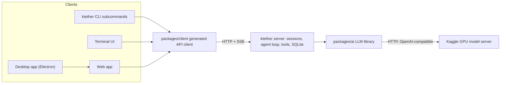
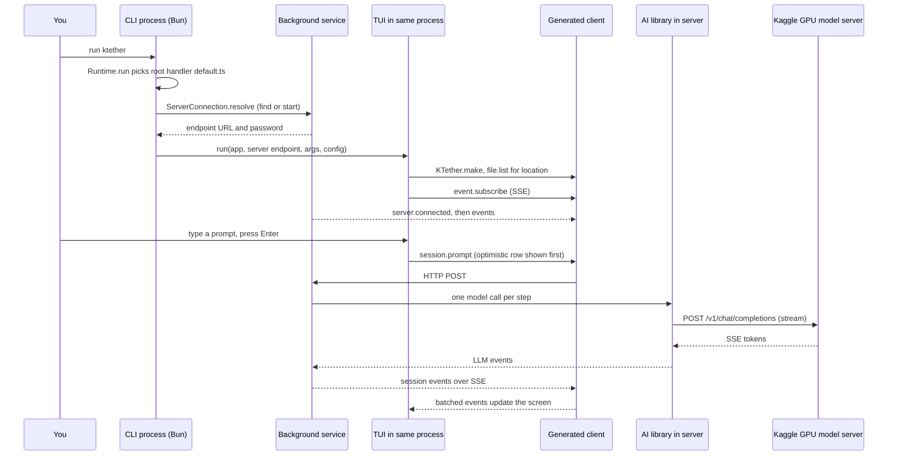

# 12. Clients and user interfaces

This chapter explains every package in `packages/` that a person actually looks at or types into: the command line (`cli`), the terminal UI (`tui`), the browser and desktop apps (`app`, `desktop`) and the libraries they share. It is written for someone who has never opened this repository.

ktether is a coding agent. You give it a task in plain English, and it reads files, runs commands and edits code, using a large language model (LLM) to decide what to do. ktether is a fork of OpenCode (MIT licence), heavily trimmed. Its product goal is to run open-source models such as Qwen3.6-27B on Kaggle's free dual-T4 GPUs and use them as the agent's model. How the Kaggle side works is covered in `docs/04-kaggle-pipeline.md`. This chapter only covers the programs that *talk to* that machinery.

Throughout, paths are relative to the repository root, `C:\Users\suggu\Projects\ktether`.

## Contents

1. Vocabulary
2. The big picture: one server, many clients
3. Status: what is adapted and what is dormant
4. How a client finds and talks to the server
5. `packages/cli`: the command line
6. `packages/tui`: the terminal UI
7. The browser and desktop family: `app`, `desktop`, `ui`, `session-ui`, `gui-extensions`, `storybook`
8. Small libraries: `theme`, `merman`, `latex`, `plugin-browser`, `codemode`, `simulation`
9. Walkthrough: what happens when you run `ktether`
10. Starting things in development
11. Where a newcomer should start reading

## 1. Vocabulary

| Term | Meaning |
| --- | --- |
| Monorepo | One git repository holding many packages. Here, every folder under `packages/` is a package with its own `package.json`. Packages import each other by name, for example `@ktether/client`. |
| Workspace | The Bun feature that links those packages together. The root `package.json` declares `"workspaces": { "packages": ["packages/*"] }`. |
| Bun | The JavaScript/TypeScript runtime and package manager this repository uses instead of Node.js plus npm. `bun run <script>` runs a script from a `package.json`. |
| Server | The ktether process that owns sessions, runs the agent loop, stores data in SQLite and exposes an HTTP API. Clients never run the agent themselves. |
| Client | Anything that talks to that API: the TUI, the CLI sub-commands, the web app, the desktop app. |
| TUI | Terminal user interface. A full-screen program drawn with text characters, as opposed to a graphical window. |
| OpenTUI | The third-party library (`@opentui/core`, `@opentui/solid`, `@opentui/keymap`) that gives the TUI a screen buffer, mouse and keyboard handling and layout boxes. |
| SolidJS | A reactive UI framework. You write components as functions that return a tree of elements, and the framework re-runs only the parts that depend on a changed value (a "signal"). The TUI uses SolidJS to drive OpenTUI instead of the browser DOM, and the web app uses it to drive the DOM. |
| Context (SolidJS) | A way to make a value, such as the server client or the theme, available to every component below some point in the tree without passing it through each level. |
| Effect | A TypeScript library for describing programs as values that can fail, be retried or be interrupted. You will see `Effect.gen(function* () { ... })` and `yield*` in the CLI and server. Read `yield*` as "run this and give me its result". |
| Session | One conversation between you and the agent, stored on the server. |
| Generated client | `packages/client` contains code generated from the server's API definition, so clients get typed methods such as `api.session.prompt(...)`. |
| SSE | Server-Sent Events: a long-lived HTTP response through which the server pushes events to the client one by one. |

## 2. The big picture: one server, many clients



Key points:

- The agent loop lives in the server (`packages/core`, `packages/server`). A client's job is to show state and send commands. That is why the TUI, the CLI and the web app can all show the same live session.
- Clients reach the server only through `packages/client`. The repository rule in `AGENTS.md` is: client runtime code may depend on Schema and Protocol but never on Core or Server. The `cli` package is the exception that proves the rule: it also *starts* the server (`ktether serve`), so it imports `@ktether/server/process`, but only lazily and only for the `serve` command (see `packages/cli/src/server-process.ts`).
- The desktop app wraps the web app. Electron's renderer process loads the same Solid code from `packages/app`.

## 3. Status: what is adapted and what is dormant

Plainly:

- **`cli` and `tui` are the live clients.** They contain the Kaggle-specific work: the `ktether gpu ...` command group (`packages/cli/src/commands/handlers/ktether/`), and the `/ktether`, `/ktether-start` and `/ktether-stop` slash commands plus the dialog `packages/tui/src/component/dialog-ktether.tsx`.
- **`app`, `desktop`, `ui`, `session-ui` and `gui-extensions` are retained as future clients. They have not been adapted to the Kaggle workflow yet.** Their provider-connect dialogs still contain dormant logic from upstream's hosted providers. Specifically:
  - `packages/app/src/providers/connect/dialog.tsx` still has branches for `props.provider === "ktether-go"` (lines near 1178 and 1536), `props.provider === "anthropic"` (near 1543) and `provider === "openai" && methodID === "chatgpt-token-sharing"` (near 148), plus whole files `chatgpt-welcome.tsx` and `chatgpt-usage-limit.tsx`.
  - `packages/tui/src/component/dialog-integration.tsx` (the TUI's "Connect an integration" dialog) ranks providers with a table that still lists `"github-copilot"` and `anthropic` (near line 53). The TUI is a live client, but this dialog is the same kind of leftover.
  - No file under `packages/app/src`, `packages/desktop/src`, `packages/session-ui/src` or `packages/gui-extensions/src` calls the `ktether` API group. I checked with `grep -rnE "api\.ktether\.|\.ktether\.(status|start|stop|models|doctor|reconnect|clean)\("` over those four folders and it returned nothing. So none of the web or desktop UI can show or control the Kaggle GPU yet.
  - Naming trap: the app's connect dialog also has `provider.id === "ktether"` branches (for example near lines 240, 367, 565 and 1548 of `packages/app/src/providers/connect/dialog.tsx`), with a `"dialog.provider.ktether.tagline"` string and a `"ktether-go"` sibling. From the surrounding code (a featured-providers list `["ktether-go", "ktether", "anthropic", "openai", ...]`, and a comment about a Go service-account key) this is the upstream product's hosted gateway provider after the rename, not the Kaggle provider, whose id is `"kaggle"` (`packages/ai/src/providers/ktether.ts`). That reading is inferred, not confirmed against upstream.
- I did not run any of the clients while writing this chapter. Everything below is from reading code.

## 4. How a client finds and talks to the server

### 4.1 The generated client

`packages/client` is the single doorway to the server. From its `package.json` exports:

| Import | What it is |
| --- | --- |
| `@ktether/client` and `@ktether/client/promise` | Plain `fetch`-based client with no Effect dependency. `KTether.make({ baseUrl, headers })` returns an object with groups such as `api.session`, `api.file`, `api.location`, `api.event`, `api.ktether`. |
| `@ktether/client/effect` | The same API for Effect users (the ACP command uses it). |
| `@ktether/client/solid` | SolidJS helpers: `createData` (a reactive cache of sessions and locations), `createClientConnection` (the event stream with reconnects), `createPersistentPtyClient` (terminal sockets). |
| `@ktether/client/service` and `.../effect/service` | Discovery and start-up of the *background service* (section 4.3). |

The files under `packages/client/src/promise/generated` and `packages/client/src/effect/generated` are generated. The project rule is: after changing the server's `HttpApi`, run `bun run generate` from `packages/client`, and never edit generated files by hand.

### 4.2 Live events

A client does not poll. `createClientConnection` in `packages/client/src/solid/connection.ts` opens one long-lived stream with `api.event.subscribe(...)`. Details I verified there:

- The first event must be `server.connected`, otherwise the connection is treated as failed.
- The comment in the file says the server writes a keepalive every 15 seconds. The client aborts and reconnects if no bytes arrive for 45 seconds (`defaultIdleTimeout`).
- Events are batched into one Solid `batch(...)` every 10 ms by default so the UI does not redraw for every token.
- If the TUI was started with a managed background service, a failed connection can call `reconnect`, which re-runs service discovery.

That the transport is SSE is stated in the file's own comments and in the `SSE echo` remarks in `packages/client/src/solid/data.ts`. I did not read the server side of the stream.

### 4.3 Two ways the CLI obtains a server

All server-using CLI commands call `ServerConnection.resolve(...)` in `packages/cli/src/services/server-connection.ts`. It returns an `endpoint` (a URL plus optional Basic-auth credentials). There are three modes, checked in this order:

| Mode | How you choose it | What happens |
| --- | --- | --- |
| Explicit server | `--server <url>` | Use that URL. A password comes from `KTETHER_PASSWORD` (or `KTETHER_SERVER_PASSWORD`, see `packages/cli/src/env.ts`). The client calls `server.info` with a 5 second timeout and prints a warning, but continues, if the server's version differs from the client's. |
| Standalone | `--standalone`, or `ktether service set disabled true` | `Standalone.start()` spawns a *private* child server (`ktether serve --stdio --port 0`) with a random one-time password (`packages/cli/src/services/standalone.ts`). The child learns the client exited because its stdin pipe closes, so it dies with the client. |
| Background service (default) | nothing | Find or start the shared long-lived server through `Service.ensure(...)` from `@ktether/client/effect/service`. |

Flags `--standalone` and `--server` live in a shared `ServerParams` object at the top of `packages/cli/src/commands/commands.ts` and are attached to each command that needs a server.

**The background service.** Running `ktether serve --service` starts a server that writes a registration file (URL, process id, password, version) into the state directory. File name logic is in `packages/cli/src/services/service-config.ts` (`filename()`), for example `service.json` for the default channels. The default port comes from `defaultPort()` there: 0xC0DE (49374) for the usual channels, 0xC0DF for `local`, and on Windows ports at or above 0xC000 are shifted into the 0xB000 block (the comments explain why). Later clients read that file, health-check the process, and reuse it. If none is healthy, `Service.ensure` spawns `ktether serve --service` (the command array is built in `ServiceConfig.options()`) and waits until the file appears.

Version handling is a policy argument, `mismatch`:

- The default TUI (`handlers/default.ts`) and `ktether mini` pass `"replace"`: if the running service's version differs from this client, stop it and start a new one, printing "Restarting background server (version mismatch)...".
- Most other commands default to `"ignore"`: use whatever is running.
- `"error"` exists too: fail if there is a mismatch.

The root script `bun run dev:live` (section 10) relies on this: it points the dev TUI at the already-running installed service with an explicit `--server`, which warns but never replaces it.

Because the TUI, a `ktether gpu status` in another terminal and a browser tab all connect to the same background service, they all see the same Kaggle GPU state.

## 5. `packages/cli`: the command line

**Purpose.** The `ktether` executable. With no arguments it opens the TUI. With a sub-command it does one job and exits. It also hosts the server (`ktether serve`).

**Runs where.** In a terminal, under Bun (`#!/usr/bin/env bun` at the top of `packages/cli/src/index.ts`). There is also a Node build (`build:node` script; entries in `packages/cli/src/node/`) which I did not examine.

### 5.1 What is inside

| Path | What it holds |
| --- | --- |
| `packages/cli/src/index.ts` | The entry point. Builds the handler map, wires the services (config, updater, global paths, logging) and runs the command. |
| `packages/cli/src/commands/commands.ts` | The **single command tree**: every command, flag and argument as data. About 625 lines. |
| `packages/cli/src/framework/spec.ts` | `Spec.make(name, { description, aliases, params, commands })`: a tiny helper over Effect's CLI library that builds one node of that tree. |
| `packages/cli/src/framework/runtime.ts` | `Runtime.handlers(...)`, `Runtime.handler(...)` and `Runtime.run(...)`: attaches a lazily imported handler to each node and runs the whole tree. |
| `packages/cli/src/commands/handlers/` | One file per command (`default.ts`, `run.ts`, `serve.ts`, `mini.ts`, `pair.ts`, folders `auth/`, `session/`, `service/`, `plugin/`, `mcp/`, `debug/`, and `ktether/` for `gpu`). |
| `packages/cli/src/services/` | Server discovery (`server-connection.ts`, `standalone.ts`, `service-config.ts`, `service-registration.ts`), the self-updater (`updater.ts`), remote pairing (`remote-tunnel.ts`), serving the web UI files (`web-ui.ts`). |
| `packages/cli/src/server-process.ts` | What `ktether serve` actually does: choose host/port/password, import `@ktether/server/process`, start it. |
| `packages/cli/src/run/` | The non-interactive `ktether run "message"` renderer. |
| `packages/cli/src/mini.ts`, `mini-host.ts` | Entry for the "minimal interactive interface" (`ktether mini`), which lives in `packages/tui/src/mini/`. |
| `packages/cli/src/acp/` | An Agent Client Protocol server (`ktether acp`) so editors can drive ktether. |
| `packages/cli/src/config/` | Reading and writing the user's config. |
| `packages/cli/dev/` | The Vite hot-reload launcher for the TUI (`README.md` in that folder describes it). |

### 5.2 The command framework

Three layers, each small:

1. **Describe** (`commands.ts`). A command is `Spec.make("name", { description, params, commands: [...] })`. `params` are Effect CLI flags and arguments. Example of the Kaggle group, shortened:

```ts
Spec.make("gpu", {
  description: "Run models on a free Kaggle GPU",
  commands: [
    Spec.make("start", {
      description: "Start the remote Kaggle GPU backend",
      params: { ...ServerParams, model: Flag.String("model").pipe(/* default "qwen3.6-27b" */), /* timeout ... */ },
    }),
    Spec.make("stop", { /* --delete */ }),
    // clean, status, reconnect, doctor, models
  ],
}),
```

The exported value is `export const Commands = Root` where `Root` is the top-level `ktether` node. The root node itself takes `directory`, `--continue/-c`, `--session/-s`, `--prompt`, `--auto` and the server flags, because running `ktether` with no sub-command is the TUI.

2. **Attach handlers** (`index.ts`). `Runtime.handlers(Commands, { $: () => import(".../default"), upgrade: () => import(...), gpu: { start: () => import(".../ktether/start"), ... }, serve: ... })`. Two things to know:
   - The key `$` means "the handler for this node itself" when the node also has children. For the root, `$` is the TUI.
   - Every handler is a *dynamic import*, so `ktether --version` does not load the TUI, the server or the Kaggle code. This is a deliberate start-up speed rule, stated in the repository's style guide.
   - The `Handlers<Node>` type in `framework/runtime.ts` requires a loader for every leaf command, and requires an entry for each child of a node that has children (only `$` is optional). So adding a command to `commands.ts` without a handler in `index.ts` fails type-checking. I read the type but did not run the type-checker.
3. **Write the handler** (`handlers/...`). Each file default-exports `Runtime.handler(Commands.commands.run, (input) => Effect.gen(...))`. `input` is fully typed from the spec. The handler for `ktether run` is a good first read: about 30 lines.

To add a command: add a `Spec.make` in `commands.ts`, add a file in `handlers/`, add the loader line in `index.ts`.

The top-level command list (from `commands.ts`) is: `upgrade` (alias `update`), `uninstall`, `acp`, `api`, `debug`, `auth`, `mcp`, `plugin`, `models`, `stats`, `mini`, `run`, `session`, `service`, `reload`, `pair`, `gpu`, `serve`. In plain words: `api` sends a raw request to the running server, `auth` manages integration credentials, `mcp` manages Model Context Protocol tool servers, `plugin` manages plugins, `session` lists, exports and imports sessions, `service` controls the background server, `pair` prints one-time links to connect a browser or app, and `reload` reloads configuration.

### 5.3 The Kaggle commands, for orientation only

`ktether gpu start|stop|clean|status|reconnect|doctor|models` are implemented in `packages/cli/src/commands/handlers/ktether/`. Each one calls `connect(...)` in `connection.ts`, which is just `ServerConnection.resolve(...)` followed by `KTether.make(...)`. In other words the CLI does not run Kaggle code itself: it asks the server (through the `ktether` API group) to do it. The pipeline itself is documented in `docs/04-kaggle-pipeline.md`.

### 5.4 Dev, build and bin

- `bun run dev` from the repo root runs `bun run --cwd packages/cli src/index.ts`, so `bun run dev gpu status` behaves like `ktether gpu status`.
- `packages/cli/bin/ktether.cjs` is the launcher shim in the published npm package. It is a small Node script (not Bun) that finds a prebuilt platform binary: the `KTETHER_BIN_PATH` environment variable, a cached `.ktether` file next to the script, or a `node_modules/@ktether/cli-<platform>-<arch>` package (with `-baseline` and `-musl` variants chosen by CPU feature and libc checks), then spawns it with your arguments and forwards `SIGINT`, `SIGTERM` and `SIGHUP`. So an installed `ktether` runs a compiled executable, not `src/index.ts`. `ktether2.cjs` is three lines: it just `require`s `./ktether.cjs`.
- `build` runs `script/build.ts` (compiles a single executable). Not examined.

## 6. `packages/tui`: the terminal UI

**Purpose.** The full-screen interface you get from plain `ktether`: home screen, session view with tabs, prompt composer, dialogs, command palette.

**Runs where.** Inside the same Bun process as the CLI command that started it (`packages/cli/src/commands/handlers/default.ts` imports `run` from `@ktether/tui` and calls it). It is a client: it talks to the server only through `@ktether/client`.

### 6.1 Start-up

`packages/tui/src/index.tsx` re-exports `run` from `app.tsx`. `run(input)` is an Effect program (`Effect.fn("Tui.run")`). In order:

1. Read config, create the API client: `KTether.make({ baseUrl, headers })`.
2. Ask the server for the working directory's location (`api.file.list({ location: { directory: process.cwd() } })`, falling back to `api.location.get()`).
3. Create an OpenTUI renderer with `createCliRenderer(...)` (60 fps target, Kitty keyboard protocol, mouse on depending on config). If the environment variable `KTETHER_DRIVE` is set it instead creates a scripted renderer from `@ktether/simulation/frontend` (section 8.6).
4. Call `render(() => <...providers... <App /> ...>, renderer)` from `@opentui/solid`. The JSX is a very deep nest of providers, then `App`.
5. Wait until the renderer is destroyed, then print the exit reason or epilogue.

The `TuiInput` type in `app.tsx` is the whole contract between the CLI and the TUI: the server endpoint (and optional `reconnect`/`restart` callbacks for a managed service), `args` (`continue`, `sessionID`, `prompt`, `auto`), config accessors, an `updater`, a package installer for plugins, and a `log` sink. The TUI never imports CLI code.

### 6.2 Contexts: the TUI's shared state

SolidJS context providers wrap the app; `useX()` hooks read them. They are built with a tiny helper, `createSimpleContext` in `packages/tui/src/context/helper.tsx`, which returns `{ provider, use }` and throws if `use` is called outside its provider. Files in `packages/tui/src/context/`:

| File | Role |
| --- | --- |
| `client.tsx` | Holds the API client and the live-event connection (wraps `createClientConnection`). `useClient().api` is the generated client. |
| `data.tsx` | Wraps `createData` from `@ktether/client/solid`: the reactive cache of sessions, messages, locations. Components read `data.session.get(id)`; they do not fetch by hand. |
| `route.tsx` | Which screen is showing. A route is one of `{type:"home"}`, `{type:"session", sessionID}`, `{type:"plugin", id, name, data}`. `route.navigate(...)` swaps it. |
| `keymap.tsx` | Commands and key bindings (below). |
| `theme.tsx` | Current theme, light/dark mode, `useTheme()`. |
| `local.tsx` | The current agent, model and variant selection. |
| `session-tabs.tsx`, `session-terminals.tsx` | The tab strip and embedded terminals. |
| `storage.tsx` | Client-local persisted state such as pane widths. |
| `permission.tsx`, `attention.tsx`, `update-notification.tsx`, `args.tsx`, `exit.tsx`, `clipboard.tsx`, `log.tsx`, `runtime.tsx` | Smaller concerns. |

### 6.3 Routes and screens

`App()` in `packages/tui/src/app.tsx` picks a screen with Solid's `<Switch>`:

```tsx
<Switch>
  <Match when={route.data.type === "home"}> <Home /> </Match>
  <Match when={route.data.type === "session"}> ... <SessionFrame sessionID={sessionID} .../> ... </Match>
  <Match when={route.data.type === "plugin"}> <PluginRoute fallback={...} /> </Match>
</Switch>
```

- Home: `packages/tui/src/routes/home.tsx` (logo, prompt box, example placeholders). Submitting here creates a session.
- Session: `packages/tui/src/routes/session/` (about 3,600 lines in `index.tsx` alone, plus message rendering, permission prompts, sidebar, timeline dialogs). Wrapped by `packages/tui/src/component/session-frame.tsx`.
- Plugin routes: a built-in or user plugin can register a whole screen. The storybook (section 6.7) uses this.

### 6.4 Dialogs

A dialog is a modal box. `DialogProvider` and `useDialog()` are in `packages/tui/src/ui/dialog.tsx`. You open one with `dialog.replace(() => <DialogSomething />)` and close with `dialog.clear()`. Reusable parts: `DialogSelect` (searchable list), `DialogHeader`, `DialogLayout`, `DialogFooter`. Concrete dialogs live in `packages/tui/src/component/dialog-*.tsx` (sessions, models, agents, themes, MCP, settings, status, pair, and `dialog-ktether.tsx`).

`dialog-ktether.tsx` is the Kaggle status panel. It polls `client.api.ktether.status()` every 2 seconds (`POLL_MILLIS`) while open and renders state (ready/pending/unreachable), model, uptime, slots, latency and GPU hours used. It splits into `DialogKTether` (polling) and `KTetherStatusView` (pure display from data), so the view can be rendered from fixed data in tests or stories.

### 6.5 Commands, the palette and slash commands

One list of commands feeds three things: key bindings, the command palette, and `/slash` commands in the prompt.

- Commands are objects registered in a *layer* with `Keymap.createLayer(() => ({ mode: "global", commands: [...] }))` (`packages/tui/src/context/keymap.tsx`, built on `@opentui/keymap`). The app's own commands are in `appCommands` in `app.tsx`. Each looks like:

```tsx
{
  name: "ktether.start",
  title: "Start Kaggle GPU",
  slash: { name: "ktether-start" },
  run: () => {
    client.api.ktether.start({}).then(() => dialog.replace(() => <DialogKTether />)).catch(toast.error)
  },
  category: "System",
},
```

  A `.map(...)` at the end turns `name` into `id`, `category` into `group`, and sets `palette: true` and `bind: false` unless overridden.
- The **command palette** (`packages/tui/src/component/command-palette.tsx`) lists every registered command that has `palette` set, with a search box, the user's shortcuts, and a "Suggested" section driven by each command's `suggested` flag. Selecting one calls `command.run()`.
- **Slash commands** come from the `slash: { name, aliases, arguments? }` field on a command. When you type `/` in the prompt, `packages/tui/src/component/prompt/autocomplete.tsx` builds the suggestion list from those fields (around line 476). Selecting an entry runs the command.
- **Key bindings** are separate from commands. Default keys are defined in `packages/tui/src/config/keybind.ts` (for example `"ktether.status": keybind("<leader>s", "View status")`), and arrays such as `appGlobalBindingCommands` in `app.tsx` say which commands get bound.

The Kaggle additions: `ktether.status` ("Kaggle GPU status", slash `/ktether`), `ktether.start` (`/ktether-start`), `ktether.stop` (`/ktether-stop`).

One thing to watch (see the end of the chapter): the GPU commands (`ktether.gpu.status`, `ktether.gpu.start`, `ktether.gpu.stop`) do not appear in the binding arrays, so they are palette and slash commands only.

### 6.6 Theme tokens

Colors are chosen by *role*, not by value. The `packages/theme` package (`packages/theme/src/tui/`: `schema.ts`, `types.ts`, `resolve.ts`, `expand.ts`, `v1-migrate.ts`) defines the token vocabulary and resolves a theme document into concrete `RGBA` colors for light and dark mode. The resolved shape (`ResolvedThemeTokens` in `types.ts`) includes:

- `text.base | muted | faint`, `text.action[variant]`, `text.formfield`, `text.feedback[kind].base | muted`
- `background.base`, `background.raised.base | high | max`, `background.action[...]`, `background.formfield`, `background.feedback[kind].base`
- `border`, `scrollbar`, `diff.*`, `syntax.*`, `markdown.*`, plus `hue` scales and `categorical` colors.
- `theme.surface("dialog")` returns the same theme resolved for a raised surface. Dialog code uses it, for example `const theme = useTheme().surface("dialog")` in `dialog-ktether.tsx`.

Rules from the repository's `AGENTS.md`: choose a token by semantic role; never reach for raw `theme.hue`; use `text.feedback` and `background.feedback` only for outcomes such as errors, warnings and success; use `formfield` tokens for form controls and `action` for actions; if no token fits, extend the theme schema first. `dialog-ktether.tsx` follows this: it uses `theme.text.feedback.success.base` for "ready", `.error.base` for "unreachable" and `.warning.base` for "pending".

Built-in themes are JSON files in `packages/tui/src/theme/assets/` (33 JSON files, such as `dracula.json` and `catppuccin.json`) and `assets/v2/ktether.json`. `packages/tui/src/theme/index.ts` merges defaults, the ktether theme, custom files and a generated "system" theme. User themes go in the config directory, with an example in `.ktether/themes/mytheme.json`.

### 6.7 Plugins and the storybook

The TUI has a plugin host (`packages/tui/src/plugin/`, API types in `packages/plugin/src/tui`). The built-ins in `packages/tui/src/plugin/builtins.ts` are sidebar sections, a diff viewer, notifications, stats, and two code-block renderers, `@ktether/merman` (Mermaid diagrams) and `@ktether/latex` (maths). A built-in storybook plugin is added only when `process.env.KTETHER_STORY` is set. A "story" is a full-screen, fixture-driven demo of one real component, registered in `packages/tui/src/feature-plugins/system/storybook/index.tsx`.

Note: the root `AGENTS.md` says `OPENCODE_STORY=<story-id> bun run dev:live`, but both `app.tsx` and `builtins.ts` read `KTETHER_STORY`. Use `KTETHER_STORY`. `KTETHER_STORY=1` opens the index and any other value opens that story.

### 6.8 Other things in the package

- `packages/tui/src/mini/`: the "mini" interface (`ktether mini`, described in `commands.ts` as "the minimal interactive interface"). Its file names (`scrollback.writer.tsx`, `footer.*.tsx`) suggest it writes into the terminal's scrollback with a small footer instead of taking over the whole screen; I did not verify this.
- `packages/tui/src/prompt/`: prompt parsing, history, frecency and stash.
- `packages/tui/src/config/`: TUI config schema, including `v1/` for an older format.
- `packages/tui/test/`: tests that use OpenTUI's test renderer; the repository's `.ktether/skills/tui-tests/SKILL.md` explains the rules.

## 7. The browser and desktop family

These five packages (plus `storybook`) are the graphical side. As said in section 3, they are retained but not yet adapted to Kaggle.

### 7.1 `packages/app`: the web app

- **Purpose.** The graphical client: a SolidJS single-page app with a shell, tabs, composer, session timeline, settings and server management.
- **Runs where.** In a browser. The CLI can serve it: `packages/cli/src/services/web-ui.ts` serves embedded static files for every path except `/api`, `/auth/` and `/openapi.json`, which go to the API (read from the code at the top of that file). `ktether pair` prints links to open it.
- **Inside.** `src/entry.tsx` (mount, service worker, optional Sentry hook which only runs when `VITE_SENTRY_DSN` is set), `src/app.tsx`, `src/shell/` (layout, tabs, routes, titlebar), `src/session/`, `src/composer/`, `src/settings/`, `src/providers/` (the dormant provider-connect UI), `src/servers/` (saved server connections), `src/runtime/` (platform, persistence, i18n, and `runtime/server/api.ts` which wraps `KTether.make` from `@ktether/client/promise`), and `src/runtime/extension/` (the host for `gui-extensions`).
- **Server link.** `createApiForServer` in `packages/app/src/runtime/server/api.ts` builds a `KTether` client for a saved server connection, and its auth is a Basic token of `ktether:<password>`.
- **Develop.** `bun run dev:web` from the root (runs `vite` in `packages/app`). The package's own `AGENTS.md` describes running a backend at port 4096 (`bun dev serve --port 4096`) and the app at 4444. That file also mentions `ktether dev web`, but `commands.ts` has no `dev` command, so I believe that line is stale.
- **Start reading.** `packages/app/AGENTS.md`, then `src/app.tsx`.

### 7.2 `packages/desktop`: the Electron app

- **Purpose.** Wraps the web app in a native window (Electron is a toolkit that bundles a Chromium browser and Node.js into one desktop program).
- **Runs where.** The renderer imports code from the app package (`packages/desktop/src/renderer/desktop-app.tsx` imports `@ktether/app/desktop`). Three Electron processes: `src/main/` (the main process: windows, native menus, SQLite storage, IPC handlers, GUI extension host), `src/preload/` (a bridge exposing `window.electron`), `src/renderer/` (the web UI).
- **Server link.** `src/main/service/` manages the "sidecar": `background-service.ts` finds or starts the same background service the CLI uses, and `desktop-cli.ts` resolves the bundled CLI binary. The renderer reaches the main process only through `window.electron` and a MessagePort RPC client (rule in the package's `AGENTS.md`).
- **Develop.** `bun run dev:desktop` (runs `bun scripts/dev.ts` in `packages/desktop`). The script sets `KTETHER_CHANNEL=local` and an isolated server, and has `--build-server` and `--download-server` options.
- **Possible build blockers (not verified by running a build).** `src/main/service/desktop-cli.ts` imports `../../../../../install?raw`, which would be a file named `install` at the repository root, and `ls` shows no such file. `scripts/utils.ts` (`downloadCliToResources`) installs a published `@ktether/cli-*` package from npm, which probably does not exist yet.

### 7.3 `packages/ui`: shared components

- **Purpose.** A SolidJS component library (buttons, dialogs, fields, tables, diff and file views, icons, i18n helpers, theme CSS) shared by `app`, `session-ui` and the storybook.
- **Runs where.** Browser only.
- **Inside.** `src/actions/`, `src/forms/`, `src/overlays/`, `src/data-display/`, `src/layout/`, `src/navigation/`, `src/icons/`, `src/theme/`, `src/i18n/`, `src/styles/`, and `src/storybook/` fixtures. The `package.json` `exports` map lists each component by path (for example `./button`, `./dialog`).
- **Rules to know.** Its `AGENTS.md` forbids hard-coded user-visible English strings (use i18n keys) and sets text line-height rules.

### 7.4 `packages/session-ui`: the conversation view

- **Purpose.** Components that render one session: message parts, tool calls, the timeline, dock prompts, file and diff presentations.
- **Runs where.** Browser only (the TUI has its own renderer in `packages/tui/src/routes/session/`).
- **Inside.** `src/timeline/`, `src/message/`, `src/tools/`, `src/components/`, `src/pierre/` (diff rendering glue), `src/v2/`, `src/storybook/`. It imports `@ktether/ui`; `src/import-boundaries.test.ts` guards allowed imports.

### 7.5 `packages/gui-extensions`: features as extensions

- **Purpose.** Every non-core feature of the desktop and web app is an *extension* built on one SDK: terminal, review, files, browser, SSH, WSL, pairing, updater, and more (`ls packages/gui-extensions/src`).
- **Runs where.** Both: a `renderer.tsx` part runs in each window, an optional `main.ts` part runs in Electron's main process, and the two talk through a typed IPC contract. Hosts live in `packages/app/src/runtime/extension/` and `packages/desktop/src/main/extension/`.
- **Start reading.** `packages/gui-extensions/README.md` is a full author guide with diagrams, and `AGENTS.md` lists the rules (one folder per extension with `index.ts`, `contract.ts`, `renderer.tsx`, `main.ts`, `i18n/`). `src/pairing/` is the worked example.

### 7.6 `packages/storybook`

- **Purpose.** A Storybook workspace for browsing `ui` and `session-ui` components in isolation, and the host for the Playwright component tests found in the `component-tests` folders.
- **Runs where.** Browser, on port 6006: `bun run dev:storybook` from the root. Configuration is in `packages/storybook/.storybook/main.ts`.
- Not to be confused with the TUI storybook in section 6.7.

## 8. Small libraries

### 8.1 `packages/theme`

Described in section 6.6. A pure library (no UI): parse a theme document, expand palettes, resolve tokens for light/dark, migrate the older v1 theme format (`./tui` and `./tui/v1` exports). Used by `packages/tui`. A script `script/build.ts` builds it. Tests: `packages/theme/test/theme.test.ts`.

### 8.2 `packages/merman`

Renders Mermaid diagrams as text art in the terminal. The plugin entry `src/plugin.ts` registers a code-block renderer for the language `mermaid` on the TUI markdown pipeline. It has per-diagram folders `flowchart/`, `sequence/`, `state/`, `gantt/`, `gitgraph/`, `timeline/`, a shared `core/`, and a palette that maps TUI theme tokens to diagram colors (`src/palette.ts`). Runs in the terminal only. This is why a model that writes a Mermaid block shows as a diagram in the TUI.

### 8.3 `packages/latex`

Same idea for maths. `src/plugin.ts` registers renderers for `latex` and `math` code blocks. It has its own parser, layout and symbol tables (`parser.ts`, `layout.ts`, `symbols.ts`, `render.ts`) and draws with terminal characters. Terminal only.

### 8.4 `packages/plugin-browser`

Despite the name, this is not a client UI. It is a *server-side plugin* (`id: "ktether.browser"` in `src/index.ts`) that exposes the desktop app's built-in browser to the agent as tools (`tabs.open`, `snapshot`, `click`, `screenshot`, network and performance inspection and so on; list in its `README.md`). The server owns tool registration and permission; the desktop owns tabs and the Chrome DevTools Protocol. Core registers it (`packages/core/src/plugin/internal.ts`). It only makes sense with the desktop app, so it is dormant in a terminal-only workflow.

### 8.5 `packages/codemode`

**What it is.** A small, pure interpreter for a JavaScript-like language, written so a model can run *one program that calls many tools* instead of making one tool call per turn. Its `README.md` says it is "our take on code mode", an idea credited to Cloudflare.

**How it works.** It does not try to sandbox real JavaScript. It only executes the language features it implements itself (parser: `acorn`; evaluator under `src/interpreter/`). Programs have no network, filesystem, process, timers or imports. The only way to affect the world is through tools the host passes in. A tool is defined with `Tool.make({ description, input, output, execute })` using Effect schemas; the model sees them as `tools.orders.lookup({ id })`. Quick start from the README:

```ts
const runtime = CodeMode.make({ tools: { orders: { lookup: lookupOrder } } })
const result = await Effect.runPromise(runtime.execute(`
  const order = await tools.orders.lookup({ id: "order_42" })
  return { id: order.id, needsAttention: order.status !== "complete" }
`))
```

Without an explicit `return`, the last top-level expression is the result. Unfinished async work is interrupted when the program ends. Supported syntax is tracked in `interpreter-support.md`.

**Where ktether uses it.** `packages/core/src/codemode/` (`tool.ts`, `catalog.ts`, `instructions.ts`, `web.ts`) turns codemode into an agent tool called "execute" whose output carries the run's result, the list of tool calls it made and any files. The browser plugin (8.4) documents its tools as codemode snippets. I did not trace how the session decides when to expose it to the model.

### 8.6 `packages/simulation`

**What it is.** A test harness that lets an automated *driver* control a real ktether TUI and a real server while *pretending to be the LLM*. It is named "drive" in its code (`KTETHER_DRIVE`, `DriveManifest`, `Drive.create`).

**Two halves.**

- Backend (`packages/simulation/src/backend/`): when the server is started with `simulation: true` (the CLI sets this from `process.env.KTETHER_SIMULATE`, see `packages/cli/src/server-process.ts`, and `packages/server/src/routes.ts` then dynamically imports `@ktether/simulation/backend`), outbound HTTP is replaced. `SimulationNetwork` answers only a fixed route table and denies unknown destinations. `SimulationOpenAI.route(...)` serves an OpenAI-style endpoint whose answers come from a driver connected over a WebSocket (`SimulatedProvider.layerDrive`). So every model response in the test is scripted.
- Frontend (`packages/simulation/src/frontend/`): when `KTETHER_DRIVE` is set, the TUI (`packages/tui/src/app.tsx`) builds its renderer through `Drive.create`, which optionally runs headless and starts a second WebSocket control server. Actions include `ui.type`, `ui.press`, `ui.click`, `ui.resize`, `ui.snapshot`, `ui.capture` (names in `packages/protocol/src/simulation.ts`).

The default endpoints are `ws://127.0.0.1:40900` (UI) and `ws://127.0.0.1:40950` (backend) from `packages/simulation/src/manifest.ts`; only loopback endpoints are accepted.

**Where it is used.** `script/drive/subagent-eviction.ts` and its `.md` are an example proof script. They run under an external tool called `ktether-drive` which is not in this repository (I did not verify it exists anywhere else). Real LLM calls never go through this package; it is for deterministic end-to-end tests and demos. It does not matter for normal use.

## Package summary table

| Package | Runs in | Talks to the server? | Dev or test command (from the package folder unless noted) | Start reading |
| --- | --- | --- | --- | --- |
| `cli` | Terminal, Bun | Yes, via `@ktether/client`; also hosts the server (`serve`) | `bun run dev` (the root script runs it); `bun test --timeout 30000 --only-failures` | `src/commands/commands.ts`, `src/index.ts` |
| `tui` | Terminal, inside the CLI process | Yes, via `@ktether/client` | No own dev script: use root `bun run dev` or `dev:live`; `bun test --timeout 30000 --only-failures` | `src/app.tsx` |
| `app` | Browser | Yes, via `@ktether/client/promise` | `bun run dev` (vite); `bun run test:unit`, `test:browser`, `test:e2e` | `AGENTS.md`, `src/entry.tsx` |
| `desktop` | Electron (main, preload, renderer) | Yes: the renderer uses the app code; the main process manages the background service | `bun run dev` (`scripts/dev.ts`); `bun test --timeout 30000` | `src/main/index.ts`, `src/main/service/` |
| `ui` | Browser (library) | No | `bun run dev` (vite); `bun test src --only-failures` | `src/actions/`, `package.json` exports |
| `session-ui` | Browser (library) | No (receives data from `app`) | `bun test src --only-failures`; `bun run test:components` (Playwright) | `src/timeline/`, `src/message/` |
| `gui-extensions` | Browser window and Electron main | Indirectly, through the hosts in `app` and `desktop` | `bun test` | `README.md` |
| `storybook` | Browser, port 6006 | No | root `bun run dev:storybook` (runs `storybook dev -p 6006`) | `.storybook/main.ts` |
| `theme` | Terminal (library inside the TUI) | No | `bun test --timeout 30000` | `src/tui/types.ts` |
| `merman` | Terminal (TUI plugin) | No | `bun test --timeout 30000 --only-failures`; `bun run audit:layouts` | `src/plugin.ts`, `src/markdown.ts` |
| `latex` | Terminal (TUI plugin) | No | `bun test --timeout 30000 --only-failures` | `src/plugin.ts`, `src/markdown.ts` |
| `simulation` | Both ends: inside the server (backend) and inside the TUI (frontend) | Not a client; it replaces the server's outbound network and drives the TUI over WebSockets | `bun test --timeout 30000 --only-failures` | `src/backend/index.ts`, `src/frontend/simulation.ts` |
| `codemode` | Inside the server (a library used by `packages/core`) | No | `bun test` | `README.md` |
| `plugin-browser` | Inside the server, connecting to the desktop app | It is part of the server side | `bun test` | `README.md`, `src/index.ts` |

Where a cell says "No", the package has no dev server of its own: it is a library that another program loads. All commands come from each package's `package.json` `scripts`, which I read, but I did not run any of them.

## 9. Walkthrough: what happens when you run `ktether`

Assume a fresh terminal on a project folder, and that you have already run `ktether gpu start` once so a Kaggle GPU is up (that part is in `docs/04-kaggle-pipeline.md`).



Step by step, with files:

1. **The shell starts the program.** An installed `ktether` runs `packages/cli/bin/ktether.cjs`, which spawns the prebuilt platform executable (section 5.4); that executable is the compiled form of `packages/cli/src/index.ts`. I did not read the build script, so that last part is inferred from the `#!/usr/bin/env bun` entry file and the `build` script name. In development, `bun run dev` runs `packages/cli/src/index.ts` directly.
2. **Parse and dispatch.** `index.ts` builds `Handlers` and calls `Runtime.run(Commands, Handlers, ...)`. With no sub-command, the root node's `$` handler is selected: `commands/handlers/default.ts`, loaded by dynamic import.
3. **Connect to a server.** `default.ts` calls `ServerConnection.resolve({ mismatch: "replace", ... })`. Unless you passed `--server` or `--standalone`, this reads the registration file for your channel, health-checks it, and starts `ktether serve --service` if needed. If a restart is needed it prints "Starting background server..." to stderr.
4. **Resume a session, maybe.** If you passed `--session`, `findSession` checks whether it exists; if not the ID is used for the new session the first prompt creates.
5. **Background update checks.** `default.ts` forks an updater that re-checks every 10 minutes. (Check `packages/cli/src/services/updater.ts` before relying on this: the commit history says the updater was changed to stop contacting upstream release servers, and I did not read what it contacts now.)
6. **Hand over to the TUI.** `default.ts` calls `run({ app, server, args, config, updater, packages, environment, log, ... })` from `@ktether/tui`.
7. **Draw.** `app.tsx` creates the renderer, mounts the provider tree and `App`. `ClientProvider` creates the event stream; `DataProvider` creates the reactive cache. `Home` is the default route (or `Session` with `--continue`).
8. **Events arrive.** `createClientConnection` receives `server.connected`, status becomes "connected", and subsequent events (session created, message updated, tool progress) are batched into the `DataProvider` store, which re-renders only the affected components.
9. **You type.** The prompt component (`packages/tui/src/component/prompt/index.tsx`) calls `data.session.prompt({ sessionID, text, files, ... })` (near line 1359). In `packages/client/src/solid/data.ts` that first shows your message immediately under a client-minted ID, then calls `api().session.prompt({ ...request, id })`. Because the server treats a reused ID idempotently, a retry cannot double-send. If the server rejects it, the row is rolled back.
10. **Server runs a step.** The server admits the prompt, schedules the session runner, builds a model request and calls `llm.stream(...)` from `packages/ai` (`packages/core/src/session/runner/step.ts`). For the Kaggle provider that is an HTTPS request to the tunnel URL. The details of that hop are the subject of `docs/13-ai-library.md`.
11. **Tool calls.** When the model asks for a tool (read a file, run a shell command), the server runs it, subject to permissions, and starts the next step. The TUI sees permission requests as events and shows `routes/session/permission.tsx`.
12. **You press `Ctrl+P` or type `/ktether`.** The palette or slash entry runs the command from `appCommands`, which opens `DialogKTether`. It polls `api.ktether.status()` through the same connection to the same server.
13. **Exit.** `ExitProvider`'s callback destroys the renderer, `run` returns, and `index.ts` calls `process.exit(...)`. The background service keeps running for the next client.

(`Ctrl+P` is the default palette binding: `"command.palette.show": keybind("ctrl+p", ...)` in `packages/tui/src/config/keybind.ts`. Users can rebind it.)

## 10. Starting things in development

From the root `package.json` scripts (verified by reading it):

| Command (from repo root) | What it starts |
| --- | --- |
| `bun install` | Install all workspace dependencies. A `postinstall` runs `bun run --cwd packages/core fix-node-pty`. |
| `bun run dev` | The CLI from source. `bun run dev` opens the TUI; `bun run dev gpu status` runs a subcommand. |
| `bun run dev serve --port 4096` | The server only (the app's `AGENTS.md` uses this). |
| `bun run dev:live` | The TUI from your worktree against the already-running installed background service, using the `dev` TUI storage channel. It shells out to `ktether service get password` and `ktether service status`, so a `ktether` binary must be on your PATH. The root `AGENTS.md` still writes these as `opencode ...`; the script itself says `ktether`. |
| `bun run dev:vite` and `dev:vite:live` | The TUI under Vite with Solid hot reload (see `packages/cli/dev/README.md`). |
| `bun run dev:web` | The web app (`packages/app`, Vite). |
| `bun run dev:desktop` | The Electron app. |
| `bun run dev:storybook` | The Storybook on port 6006. |
| `bun run typecheck`, `bun run lint`, `bun run check` | Whole-repo checks. `bun run check` is lint plus typecheck. |

Tests cannot run from the root (the `test` script exits with an error). Run `bun test` or `bun run test` from inside a package folder such as `packages/tui`.

## 11. Where a newcomer should start reading

| If you want to understand... | Read, in this order |
| --- | --- |
| How a command line becomes code | `packages/cli/src/commands/commands.ts` (skim), `packages/cli/src/index.ts`, `packages/cli/src/framework/runtime.ts`, `packages/cli/src/commands/handlers/run.ts` |
| How the CLI finds a server | `packages/cli/src/services/server-connection.ts`, `standalone.ts`, then `packages/client/src/effect/service.ts` (`ensure`) |
| The TUI's skeleton | `packages/tui/src/app.tsx` from `export const run` down to `function App()`, then `context/route.tsx`, `context/client.tsx`, `context/data.tsx` |
| One complete TUI feature end to end | `packages/tui/src/component/dialog-ktether.tsx`, then its three command entries in `app.tsx` (search `ktether.start`) |
| Sending a prompt | `packages/tui/src/component/prompt/index.tsx` (near `data.session.prompt`) and `packages/client/src/solid/data.ts` (`prompt(`) |
| Live events | `packages/client/src/solid/connection.ts` |
| Theme tokens | `packages/theme/src/tui/types.ts`, then `packages/tui/src/context/theme.tsx` |
| The web app | `packages/app/AGENTS.md`, `packages/app/src/entry.tsx`, `packages/app/src/runtime/server/api.ts` |
| GUI extensions | `packages/gui-extensions/README.md` |
| What the model library does | `docs/13-ai-library.md` |

## Things that look wrong, stale or dead

These were seen while reading and not fixed (this chapter is documentation only):

- **Duplicate command id (fixed).** The rename briefly produced two commands named `ktether.status`; the Kaggle GPU commands are now `ktether.gpu.status`, `ktether.gpu.start` and `ktether.gpu.stop`.
- The `ktether.gpu.*` commands are not in the binding-command arrays at the top of `app.tsx`, so they are palette and slash only. That is intended.
- Root `AGENTS.md` still says `opencode service status`, `opencode service get password` and `OPENCODE_STORY`; the code uses `ktether` and `KTETHER_STORY`.
- `packages/app/AGENTS.md` mentions `ktether dev web`; no `dev` command exists in `packages/cli/src/commands/commands.ts`.
- `packages/desktop/src/main/service/desktop-cli.ts` imports a root-level `install` file that does not exist; `scripts/utils.ts` downloads an npm package that probably is not published.
- `.ktether/tui.json` and `.ktether/ktether.jsonc` point `$schema` at `raw.githubusercontent.com/premsuggu/ktether/main/schema/...`; there is no `schema/` folder at the repository root, so I believe those URLs do not resolve.
- `packages/simulation/package.json` lists its repository as `github.com/anomalyco/ktether`, an upstream-looking URL.
- The dormant hosted-provider UI in `app` and `dialog-integration.tsx` (section 3).
