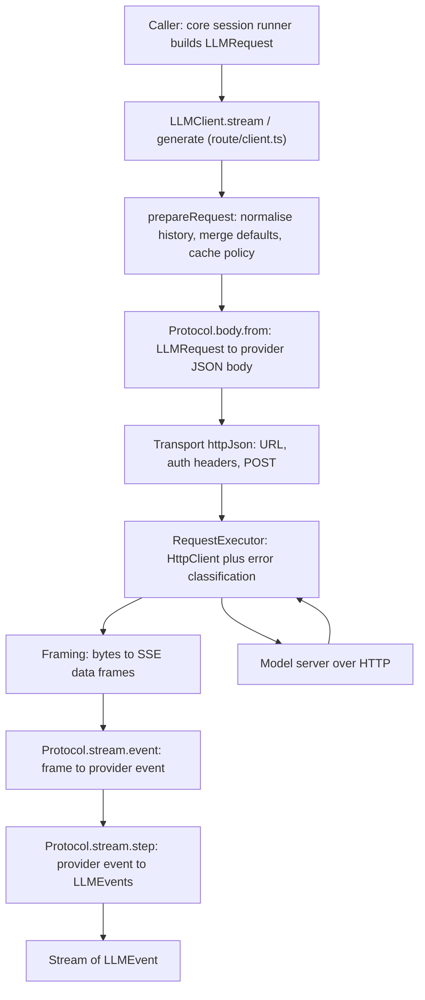
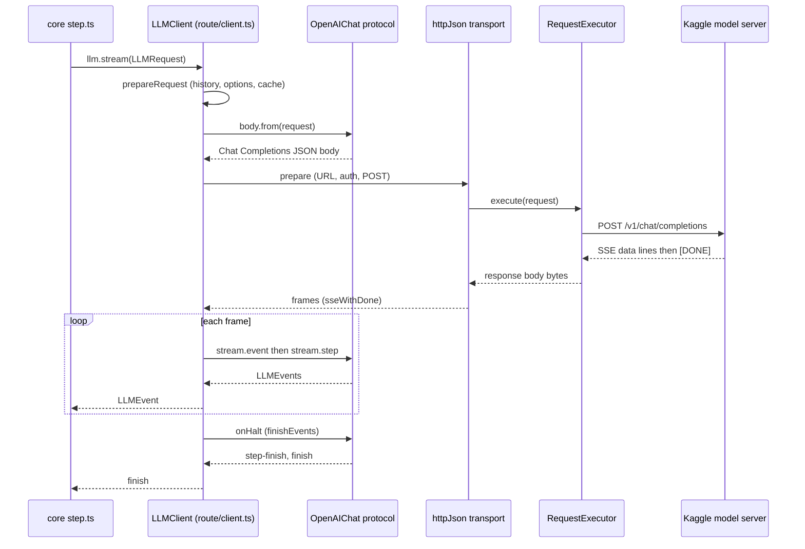

# 13. The AI library (`packages/ai`)

`@ktether/ai` is the library that turns "the agent wants the model to take one more step" into real HTTP calls to a model server, and turns the streamed answer back into typed events. For ktether's Kaggle workflow, the model server is a llama.cpp-style server reached through a tunnel, and the library talks to it using the **OpenAI-compatible Chat Completions** wire format.

This chapter is for a reader who has not seen the repository before. It explains the concepts, the directory layout, one request from start to wire, and how to add a new provider or protocol. Everything here comes from reading the code under `packages/ai/src` and the places in `packages/core` that call it. I did not run any of it.

**Important warning about the docs inside the package.** `packages/ai/README.md` (1,400 lines) still describes upstream's hosted providers (Anthropic, Google, Venice, Alibaba, Z.AI, Moonshot, MiniMax, Meta, Bedrock, image/video/speech vendors and so on). Those providers are no longer in `packages/ai/src/providers/`. Treat the README as stale; this chapter documents `src/`. ("Upstream" below means the OpenCode project this repository was forked from.) See the last section for a list of leftovers.

## Contents

1. What the library is and is not
2. Vocabulary
3. The layers at a glance
4. Directory layout
5. Concepts, one by one
6. Walkthrough: one request to the Kaggle server
7. Who calls the library
8. Adding a provider
9. Adding a protocol
10. Testing
11. Stale or dead code seen while reading

## 1. What the library is and is not

- **It is** a stateless client for model APIs. You build an `LLMRequest` (model, system prompt, messages, tools, options), call `LLM.stream(request)` or `LLM.generate(request)`, and get back a stream of provider-neutral `LLMEvent`s or one `LLMResponse`.
- **It makes exactly one model call per `stream`/`generate`.** `packages/ai/AGENTS.md` states the rule: "`LLM.stream`/`LLM.generate` run exactly one model call." There is no agent loop here. The loop (call model, run tools, call model again) lives in `packages/core/src/session/`, and the repository's `AGENTS.md` says "Do not add an in-memory tool loop."
- **It is independent of sessions, permissions and plugins.** Those belong to `packages/core`.
- **It does not retry LLM calls.** I found no retry schedule in `src/route/` (the queued media `Generation` polling does retry, per the README; I did not read that code). It classifies errors (`isRetryable` in `src/provider-error.ts`) and core's session runner decides whether to retry (`packages/core/src/session/runner/retry.ts`, not read in detail).
- **It also contains non-text clients** (image, video, speech, transcription, a realtime voice helper). Section 5.12 explains them and why they do not matter for Kaggle.

## 2. Vocabulary

| Term | Meaning |
| --- | --- |
| LLM | Large language model: a program that continues text. Here, a model such as Qwen3.6-27B served over HTTP. |
| Token | A chunk of text the model reads or writes, roughly three-quarters of a word. Limits and costs are counted in tokens. |
| Streaming | The server sends the answer in many small pieces as it generates, instead of one response at the end. |
| SSE | Server-Sent Events. A streaming HTTP response made of lines like `data: {...}` separated by blank lines. |
| Chat Completions | OpenAI's older request format: `POST /v1/chat/completions` with `{ model, messages, tools, stream }`. Many open-source servers, including llama.cpp's, copy it. "OpenAI-compatible" means "speaks this format". |
| Tool call | The model answers "please run function X with arguments Y" instead of text. The agent runs it and sends the result back. |
| Provider | A company or deployment that serves models, e.g. OpenAI, xAI or "my Kaggle tunnel". In this library, the code that knows its URL, credentials and which API it speaks. |
| Protocol | The *shape* of an API (how to build the JSON body, how to parse the streamed events). Independent of URL or credentials. |
| Route | A protocol plus a deployment: endpoint (URL), auth, framing and transport. A route is what actually sends requests. |
| Effect | A TypeScript library for programs that can fail, be interrupted or need injected services. `Effect.gen(function* () { ... })` with `yield*` is its "async/await". A `Stream` is a sequence of values over time. A "layer" builds a service. You do not need to know more to read this chapter. |
| Schema | Effect's runtime type definitions. `Schema.Struct({...})` both describes and validates data. |
| Tagged union | A set of object types distinguished by a field, here `type`, such as `{ type: "text-delta", ... }`. |

## 3. The layers at a glance



A **route** is built from four independent pieces. `Route.make` in `packages/ai/src/route/client.ts` says so in its doc comment:

- `Protocol`: what API am I speaking? (body construction, body schema, response parsing)
- `Endpoint`: where do I send the request?
- `Auth`: how do I authenticate it?
- `Framing`: how do I cut the response stream into frames?

Because these are independent, a provider that speaks an existing API reuses its protocol and supplies only a URL and credentials. That is exactly how the Kaggle provider works: it reuses `OpenAIChat.protocol` and changes the URL and auth.

## 4. Directory layout

Inside `packages/ai/src`:

| Path | What it holds |
| --- | --- |
| `index.ts` | Package entry. Exports `LLM`, `LLMClient`, `AIClient`, schema classes, tool helpers, media helpers and more. |
| `llm.ts` | `LLM.request(...)`, `LLM.generate(...)`, `LLM.stream(...)`, `LLM.generateObject(...)`. The ergonomic front door. |
| `route.ts`, `route/` | The engine. `client.ts` (`Route.make`, `LLMClient`), `protocol.ts`, `endpoint.ts`, `auth.ts`, `auth-options.ts`, `framing.ts`, `executor.ts`, `executor-service.ts`, `transport/http.ts`, `transport/websocket.ts`. Also `media*.ts` for non-text routes. |
| `protocols.ts`, `protocols/` | Wire formats. See the table below. `protocols/shared.ts` has helpers; `protocols/utils/` has small shared parts (SSE lifecycle, tool streaming, partial JSON). |
| `providers.ts`, `providers/` | Deployments. `ktether.ts`, `openai.ts`, `openai-compatible.ts`, `openai-compatible-responses.ts`, `xai.ts`, `openai/chat.ts`, `openai/responses.ts`, `openai-compatible/responses.ts`, option types. |
| `schema/` | The data model: `messages.ts` (request, messages, parts), `events.ts` (`LLMEvent`, `LLMResponse`, `Usage`), `options.ts` (generation, HTTP, `LanguageModel`, cache), `errors.ts`, `ids.ts`. |
| `tool.ts`, `tool-runtime.ts`, `tool-history.ts` | Tool definitions, running one tool call, repairing tool history. |
| `cache-policy.ts` | Automatic placement of prompt-cache markers. |
| `effort-updates.ts` | Handling of mid-conversation reasoning-effort changes. |
| `provider.ts`, `provider-package.ts` | Types for a provider definition and for the `model(modelID, settings)` entrypoint that core loads by name. |
| `provider-error.ts` | Turning HTTP failures into typed errors; context-overflow detection; `isRetryable`. |
| `ai-client.ts` | `AIClient.layer`: one layer containing the LLM client and the media clients. |
| `promise.ts` | A Promise wrapper (`AI.make()`). The only file allowed to use Promises. No package under `packages/*/src` imports it (grep). |
| `image*.ts`, `video*.ts`, `speech*.ts`, `transcription*.ts`, `media*.ts`, `generation.ts` | Non-text modalities and queued "generation" jobs. |
| `experimental.ts`, `experimental/` | `Realtime` (voice session setup) and `Evaluation`. |
| `testing.ts` | Test helpers exported as `@ktether/ai/testing`. |

Protocols present in `src/protocols/`:

| File | API it speaks | Used by a provider in this repo? |
| --- | --- | --- |
| `openai-chat.ts` | OpenAI Chat Completions | Yes: `openai`, `openai-compatible`, `xai` chat, and `ktether` via the next row. |
| `openai-compatible-chat.ts` | Same protocol, different route id | Yes: `ktether` (Kaggle), `openai-compatible`. |
| `openai-responses.ts`, `open-responses.ts` (+ `-channel`, `-continuation`), `openai-compatible-responses.ts`, `xai-responses.ts` | The newer "Responses" API, with an optional WebSocket channel | Yes by OpenAI and xAI providers. Not used by Kaggle. |
| `openai-images.ts`, `openai-speech.ts`, `openai-transcription.ts`, `xai-images.ts`, `xai-video.ts` | Media APIs | Yes by OpenAI and xAI facades. |
| `anthropic-messages.ts` | Anthropic Messages | No provider composes it (see section 11). |

Package exports: `packages/ai/package.json` maps `"./*": "./src/*.ts"`, so any file in `src/` is importable by path, for example `@ktether/ai/providers/ktether` is `src/providers/ktether.ts`. Also `"."` is `src/index.ts`, `"./promise"` and `"./testing"` have their own entries.

## 5. Concepts, one by one

### 5.1 The request: `LLMRequest`

`packages/ai/src/schema/messages.ts` defines `LLMRequest` as a Schema class. Its fields (see `LLMRequest.input` there) are: `id`, `model`, `system` (a list of text parts), `messages`, `tools`, `toolChoice`, `generation`, `providerOptions`, `http`, `cache`, `promptCacheKey`, `metadata`.

You usually build one with `LLM.request({...})` in `llm.ts`, which accepts conveniences: `system: "..."` (string), `prompt: "..."` (becomes a user message), `messages: [...]`, `tools`, `generation: { maxTokens, temperature, topP, topK, penalties, seed, stop }`.

Messages (`Message.user`, `Message.assistant`, `Message.tool`, and a special system message for effort markers) hold *content parts*: text, media, tool-call, tool-result, reasoning, and compaction (a provider-made checkpoint). A tool-call part has `id`, `name`, `input`; a tool-result part has `id`, `name`, and a result that is `json`, `text`, `error` or `content`.

Forward compatibility is a stated principle (`packages/ai/AGENTS.md`): string options are typed `Known | (string & {})` so new provider values pass through; the reasoning effort type `ReasoningEffort` is such an open string.

### 5.2 The events: `LLMEvent` and `LLMResponse`

Output is a stream of `LLMEvent`s, a tagged union in `schema/events.ts`. The kinds are:

`step-start`, `text-start`, `text-delta`, `text-end`, `reasoning-start`, `reasoning-delta`, `reasoning-end`, `tool-input-start`, `tool-input-delta`, `tool-input-end`, `tool-input-error`, `tool-call`, `tool-result`, `tool-error`, `media`, `step-finish`, `finish`, `provider-error`, and `compaction`.

This is deliberately the same no matter which API produced it. A model that "thinks" first produces `reasoning-*` events and then `text-*` events. A tool call arrives first as streamed `tool-input-delta` pieces (the JSON arguments as text), then once as a complete `tool-call` event.

`LLM.generate` just folds the stream into an `LLMResponse` with `message`, `events`, `usage` and `finishReason`, plus helpers `.text`, `.reasoning`, `.toolCalls`. It fails with an "ended unexpectedly" error if no finish event arrived.

`Usage` carries `inputTokens`, `outputTokens`, `reasoningTokens`, cache read/write counts, `totalTokens`, and the provider's raw usage object under `providerMetadata`.

### 5.3 The model: `LanguageModel`

`LanguageModel` (in `schema/options.ts`) is a small value: `id` (the model name sent on the wire), `provider` (an id such as `"kaggle"`), `route` (the executable route), optional `defaults` and `compatibility`. You get one from `route.model({ id, provider, compatibility })`, which is what provider modules do.

`compatibility` is a bag of flags for server quirks. Examples from the class: `maxTokensField` (`"max_tokens"` vs `"max_completion_tokens"`), `supportsStore`, `supportsUsageInStreaming`, `supportsStrictMode`, `supportsPromptCacheKey`, `reasoningField`, `requireFinishReason`, `cacheFormat`, `sanitizer`. The Kaggle provider sets two of them (section 6).

`LLM.request` is typed so `providerOptions` must match the selected model's option type.

### 5.4 Routes and the `Route.make` builder

A `Route` (interface in `route/client.ts`) carries: `id`, `provider`, `providerMetadataKey`, `protocol` (an id string), `endpoint`, `auth`, `headers`, `transport`, `defaults`, `body` (from the protocol), and these methods:

- `route.with(patch)` returns a *new* route with changes (provider name, endpoint base URL, auth, default options). Routes are immutable values.
- `route.model(input)` returns a `LanguageModel` bound to the route. It throws a `ProviderConfigurationError` if the route has no `baseURL` ("configure it on the route first").

`Route.make({ id, protocol, endpoint, framing, auth?, headers?, defaults? })` is the canonical constructor. The OpenAI-compatible Chat route is the whole of `packages/ai/src/protocols/openai-compatible-chat.ts`:

```ts
export const route = Route.make({
  id: ADAPTER,                                  // "openai-compatible-chat"
  providerMetadataKey: "openai",
  protocol: OpenAIChat.protocol,
  endpoint: Endpoint.path("/chat/completions"),
  framing: OpenAIChat.framing,
})
```

Note that it has no `baseURL`: a provider must add one with `route.with`.

### 5.5 Protocol

`Protocol<Body, Frame, Event, State>` (`route/protocol.ts`) has two halves:

- **Request side** `body`: `schema` (the JSON body shape) and `from(request)`, an Effect that builds the provider-native body from the common `LLMRequest`. This "lowering" is where provider quirks live; for Chat Completions it is `fromRequest` in `protocols/openai-chat.ts`.
- **Response side** `stream`: `event` (a schema that decodes one wire frame into a provider event), `initial(request)` (starting parser state), `step(state, event)` (returns the next state plus zero or more `LLMEvent`s), optional `terminal(event)` (the event that ends the stream) and optional `onHalt(state)` (final events when the stream ends).

`Protocol.make({...})` is an identity helper for type inference. The state machine is what makes streaming robust: for example OpenAI Chat sends a tool call's arguments in fragments, and `step` accumulates them until the finish reason arrives.

Observation: the doc comments say `Route.make` "validates and JSON-encodes" the body with `body.schema`. I searched for a use of `body.schema` and found none outside those comments: the route encodes with `ProviderShared.encodeJson` (plain JSON stringify). So in practice the schema is for typing, not runtime validation of the outgoing body.

### 5.6 Endpoint

`Endpoint.path("/chat/completions", { baseURL?, query? })` (`route/endpoint.ts`). `path` may be a function of the request and body for APIs that put the model in the URL. `Endpoint.render` builds `new URL(trimmedBase + path)` and adds query parameters. `route.with({ endpoint: { baseURL } })` merges a patch into the existing definition.

### 5.7 Auth

`route/auth.ts` models credentials as small composable values:

- A **Credential** is something that can load a secret (`Auth.value`, `Auth.optional`, `Auth.config(envName)`), and can be chained with `.orElse(otherCredential)`.
- An **Auth** definition turns a credential into request headers (`.bearer()` gives `authorization: Bearer <secret>`; `.header(name)` uses a custom header). Other constructors: `Auth.none`, `Auth.headers`, `Auth.custom`.
- `Auth.toEffect` runs it and converts any failure into an `AIError` whose reason is `AuthenticationError`.

Provider options use `ProviderAuthOption` (`route/auth-options.ts`): you pass either an `apiKey` or a complete `auth` object. `AuthOptions.bearer(options, envVar)` implements the usual rule: use `auth` if given, otherwise `apiKey`, otherwise the environment variable, then apply it as a bearer token. `Config.Redacted` is used so secrets are not printed.

### 5.8 Framing and the transport

`Framing` (`route/framing.ts`) cuts a byte stream into frames. `Framing.sse` decodes UTF-8, runs an SSE parser and emits the `data:` payload of each event. It drops empty events, a bare `null`, and the `: keepalive` data some gateways send. `Framing.sseWithDone` keeps the literal `[DONE]` that OpenAI-style servers send as the last event, so the protocol can treat it as the terminal marker. Others: `sseEvents`, `lines` (newline-delimited JSON), `document` (whole body as one frame).

`Transport` (`route/transport/index.ts`) has `prepare` (build the request) and `execute` (send it, return frames). `HttpTransport.httpJson({ framing })` in `transport/http.ts` is the default for `Route.make`: it renders the URL, applies the `http.body` overlay, runs auth, builds the POST, applies timeouts and returns the framed stream. A WebSocket transport (`transport/websocket.ts`) exists for the Responses API; the Kaggle route does not use it.

### 5.9 The request executor

`RequestExecutor.Service` (`route/executor.ts`, interface in `executor-service.ts`) is the one place that actually calls Effect's `HttpClient`. `RequestExecutor.fetchLayer` uses `fetch`. It also:

- converts transport failures into `TransportError`;
- for HTTP status 400 and above reads the body and builds a typed error (`httpFailure`), including `Retry-After` and rate-limit headers when present;
- supports `RequestExecutor.middleware(fn)` so a caller can wrap every request (logging, tracing).

`LLMClient.layer` (the `LLMClient.Service`) requires a `RequestExecutor.Service`. In the server, `packages/core/src/effect/app-node-platform.ts` declares `llmClient = makeGlobalNode({ service: LLMClient.Service, layer: LLMClient.layer, deps: [requestExecutor] })`. `AIClient.layer` in `ai-client.ts` is a convenience that merges all modality clients over `fetchLayer`; core does not use it.

### 5.10 Providers

A provider module configures a route and exposes `configure(options)` returning `{ id, model(modelId), configure }`, and a package-level `model(modelId, settings)` function with flat settings, which is what core's loader calls. Types: `ProviderPackage.Definition` in `provider-package.ts` (`model(modelID, settings) => LanguageModel`) and `Provider.Definition` in `provider.ts`.

Providers present in `src/providers/`:

| Module | Provider id | Notes |
| --- | --- | --- |
| `ktether.ts` | `"kaggle"` | The Kaggle tunnel. Reuses `OpenAICompatibleChat.route`. Section 6. |
| `openai-compatible.ts` | `"openai-compatible"` | Any OpenAI Chat-style server given an explicit `baseURL`. The simplest template to copy. |
| `openai-compatible-responses.ts` | `"openai-compatible"` | Same idea for the Responses API. |
| `openai.ts` | `"openai"` | Hosted OpenAI: chat and responses routes, plus image/speech/transcription. |
| `xai.ts` | `"xai"` | Hosted xAI. |

`packages/ai/src/providers/index.ts` re-exports `KTether`, `OpenAI`, `OpenAICompatible`, `OpenAICompatibleResponses` and `XAI`.

### 5.11 Layering of options

A request's final options are merged in this order, later winning (`resolveRequestOptions` in `route/client.ts`): route defaults, then model defaults, then the request itself, for `generation`, `providerOptions` and `http`. `http` also carries `headers`, `query`, a raw JSON `body` overlay merged last into the outgoing body, timeouts and optional `encoding` (gzip or zstd). `http.body` can only overlay a JSON object body.

Timeouts (`schema/options.ts`): `headerTimeout` defaults to 300,000 ms (time to receive response headers), `chunkTimeout` to 900,000 ms (time between chunks once streaming), and `timeout` for the whole request has no default (unbounded). Setting a value to `false` disables it.

Why this matters for Kaggle: a 27B model on T4 GPUs can take a long time to read a long prompt before the first token. The 5-minute header limit and the 15-minute chunk limit are the library's defaults. Core can override them per provider config (`Provider.timeouts(configured)` in `packages/core/src/model-resolver.ts`, I did not read the config schema).

### 5.12 Tools and the tool runtime

`Tool.make({ description, parameters, success, execute })` (`src/tool.ts`) defines a tool with Effect schemas for its parameters and its result. There is also a "dynamic" form taking raw JSON Schema (for MCP servers and plugins). A tool's `execute` is optional: omit it to merely *describe* a tool to the model.

`ToolRuntime.dispatch(tools, call)` (`src/tool-runtime.ts`) runs **one** tool call: it looks the tool up (error result if unknown), decodes the model's JSON arguments with the schema (error result if invalid), runs `execute`, encodes the result, and returns `events` (`tool-result`, or `tool-error` plus `tool-result`). It does not call the model again. That is by design: "Execute one canonical tool call without owning provider IO or continuation."

`toDefinitions(tools)` converts executable tools into the schema-only `ToolDefinition` list that goes into a request.

How the server actually runs tools: `packages/core/src/session/runner/step.ts` forks a fiber per `tool-call` event with core's own tool executor (permissions, truncation), not `ToolRuntime`. I did not check where `ToolRuntime.dispatch` is used in core.

Before a request goes out, `ToolSchemaProjection.tools(...)` (`protocols/utils/tool-schema.ts`) forces every tool's input schema to have an object root, and applies provider-specific simplifications only for models whose id matches `/gemini/i` or `/kimi/i` or when a sanitizer is configured. Qwen model ids do not match.

`LLM.generateObject` (in `llm.ts`) gets structured output on any protocol by forcing a synthetic tool named `generate_object` and decoding its arguments.

`tool-history.ts` (`normalizeToolHistory`) repairs a message list before sending: it inserts a placeholder result `"Tool result missing"` for a tool call that has no result, and `"(no tool output)"` for an empty one, because most servers reject unmatched tool calls.

### 5.13 Cache policy

`LLMRequest.cache` is `"auto"` (default), `"none"` or a detailed object. `applyCachePolicy` (`src/cache-policy.ts`) adds `CacheHint` markers (up to four "breakpoints": last tool, first and last system part, conversation tail) so protocols that support explicit prompt-cache markers, such as Anthropic's `cache_control`, can reuse earlier parts of a long prompt.

For the Kaggle route this does nothing. `selectPolicy` looks at `request.model.route.id` and returns the empty policy unless the route id is in `RESPECTS_INLINE_HINTS`. The Kaggle route id is `"openai-compatible-chat"`, which is not in that set. In addition, `openai-chat.ts` only sends `prompt_cache_key` when `compatibility.supportsPromptCacheKey` is true, which the Kaggle provider does not set. Any prefix caching a llama.cpp server does happens inside the server without client hints. I did not verify llama.cpp's behaviour.

### 5.14 Compaction

Compaction means shrinking a long conversation when it nears the model's context limit. There are two mechanisms, chosen in `packages/core/src/session/compaction.ts` (the `compact` function):

- *Native*: the provider's own API does it (a route declares `compact: { endpoint }` or `{ trigger }`, as xAI's Responses route does). Used only when the model's compaction type is `"native"`.
- *Summary*: the agent asks a model to write a summary (`summarize` in the same file).

The Kaggle route declares no `compact` operations, so `LLMClient.canCompact(...)` is false and native compaction is unavailable; the summary mechanism is the one that applies. I did not trace which one the Kaggle model is configured to use (model `compaction` metadata is in core), so this is inferred from the code. `provider-error.ts` also lists the pattern `"exceeds the available context size"` among its context-overflow patterns; that matches llama.cpp's wording as I remember it (not verified), so an overflow from the server is classified as such (`isContextOverflow`).

### 5.15 Errors

Every failure is an `AIError` (`schema/errors.ts`) wrapping a `reason` that is a tagged type: `InvalidRequest`, `UnsupportedOperation`, `ProviderConfiguration`, `NoRoute`, `Authentication`, `RateLimit`, `QuotaExceeded`, `ContentPolicy`, `ProviderInternal`, `Transport`, `InvalidProviderOutput`, `UnknownProvider`, `Timeout`. Errors carry HTTP context (URL, status, headers) when known. `classifyProviderFailure` in `provider-error.ts` maps an HTTP status and body onto these, including the context-overflow and payload-too-large classifications.

### 5.16 Effort updates and misc

`effort-updates.ts`: changing the reasoning effort mid-conversation would invalidate provider caches, so routes that support per-message effort updates keep the top-level value frozen and use `Message.effort(...)` markers; for other routes (such as Chat Completions) `applyEffortUpdates` strips the markers. `reasoning_effort` is only sent when `providerOptions.reasoningEffort` is set.

Reasoning text from the model is read from `reasoning_content`, `reasoning` or `reasoning_text` in the streamed delta (the function `reasoningDelta` in `openai-chat.ts`), so servers that expose Qwen's thinking text under `reasoning_content` work without configuration. I did not verify which field the Kaggle server uses.

### 5.17 The non-text clients and the realtime/voice client

`ImageClient`, `VideoClient`, `SpeechClient`, `TranscriptionClient` and the `Generation` helper for submit-and-poll jobs are present, but the only providers left that implement them are OpenAI (images, speech, transcription) and xAI (images, video), both hosted services. They are irrelevant to the Kaggle workflow.

The realtime/voice client is `Realtime` in `src/experimental/realtime.ts`. `Realtime.connect({ model, apiKey, session, transport })` sets up a live voice session: it picks an "engine" by model name prefix (`gpt-live`, `gpt-realtime`, `grok-voice`), then calls OpenAI's `/live/sessions`, `/realtime/calls` or `/realtime/client_secrets`, or xAI's `/realtime/client_secrets`, and returns either a WebRTC answer or a WebSocket URL plus short-lived token for the caller to connect to. It does not stream audio itself. `packages/core/src/voice.ts` imports it from `@ktether/ai/experimental`. All three engines are hosted OpenAI or xAI services with hard-coded base URLs, so voice does not work against a Kaggle model.

## 6. Walkthrough: one request to the Kaggle server

This follows a single step of an agent conversation through the library for the Kaggle provider, from `LLMClient` to bytes on the wire and back. Source files are named at each step.

### 6.0 Setup: how the model is built

`packages/core/src/plugin/provider/ktether.ts` registers a provider with id `"kaggle"` whose package is `@ktether/ai/providers/ktether`, plus the models in `packages/core/src/ktether/registry.ts` (ids include `qwen3.6-27b`, `qwen2.5-coder-14b`, `qwen2.5-coder-32b`, `qwen2.5-coder-7b`). `packages/core/src/provider.ts` lists that package in its `builtins` map so it can be loaded by name.

When core resolves a model (`packages/core/src/model-resolver.ts`, around line 234) it calls the package's `model(modelId, settings)`, which is this function in `packages/ai/src/providers/ktether.ts`:

```ts
export const model = (modelID, { apiKey, baseURL, body, headers, provider: providerName, ...providerOptions }) =>
  configure({ apiKey, baseURL, headers, http: body === undefined ? undefined : { body },
    provider: providerName, providerOptions }).model(modelID)
```

and `configure` does the following (all in `ktether.ts`):

1. `provider = input.provider ?? "kaggle"`.
2. Endpoint resolution, in this order: `input.baseURL`, then the environment variable `KTETHER_URL`, then the `url` field of `~/.local/state/ktether/session.json` (the state file the pipeline writes; read by `readPersistedEndpoint`), then `http://127.0.0.1:8080/v1`. Trailing slashes are trimmed and `/v1` is appended if missing.
3. Key resolution: `input.apiKey`, then `KTETHER_API_KEY`, then `apiKey` from the same state file.
4. `auth = input.auth ?? AuthOptions.bearer(apiKey !== undefined ? { apiKey } : {}, "KTETHER_API_KEY")`.
5. `route = OpenAICompatibleChat.route.with({ ...rest, provider, endpoint: { baseURL }, auth })`.
6. The model is `route.model({ id: modelID, provider, compatibility: { maxTokensField: "max_tokens", supportsStore: false } })`.

Consequences, each verifiable in `route/client.ts`:

- `route.with({ provider: "kaggle" })` also changes `providerMetadataKey` from `"openai"` to `"kaggle"` (the logic is in `build`'s `with`, around lines 400 to 404). Provider-specific metadata on events and messages is therefore keyed `kaggle`.
- The endpoint patch merges: base URL `.../v1` plus path `/chat/completions`.
- `route.model` requires a `baseURL`; the default `http://127.0.0.1:8080/v1` guarantees one.

How often core rebuilds this model, and so re-reads the state file, is **not** something I verified. The plugin's comment in `plugin/provider/ktether.ts` says the URL and key are read "when a request is made, so they are never stale", but the code reads them synchronously in `configure`, which runs when the model is resolved, and `session/runner/model.ts` calls the resolver when the runner resolves a session's model. Whether that is once per step or once per session I did not trace.

### 6.1 The caller builds a request

In `packages/core/src/session/runner/step.ts` the runner calls `llm.stream(input.prepared.request, input.prepared.options)`, where `llm` is `LLMClient.Service`. The request is an `LLMRequest` built by the session code with the session's history, tool definitions, system instructions and generation settings. For this walkthrough take a simple request: one system string, one user message, one tool called `read`.

### 6.2 `LLMClient.stream` compiles the request

`streamRequestWith` in `route/client.ts` runs `compile(request, options)`:

```ts
const resolved = prepareRequest(request)
const route = resolved.model.route
const body = yield* route.body.from(resolved)
const prepared = yield* route.prepareTransport(body, resolved, options)
```

### 6.3 `prepareRequest`

In order (`route/client.ts`, `prepareRequest`):

1. `resolveRequestOptions`: `normalizeToolHistory` on the messages, then merge `generation`, `providerOptions` and `http` from route defaults, model defaults and request.
2. `sanitizeSurrogates`: fix broken Unicode so JSON encoding cannot fail.
3. Deduplicate tools by `type:name`, and `ToolSchemaProjection.tools(...)` (object-root schemas).
4. `applyEffortUpdates` (strips effort markers for this route).
5. `applyCachePolicy` (no-op for this route, section 5.13).
6. Merge route-level `headers` into `http.headers`.

### 6.4 The body: `OpenAIChat.fromRequest`

`route.body.from` is `fromRequest` in `protocols/openai-chat.ts`. For the Kaggle model it computes:

- `maxTokensField = "max_tokens"` (from compatibility, instead of the default detection by provider name);
- `supportsStore = false`, so no `store` key is sent;
- `supportsUsageInStreaming` defaults to true, so `stream_options: { include_usage: true }`;
- `supportsStrictMode` defaults to true (the default heuristic only turns it off for a list of hosted providers), so every tool gets `"strict": false`.

System parts are joined with newlines into one `{ role: "system" }` message. The returned object is, in key order: `model`, `messages`, `tools`, `tool_choice` (only if tools are active and a choice was given), `stream: true`, `stream_options`, `max_tokens`, `temperature`, `top_p`, penalties, `seed`, `stop`, then `reasoning_effort` if set. Fields whose value is `undefined` disappear during JSON encoding. The JSON that goes to the server looks like this (illustrative, assembled from the code, not captured from a real server):

```json
{
  "model": "qwen3.6-27b",
  "messages": [
    { "role": "system", "content": "You are a coding agent." },
    { "role": "user", "content": "Read package.json" }
  ],
  "tools": [{ "type": "function", "function": {
    "name": "read", "description": "Read a file",
    "parameters": { "type": "object", "properties": { "path": { "type": "string" } } },
    "strict": false } }],
  "stream": true,
  "stream_options": { "include_usage": true },
  "max_tokens": 4096
}
```

### 6.5 `prepareTransport`: URL, auth, POST

`route.prepareTransport` calls `HttpTransport.httpJson(...).prepare`, which uses `jsonRequestParts` (`route/transport/http.ts`):

1. URL: `Endpoint.render` gives `<baseURL>/chat/completions`, for example `https://<tunnel-host>/v1/chat/completions` (query parameters from `http.query` are added if present).
2. Body: if `request.http.body` exists it is merged over the object; otherwise the body is encoded as is. Result: `bodyText`.
3. Headers: `Auth.toEffect(route.auth)(...)` receives headers (`http.headers`) and returns them plus `authorization: Bearer <key>`.
4. `ProviderShared.jsonPost` builds the POST, forcing `content-type: application/json`, and gzip or zstd-compresses the body only if `http.encoding` says so.

**What happens with no key.** If neither `apiKey`, `KTETHER_API_KEY` nor the state file provides a key, the auth chain is `Auth.optional(undefined)` then `.orElse(Auth.config("KTETHER_API_KEY"))`, both of which fail with `MissingCredentialError`; `Auth.toEffect` turns that into an `AIError` with an `AuthenticationError` reason whose message is "KTETHER_API_KEY is not set". The request fails *before* anything is sent. That means even an unauthenticated local server at the default `127.0.0.1:8080` cannot be used without some key being set. I inferred this from reading `auth.ts` and `auth-options.ts`; I did not run it.

### 6.6 Execute: headers, then streaming

`httpJson.execute` (`transport/http.ts`) calls `runtime.http.execute(request, middleware)` (the `RequestExecutor`), with `Effect.timeoutOrElse` for the header timeout (min of `headerTimeout` and total `timeout`). A failure here is a `Transport` error with code `Timeout`. The executor maps transport errors and any status of 400 or more into typed `AIError`s (section 5.9). On success it returns the response; its body stream is wrapped with the per-chunk timeout (`chunkTimeout`) and an interrupt at the overall `timeout` if one is set.

### 6.7 Framing: bytes to frames

`prepared.framing.frame(...)` is `OpenAIChat.framing`, i.e. `Framing.sseWithDone`: decode UTF-8 text, parse SSE, keep each non-empty `data:` payload, including the literal `[DONE]`.

### 6.8 Decode and step

Back in `streamPrepared` (`route/client.ts`):

1. Each frame is decoded with `protocol.stream.event`: a union of the literal `"[DONE]"` and a JSON-parsed `OpenAIChatEvent` (`choices`, `usage`, `error`, plus any extra fields, since the schema allows rest fields).
2. `Stream.takeUntil(terminal)` stops after `[DONE]`.
3. For each event, `protocol.stream.step(state, event)` returns `[nextState, events]`. In `step` (`openai-chat.ts`): an `error` object fails the stream; `delta.content` becomes `text-start`/`text-delta`; reasoning fields become `reasoning-*`; `delta.tool_calls` fragments are accumulated by index or id (arguments are concatenated text) and streamed as `tool-input-*` events; `finish_reason` is mapped (`stop`, `end` to stop, `length`, `content_filter`, `tool_calls` to tool-calls; anything unknown is an error); a `usage` object is mapped into `Usage`. A trailing usage-only chunk after the finish reason is accepted; any *content* after the finish reason is an error.
4. `onHalt` (`finishEvents`) runs when the stream ends. It fails with "ended without finish_reason" if none was seen (because Kaggle's route keeps `requireFinishReason` at its default of true). Otherwise it closes reasoning, emits completed `tool-call` events, then `step-finish` and `finish` with the final usage. If the model made tool calls and the reason was `stop`, the reason becomes `tool-calls`.
5. `requireTerminalEvent` guards the outside: the stream must end with a `finish` or `provider-error` event, or the client fails with an "incomplete-stream" error. Events after a terminal event are errors.

An illustrative response stream for the request above (OpenAI wire format, not captured from Kaggle):

```text
data: {"choices":[{"delta":{"reasoning_content":"The user wants package.json..."}}]}
data: {"choices":[{"delta":{"tool_calls":[{"index":0,"id":"call_1","function":{"name":"read","arguments":"{\"path\":"}}]}}]}
data: {"choices":[{"delta":{"tool_calls":[{"index":0,"function":{"arguments":"\"package.json\"}"}}]}}]}
data: {"choices":[{"delta":{},"finish_reason":"tool_calls"}]}
data: {"choices":[],"usage":{"prompt_tokens":812,"completion_tokens":41}}
data: [DONE]
```

which becomes roughly: `step-start`, `reasoning-start`, `reasoning-delta`, `tool-input-start`, `tool-input-delta` (twice) while the stream runs, and then, once the stream ends, `reasoning-end`, `tool-input-end`, `tool-call`, `step-finish`, `finish`. (Completed tool calls are held in the parser state until `finishEvents` runs, so a consumer sees the finished `tool-call` only at the very end of the stream.)

### 6.9 Back in core

The runner in `step.ts` reads that stream with `Stream.runForEach`, publishes each event to the session's event bus, and on each `tool-call` starts the tool in a separate fiber. If the error is a context overflow before any output, it triggers compaction. Errors are passed to `SessionRunnerRetry` for retry policy. Everything the TUI later displays is derived from those published events (`docs/12-clients-and-ui.md`).

### 6.10 The same walkthrough as a diagram



## 7. Who calls the library

| Caller | Where | How |
| --- | --- | --- |
| Session step | `packages/core/src/session/runner/step.ts` | `llm.stream(request, options)` once per step, reading the stream to the end. |
| Compaction and titles | `session/compaction.ts`, `session/title.ts` | `LLMClient.stream`/`compact`, `LLMClient.canCompact`. |
| One-off generation | `packages/core/src/generate.ts`, `session/generate.ts` | Same client. |
| Model loading | `packages/core/src/model-resolver.ts`, `provider.ts`, `aisdk-native.ts` | Imports provider packages by name and calls their `model(...)`. `aisdk-native.ts` maps the old AI-SDK names `@ai-sdk/openai`, `@ai-sdk/openai-compatible`, `@ai-sdk/xai` onto the native packages. |
| Voice | `packages/core/src/voice.ts` | `Realtime` from `@ktether/ai/experimental`. |
| Tests and simulation | `packages/simulation` | Depends on `@ktether/ai` (see `docs/12-clients-and-ui.md`, section 8.6). |

## 8. Adding a provider

Use `src/providers/openai-compatible.ts` as the template (61 lines). The checklist, each step verifiable in the repository:

1. **Pick a protocol.** If the server speaks Chat Completions, reuse `OpenAICompatibleChat.route`. Do not copy a protocol; `AGENTS.md` says "Providers compose existing protocols with `Route.make(...)` instead of cloning them."
2. **Create the module** `packages/ai/src/providers/<name>.ts`. Export an `id` (`ProviderID.make("<name>")`), a `configure(input)` that calls `route.with({ provider, endpoint: { baseURL }, auth, ... })` and returns `{ id, model, configure }`, and a package-level `model(modelID, settings)` (type `ProviderPackage.Definition["model"]`). Set `compatibility` flags for server quirks when you call `route.model`.
3. **Pick the auth rule.** `AuthOptions.bearer(input, "<NAME>_API_KEY")` gives apiKey, then environment variable, then bearer. For a header other than `authorization`, use `Auth.header("x-api-key", source)` and pass `auth` directly.
4. **Re-export** it in `packages/ai/src/providers/index.ts`, for example `export * as MyProvider from "./my-provider.js"`.
5. **Importable by path** automatically through the `"./*"` export in `packages/ai/package.json` (`@ktether/ai/providers/my-provider`).
6. **Register it for loading by name.** Add a line to the `builtins` map in `packages/core/src/provider.ts`, for example `["@ktether/ai/providers/my-provider", () => import("@ktether/ai/providers/my-provider")]`. Without this, core cannot load it.
7. **Add it to the catalog.** For a provider that should appear in the model list, add a core plugin like `packages/core/src/plugin/provider/ktether.ts`: `ctx.provider.transform(providers => { providers.update("<id>", p => { p.package = "..."; p.activation = "enabled" }); providers.models.update(...) })`. The provider plugins are listed in `packages/core/src/plugin/provider.ts`, which imports `KTetherPlugin` from `./provider/ktether.js` and puts it in an array; add yours there.
8. **Add a test.** Copy `packages/ai/test/provider/openai-compatible-chat.test.ts`: build a model with `route.with({...}).model({...})`, call `compileRequest` to assert the JSON body, and use `test/lib/http.ts` and `test/lib/sse.ts` to fake the server.

A tip based on the `ktether.ts` provider: keep configuration reading out of the provider where you can. `ktether.ts` reads a state file with `fs`, `JSON.parse` and `try/catch`, which `packages/ai/AGENTS.md` discourages ("Use `HttpClient`, `Stream`, and Schema codecs instead of `fetch`, async generators, and `JSON.parse`/`JSON.stringify`"). Resolving the endpoint in core and passing it in through `settings` would follow the rule. That is a suggestion, not a requirement of the code.

## 9. Adding a protocol

Only needed when the server speaks an API shape that no existing protocol handles.

1. **Write `packages/ai/src/protocols/<name>.ts`** exporting a `protocol` made with `Protocol.make({ id, body: { schema, from }, stream: { event, initial, step, terminal?, onHalt? } })`. Model it on `openai-chat.ts`: an Effect Schema for the body; a `from` function lowering `LLMRequest` to that body; a schema for one streamed event (use `Protocol.jsonEvent(schema)` to parse JSON text); a `step` state machine that emits `LLMEvent`s. Use `protocols/utils/lifecycle.ts` (`Lifecycle.textDelta`, `reasoningDelta`, `finish`, ...) to emit well-formed start/delta/end sequences, and `protocols/utils/tool-stream.ts` to assemble streamed tool calls.
2. **Choose framing.** `Framing.sse` for SSE, `Framing.sseWithDone` if the stream ends with `[DONE]`, `Framing.lines` for newline-delimited JSON. Anything else needs a new `Framing.Definition` with `frame(bytes)`.
3. **Export a route**: `export const route = Route.make({ id, provider?, providerMetadataKey, protocol, endpoint: Endpoint.path("/path", { baseURL? }), framing, auth? })`. If you need a different transport (WebSocket), use the `transport` form of `Route.make`; see `open-responses-channel.ts`.
4. **Register the namespace** in `packages/ai/src/protocols/index.ts` with `export * as MyProtocol from "./my-protocol.js"`.
5. **Cache and effort.** If the API has explicit cache markers, add the route id to `RESPECTS_INLINE_HINTS` in `src/cache-policy.ts`. If it supports per-message effort, set `supportsEffortUpdates` on the protocol.
6. **Errors.** Fail with `AIError` and the right reason, using helpers in `protocols/shared.ts` (`eventError`, `invalidRequest`, `unsupportedOperation`). Make `onHalt` fail on incomplete streams like `finishEvents` does.
7. **Test** with fixed SSE fixtures; compare the pattern in `test/provider/openai-chat.test.ts` and `test/provider/open-responses-*.test.ts`.

## 10. Testing

From `packages/ai/AGENTS.md` and the layout of `packages/ai/test`:

- Run tests from `packages/ai` (`bun test --timeout 30000 --only-failures` is the package's `test` script). Tests cannot run from the repository root.
- Use `testEffect(...)` from `test/lib/effect.ts` for tests needing Effect layers.
- Provider tests either build fake HTTP responses (`test/lib/http.ts`, `sse.ts`, `openai-chunks.ts`) or replay "cassettes", recorded HTTP exchanges stored as JSON under `test/fixtures/recordings/`. Replay is the default and needs no keys. Recording needs `RECORD=true`, unsetting `CI`, and the provider's real key; re-record only the cassette you changed.
- The tests most relevant to Kaggle: `test/provider/openai-compatible-chat.test.ts`, `test/provider/openai-chat.test.ts`, `test/compile.test.ts`, `test/auth.test.ts`, `test/executor.test.ts`, `test/http-timeout.test.ts`.

## 11. Stale or dead code seen while reading

- **`packages/ai/README.md`** documents providers, image/video/speech vendors and entrypoints that no longer exist (it opens by importing `OpenAI` but spends most of its length on Venice, Alibaba, Z.AI, Moonshot, MiniMax, Meta, Google, Bedrock and others). It also says `KTETHER_API_KEY` is read by an `experimental.evaluation` selector ("`ktether` exposes the same selector"), which I did not find in `src/providers/ktether.ts`.
- **Hosted-provider heuristics inside `protocols/openai-chat.ts`**: the `detectMaxTokensField`, `detectSupportsStore`, `detectSupportsStrictMode` and `detectZaiToolStream` functions branch on provider names and URLs such as DeepSeek, Moonshot, Together, Z.AI, NVIDIA, Cerebras, Cloudflare and Vercel. The Kaggle provider bypasses most of this through explicit `compatibility`, but not all of it (it relies on the default for `supportsStrictMode`).
- **`src/cache-policy.ts`** lists route ids for providers that are gone (`alibaba-chat`, `moonshot-messages`, `bedrock-converse`, `openrouter`, `digitalocean` and others).
- **Protocol code with no provider composing it**: `protocols/anthropic-messages.ts` is exported from `protocols/index.ts` but no provider uses it. `protocols/utils/bedrock-auth.ts`, `bedrock-cache.ts`, `bedrock-media.ts`, `gemini-generate-content.ts` and `mistral-tool-id.ts` are not imported by any file under `packages/ai/src`, `packages/ai/test` or `packages/core/src` (grep by file name). `gemini-json-schema.ts` is still used by `tool-schema.ts`. The package also still depends on `@aws-sdk/credential-providers`, `@smithy/*`, `aws4fetch` and `google-auth-library` in `package.json`, which appear to serve only this code.
- **`packages/core/src/model-resolver.ts`** (around lines 313 to 466) still names many provider packages that do not exist in `packages/ai/src/providers/` (`amazon-bedrock`, `anthropic`, `baseten`, `cerebras`, `cloudflare-*`, `deepinfra`, `deepseek`, `fireworks`, `google-vertex` and others).
- **Realtime/voice** only supports hosted OpenAI and xAI and is irrelevant to Kaggle.
- **`providers/ktether.ts`** names the provider id `"kaggle"` while the file, the package path and the plugin are named `ktether`; the TUI and CLI call the feature "ktether" or "Kaggle GPU". Not a bug, but easy to trip over. The file also reads configuration with `fs`/`JSON.parse`/`try`/`catch`, against the package rule, and its state-file path is hard-coded as `~/.local/state/ktether/session.json` in both `providers/ktether.ts` and `packages/core/src/ktether/state.ts` (not XDG-aware, but the two agree).
- **Auth without a key** (section 6.5) fails even for an unauthenticated local server.
- **`body.schema`** is documented as validating the outgoing body but I found no call that does so.
